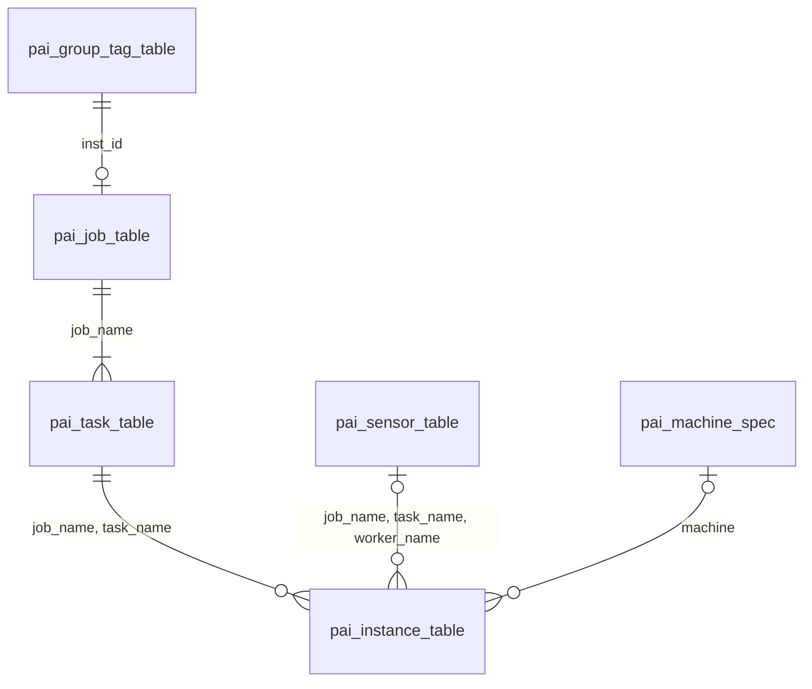
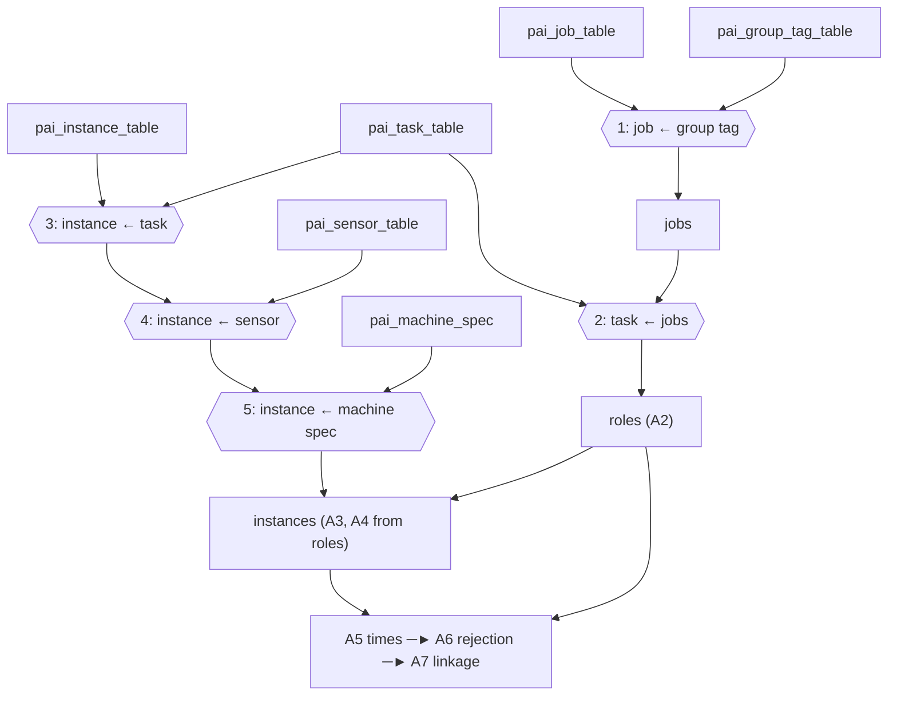

# Alibaba GPU 2020 Adapter Design (Task 3)

**Issue:** #79 · **Schema version:** 0.2.0 · **Code:** `src/adapters/alibaba_gpu_2020.py`, `tests/test_alibaba_gpu_2020_adapter.py`

What the Task 3 adapter does and why: every Part A and Part B step, and every design decision.

| Related document | Role |
|---|---|
| `docs/design/canonical_workload_schema.md` (schema), `canonical_schema_design_decisions.md` (D-xx) | The canonical model and why it is so |
| `docs/design/adapter_framework.md` (framework) | Shared adapter framework: views, validation, linkage, metadata |
| `docs/design/alibaba_gpu_2020_output_contract.md` (contract) | What Tasks 4, 6, 7 and 8 may rely on, including the exact view columns |
| `docs/data/alibaba_gpu_2020_source_data_checks.md` (checks report) | Verified source properties. **Cite for data validation** |
| `docs/data/alibaba_gpu_2020_adapter_results.md` (results) | Measured figures for every step. **Cite for pipeline validation** |

---

## 1. Overview

**Problem.** The trace (`cluster-trace-gpu-v2020`) has six tables at different levels: jobs, tasks, instances, per-worker sensor summaries, group tags and machine specs. TraceAdvisor evaluates recommendations on **one row per task role per job**, with requests and usage in declared units, a usable time, and an identity that links each job to earlier and later runs of the same workload. The adapter builds that shape without losing, inventing or changing any source value.

**Outputs.**

| Output | One row per | Purpose |
|---|---|---|
| `role_occurrence` view | Task role of an accepted job | Evaluation rows (Task 4 onwards) |
| `instance` view | Instance row of an accepted job; every retry is its own row | Audit of each role value |
| Rejected output | Job, role and instance row of a job with no submission time | Audit of rows with no usable time |
| `metadata.json`, count report | — | Provenance, counts, join coverage |

**Out of scope:** splits, history and targets (Task 4); baselines, ML and metrics (Tasks 5–7); job-total rows; GPU evaluation; changes to other adapters or to the framework.

**Principles.**
1. **Nothing is invented.** Missing stays null; no time is inferred or substituted.
2. **No row disappears.** Every source row is in a view or in the rejected output; excluded and invalid rows stay, labelled.
3. **Joins never change row counts.** Left joins to unique lookups only.
4. **Values are copied, not recomputed.** Instances copy parent identity; canonical fields copy source values.
5. **Identity is deterministic,** independent of input row order.
6. **Violations fail the run** with `AdapterValidationError`; nothing is repaired silently.
7. **Each step only adds columns** and refuses to run twice.

**Terms.** *Role:* one `(job_name, task_name)`. *Slot:* one `(job_name, task_name, inst_name)`; a retried slot has several *attempts* (instance rows). *Accepted / rejected:* job with / without a submission time. *Eligible / excluded:* accepted role that passes / fails the 14 rules. *Valid / partial / invalid:* data quality, independent of eligibility. *Populated:* a canonical value that is not null.

---

## 2. Context and source data

```
Task 2 loader ──► six verified tables (+ source_row_number)
        ▼
Task 3 adapter:  Part A prepare_sources ─► Part B map_prepared_sources ─► adapt_sources
        ▼
role_occurrence · instance · rejected · metadata.json · count_report.md
        ▼
Task 4 (splits, history, targets) ─► Tasks 6–7 ─► Task 8 (final verification)
```

**Dependencies.** Task 1 framework (`BaseDatasetAdapter`, `adapt_sources`, linkage and rejected-output checks, `build_multiview_metadata`); `ALIBABA_GPU_2020_CAPABILITIES` with the 14 exclusion reasons in rule order; the Task 2 loader (`load_table`, checksum manifest, `source_row_number`); raw data in `data/raw/alibaba_gpu_2020/`, set up as in `docs/data/alibaba_gpu_2020_source_setup.md`.

**Design basis.** Task 3 implements the frozen schema and changes none of its rules.

| Step | Schema decisions | Sections |
|---|---|---|
| A1 Joins | D-17 (one sensor row per worker, never aggregated) | Schema §9.3; framework §4.2 |
| A2 Role identity | D-03, D-04, D-05, D-06, D-07 | Schema §4.1, §5.1–5.3 |
| A3 Instance identity | D-21, D-24 | Schema §5.4 |
| A4 Parent inheritance, A7 Linkage | D-08, D-22 | Schema §5.5; framework §9.2 |
| A5 Timestamps | D-22 | Schema §7 |
| A6 Rejection routing | D-23 | Schema §9.5; framework §4.4 |
| B1 Exclusion rules | D-17, D-05, D-24 | Schema §9.3, §9.4 |
| B2 Validity | D-15, D-16 | Schema §9.1, §9.2 |
| B3 Resource mappings | D-09, D-10, D-12, D-13, D-20 | Schema §6, §7 |
| B4 Role aggregation | D-11, D-14 | Schema §8 |
| B5 View assembly | D-03, D-18 | Schema §4.1; framework §4.3, §7.2 |
| B6 Metadata | — | Schema §10, §14; framework §6 |

D-01, D-02 and D-19 set project context and constrain no step directly.

**Source tables.**

| Table | Rows | Grain | Key |
|---|---|---|---|
| `pai_job_table` | 1,055,501 | Job | `job_name` |
| `pai_task_table` | 1,261,050 | Task role | `(job_name, task_name)` |
| `pai_instance_table` | 7,522,002 | Instance attempt | None (slots repeat on retries) |
| `pai_sensor_table` | 3,033,232 | Worker lifetime usage | `(job_name, task_name, worker_name)` |
| `pai_group_tag_table` | 1,055,032 | Job group tag | `inst_id` |
| `pai_machine_spec` | 1,897 | Host | `machine` |



The checks report verified on the full tables that every lookup key is unique and non-null, that there are no orphans, negative values or `end < start`, and lists the source conditions kept as they are (jobs without a group, jobs without a submission time, unplaced instances, retried slots, telemetry from about day 19 to 68.9). Contract §10 summarises them for consumers.

---

## 3. Architecture

```
prepare_sources (Part A)                     map_prepared_sources (Part B)
 A1 joins ─► A2 role identity                 B1 exclusion rules
 ─► A3 instance identity ─► A4 inheritance    B3 resource mappings
 ─► A5 timestamps ─► A6 rejection routing     B4 role aggregation and scope
 ─► A7 linkage                                B2 validity
   └─► jobs · roles · instances · rejected ─► B5 view assembly
                                                ▼
          adapt_sources: view validation, linkage, rejected checks, overlap ─► B6 metadata
                                                ▼
                                   B7 build script ─► artifacts
```

**Build order.** Part B runs B1 → B3 → B4 → B2 → B5 → B6 → B7. B2 keeps its number but runs after B3 and B4, because it reads their final values.

| Step | Code |
|---|---|
| S1 | `AlibabaGPU2020Adapter` (profile, `rejected_required_columns`, export); `to_canonical` raises: six-table path only |
| A1 | `prepare_sources`, `_left_join` |
| A2–A7 | `_add_role_identity`, `_add_instance_identity`, `_inherit_parent_identity`, `_add_timestamps`, `_route_rejections`, `_build_rejected`, `_check_linkage` |
| B1 | `_role_instance_flags`, `_failed_rules`, `_assign_exclusion_reasons` |
| B3 | `ROLE_RESOURCE_MAP`, `INSTANCE_RESOURCE_MAP`, `_map_resources` |
| B4 | `_aggregate_role_resources`, `_add_resource_scope` |
| B2 | `_instance_validity`, `_role_validity`, `_row_status`, `_assign_validity` |
| B5 | `map_prepared_sources`, `ROLE_VIEW_COLUMNS`, `INSTANCE_VIEW_COLUMNS`, `_role_view`, `_instance_view`, `_rejected_dtypes` |
| B6 | `build_multiview_metadata`, `_eligibility_summary` |
| B7 | `scripts/build_alibaba_gpu_2020_canonical.py` |

**Prepared frames.** `prepare_sources` returns `jobs`, `roles` and `instances`, each with every source row in source order and an `is_rejected` flag, plus a `rejected` frame (`rejection_level`, `rejection_reason`, then the union of the three frames' columns). Only `is_rejected = False` rows become views; `jobs` is never a view. Column counts and sizes are in the results doc.

---

## 4. Part A: preparation

### 4.1 A1 Joins

| Join | Driving ← lookup | Key |
|---|---|---|
| `job_group_tag` | job ← group tag | `inst_id` |
| `task_job` | task ← `jobs` | `job_name` |
| `instance_task` | instance ← task | `(job_name, task_name)` |
| `instance_sensor` | instance ← sensor | `(job_name, task_name, worker_name)` |
| `instance_machine_spec` | instance ← machine spec | `machine` |



- A missing table or required column raises. Every lookup key must be unique and non-null, or the run raises.
- **Null keys never match** (pandas would match null to null): such a row gets no match, a false flag and null lookup columns.
- Left joins with `validate="many_to_one"`; each frame keeps its source row count and order. Match flags: `has_group_tag`, `has_job`, `has_parent_role`, `has_sensor`, `has_machine_spec`.
- Sensor rows are never aggregated: every attempt of a retried worker gets that worker's single row.
- Two-way join coverage is stored in `adapter.join_coverage_counts` after all checks pass.
- **`source_row_number`:** required (integer, unique, non-null) on instances, where it is the attempt tie-breaker and the rejected-row trace; optional on job and task, kept as `job_source_row_number` / `task_source_row_number`; dropped on lookups.
- **Naming:** a column keeps its source name unless two tables in one frame share it; then each takes a prefix (`job_`, `task_`, `machine_`) from one explicit map. Any other overlap raises.
- **Dropped:** sensor `read`, `write`, `read_count`, `write_count`, `gpu_name`, `machine`, `inst_id`; group-tag `user`.

### 4.2 A2 Role identity

| Field | Job with a group | Job without a group (fallback) |
|---|---|---|
| `workload_id` | `group` | `job_name` |
| `recurrence_key` | `group\|\|task_name` | Null |
| `occurrence_id` | `group\|\|job_name` | `job_name` |
| `role_key` | `group\|\|job_name\|\|task_name` | `job_name\|\|task_name` |

A null, empty or whitespace group counts as missing. `recurrence_key` includes `task_name` so a worker's history never mixes with a parameter server's. Blank names, a key part containing `||`, or a duplicate `role_key` raise.

### 4.3 A3 Instance identity

| Field | Rule |
|---|---|
| `instance_slot_key` | `job_name\|\|task_name\|\|inst_name` |
| `instance_attempt_index` | 1-based in the slot: own start ascending, null starts last, then `source_row_number` |
| `instance_id` | `instance_slot_key\|\|instance_attempt_index` |
| `execution_id` | `job_name\|\|task_name` |
| `worker_id` | `worker_name`; null when missing |
| `source_inst_name`, `source_worker_name`, `source_status`, `source_machine` | Raw values |

`worker_name`, times and `inst_id` are never key parts (often null, or job-level). The order uses a stable positional sort, so it does not depend on input order.

### 4.4 A4 Parent inheritance

Instances copy `workload_id`, `recurrence_key`, `occurrence_id` and `role_key` from the parent role on `(job_name, task_name)`, never recomputing them. A guard checks the copied `role_key` against `execution_id`. An instance without a parent keeps nulls, and A7 fails the run.

### 4.5 A5 Timestamps

Seconds × 1,000,000 into nullable `Int64`; a fractional microsecond raises; `time_basis = trace_relative`.

| Row | `event_time_us` | `start_time_us` | `end_time_us` | `launch_time_us` |
|---|---|---|---|---|
| Role | — | Job submission | Job completion or null | First task launch (metadata only) |
| Instance | Parent job submission | Own start or null | Own end or null | — |

No time replaces a missing one.

### 4.6 A6 Rejection routing

- A job with a null submission time is rejected, with all its roles and instances (flagged by `job_name`), even an instance with its own start.
- Rejected rows stay in their frames with `is_rejected = True` and are copied into `rejected`.
- Guards: the role flag must equal "null `start_time_us`", the instance flag "null `event_time_us`".
- `rejected` is checked with `validate_rejected_output` and `rejected_required_columns` (`job`: `job_name`; `role_occurrence`: `job_name`, `task_name`; `instance`: `source_row_number`, `job_name`, `task_name`, `inst_name`). Nothing is zero-filled.

### 4.7 A7 Linkage

- **Accepted set:** `validate_role_instance_linkage` with the profile — no orphan, equal identity fields, `event_time_us` equal to the parent `start_time_us`.
- **Rejected set:** the same check with the event-time condition off (profile copy with `instance_event_time_semantics = None`); instead every rejected role and instance must have null times.
- Separate sets make a cross-split parent an orphan. `adapt_sources` checks the final views again.

---

## 5. Part B: eligibility, resources and outputs

### 5.1 B1 Exclusion rules

Decides whether each accepted role can be used for evaluation.

1. `_role_instance_flags` answers yes/no per instance (failed, interrupted, not finished, no worker name, same worker twice in the role, has a sensor row, peak memory above host memory, bad memory values) and groups them by `role_key` (`max` for "any", `min` for "every instance has a sensor row"). A role with no instances gets False everywhere.
2. `_failed_rules` adds the role's own checks: one yes/no array per rule.
3. `_assign_exclusion_reasons` walks the rules in the schema's order; the first broken rule sets `exclusion_reason`. A role breaking none keeps null and is **eligible**. Rejected roles are skipped; instances get no reason.

| # | `exclusion_reason` | Fails when |
|---|---|---|
| 1 | `no_recurrence_key` | `recurrence_key` is null |
| 2 | `job_failed` | `job_status` is `Failed` |
| 3 | `job_incomplete` | `job_status` not `Terminated`, or `end_time_us` null |
| 4 | `task_not_terminated` | `task_status` not `Terminated` |
| 5 | `missing_or_invalid_request` | `plan_cpu` or `plan_mem` null or ≤ 0 |
| 6 | `instance_failed` | Any instance `Failed` |
| 7 | `instance_interrupted` | Any instance `Interrupted` |
| 8 | `instance_incomplete` | Any instance otherwise not `Terminated` |
| 9 | `missing_worker_name` | Any instance without `worker_name` |
| 10 | `multi_attempt_worker` | The same non-null `worker_id` twice in the role |
| 11 | `missing_sensor` | No instance has a sensor row (includes roles with no instances) |
| 12 | `partial_sensor_coverage` | Some, not all, instances have one |
| 13 | `invalid_memory_exceeds_capacity` | Any `max_mem > cap_mem` |
| 14 | `invalid_resource` | Any `max_mem < avg_mem`, or negative `avg_mem` / `max_mem` |

A null status is "not `Terminated`" and never `Failed` or `Interrupted`. A null request fails rule 5. Numeric nulls never fail rules 13–14. A sensor row with missing CPU still counts as coverage.

### 5.2 B3 Resource mappings

Copies source columns into canonical fields with a unit; no arithmetic, filling or clipping. Defined once in `ROLE_RESOURCE_MAP` and `INSTANCE_RESOURCE_MAP`; every row is mapped.

| Rows | Field | Source | Unit |
|---|---|---|---|
| Roles | `requested_cpu` / `requested_memory` / `requested_gpu` | `plan_cpu` / `plan_mem` / `plan_gpu` (per instance; GPU descriptive) | `percent_of_vcpu` / `gb` / `percent_of_gpu` |
| Instances | `observed_cpu` | `cpu_usage` (lifetime average) | `percent_of_vcpu` |
| | `observed_memory` / `peak_memory` | `avg_mem` / `max_mem` (peak is the primary evaluated value) | `gb` |
| | `observed_gpu` / `peak_gpu_memory` | `gpu_wrk_util` / `max_gpu_wrk_mem` (descriptive) | `percent_of_gpu` / `gb` |
| | `peak_cpu` | Always null: no CPU peak in the source | null |

### 5.3 B4 Role aggregation and scope

Gives each role one usage value per resource: what each instance of the role needed (schema §8).
1. Take instances with `has_sensor = True` and group by `role_key`.
2. Each field is the **maximum**, but **null if any of those instances lacks it**. Values are never summed.
3. Line up with the roles by position; a role with no covered instance gets nulls. `peak_cpu` is null.

Every role is aggregated, including excluded and rejected ones. Retries share their worker's sensor row, so they cannot change the maximum. Scope columns are constant per frame: roles `task_role_per_instance` / `none` / `maximum_over_instances`; instances `instance` / `none` / `none`.

### 5.4 B2 Validity

Records data quality; never reads `exclusion_reason`, requests or GPU values.

| Stage | Memory | CPU |
|---|---|---|
| 1, instance (own values) | `invalid`: `peak_memory > cap_mem`, `peak_memory < observed_memory`, or negative. `partial`: no sensor row or a null value | `invalid`: negative. `partial`: no sensor row or null |
| 2, role (roll-up) | `invalid` if any instance is; else `partial` if any is or the role has no instances; else `valid` | Same |

Null comparisons are never invalid. **Row status** (both frames): `invalid` if any resource is; else `partial` if none is populated; else `valid` if every populated resource is valid; else `partial`. *Populated* uses the canonical values (`observed_cpu`; `observed_memory` or `peak_memory`), never `peak_cpu`, which is null by capability. A role's row status uses its own statuses and B4 values, never the instances' row statuses.

### 5.5 B5 View assembly

`map_prepared_sources`:
1. Runs B1 → B3 → B4 → B2 and stores the eligibility summary (B6).
2. Rejected output: Part A's frame, built before any trimming, values unchanged, no B1–B4 columns; `_rejected_dtypes` gives each column a nullable form of its source dtype (`bool` → `boolean`, integers → `Int64`, text → `string`).
3. Views: accepted rows, plus `schema_version`, `dataset_id` and `record_level`, trimmed to `ROLE_VIEW_COLUMNS` (46) and `INSTANCE_VIEW_COLUMNS` (47). The column lists are in contract §4–5.

`adapt_sources(sources, primary_view="role_occurrence", provenance=...)` then validates each view (units, non-negative values, vocabularies, `peak_cpu` gated, no target columns), the linkage, the rejected output and the view/rejected overlap.

### 5.6 B6 Metadata

`build_multiview_metadata` calls the framework, then sets:
- `join_coverage_counts` from the adapter (a value passed in provenance raises);
- `exclusion_reason_counts` in rule order, all 14 reasons including zeros, `<null>` last (an unknown reason raises);
- `eligibility_summary`: `accepted_roles`, `pass_all_but_multi_attempt_worker`, `eligible`, `eligible_missing_cpu`, from B1's rule results so B1 runs once.

`telemetry_window` stays as provenance supplies it. Metadata before `prepare_sources` and `map_prepared_sources` raises.

### 5.7 B7 Build script

`scripts/build_alibaba_gpu_2020_canonical.py` builds the six output files into `data/processed/alibaba_gpu_v2020/` (gitignored; `--out-dir` to change), or checks a downloaded copy with `--verify DIR`. It only calls the loader, the adapter and the framework.

**Build**
1. **Pre-checks** (exit 2, nothing loaded): the output folder is missing or empty, or `--force` is given; the code is a Git checkout with no tracked changes, or `--allow-dirty` is given. Stale `.<name>.tmp-*` and `.<name>.previous-*` folders next to the output are reported, never deleted.
2. **Sources:** `source_provenance()` hashes the six tables against the manifest; `load_table(table, columns=SOURCE_COLUMNS[table], verify=False)` loads only the adapter's columns.
3. **Adapter:** `adapt_sources(sources, primary_view="role_occurrence", provenance=...)`, with `telemetry_window = {"description": "About day 19 to day 68.9", "start_day": 19, "end_day": 68.9}` (the sensor table has no timestamps; the window is from the checks report).
4. **Write** to a temporary folder `.<name>.tmp-<pid>` beside the output: the three Parquet files (pyarrow, no index), `metadata.json`, `count_report.md`, then `SHA256SUMS`. The adapter result is dropped first, because it holds every view; the script keeps only the three frames and frees each one after writing it.
5. **Check** the temporary folder with the `--verify` routine, then compare the headline counts with `EXPECTED_COUNTS` (a copy of results doc §5 and §9: view and rejected rows, the 14 rule counts and `<null>`, the eligibility summary).
6. **Publish** only if every check passes: rename an existing output to `.<name>.previous-<pid>`, rename the temporary folder to the output, then delete the previous folder. If the second rename fails, the first is reversed. This prevents partial or mixed output; it cannot guarantee the output is never briefly absent if the process is killed between the renames, which is why the previous folder is kept until the new one is installed.

**`metadata.json`** is the adapter metadata plus a `build` block: `code_commit` (`git rev-parse HEAD`; null outside Git), `code_dirty` (a tracked file differs from HEAD; untracked files ignored), `python_version`, `pandas_version`, `pyarrow_version`. It holds no timestamp, host or path, so it is deterministic. The framework keeps only its four provenance keys, so the build block is added by the script, not passed as provenance.

**`count_report.md`**: rows per view and rejected rows per level, exclusion reasons in rule order, the eligibility summary, validity counts per view, join coverage, and the expected / actual / difference table. Run time and memory are printed to the console only.

**`--verify DIR`** fails (exit 1) if:
1. `SHA256SUMS` is missing, malformed or has a duplicate entry. Format: `<64 lowercase hex>  <file name>`, sorted, LF, bare names, not listing itself; `sha256sum -c` and `shasum -a 256 -c` accept it;
2. its file set is not exactly the other five files;
3. a listed file is missing or its SHA-256 differs;
4. the folder holds anything else, including `.DS_Store`, `desktop.ini` or subfolders. Download into an empty folder;
5. `metadata.json` does not parse or lacks `canonical_row_counts` or `rejection_count`;
6. a Parquet row count (from the footer) differs from `metadata.json`, or its column names differ from `ROLE_VIEW_COLUMNS` / `INSTANCE_VIEW_COLUMNS`.

**Failures.** Every failure leaves an existing output unchanged, publishes nothing, removes the temporary folder (kept, and its path printed, with `--keep-failed-output`; never renamed to the output name) and exits non-zero. Cleanup runs in `try/finally`, including on Ctrl-C; a hard kill (for example running out of memory) can leave a temporary folder, which the next run reports.

| Failure | Exit |
|---|---|
| Bad arguments; output exists without `--force`; dirty tree or no Git without `--allow-dirty` | 2 |
| Source file missing or verification failed; adapter validation; writing, checksum, verify or publish failure | 3 |
| Expected-count difference (diagnostic output only, never published) | 1 |

**Memory.** Measured on the full tables (results doc §11): the process peaks at about 27 GB, during the framework's validation in `adapt_sources`, because several whole-frame copies are alive at once (prepared frames, views, validation copies). A 16 GB machine completes the build only with heavy swap and few other applications open, in about 12 minutes; 32 GB is recommended for rebuilding and 8 GB is not realistic. Downloading the shared output and running `--verify` need little memory, so that is how teammates get the data. Arrow-backed strings were measured and do not help (13% larger on load). The remaining hotspots are in `base.py`, `validation.py` and the adapter's `.assign` chain, outside B7; they are recorded in `docs/planning/github_issues/task3_followup_memory.md`.

**Reproducibility.** The same sources, commit, Python, pandas and pyarrow give identical outputs. Parquet bytes are not promised across library versions, so rebuilds are compared by `metadata.json`, the count report, the column lists and a passing `--verify`; downloaded copies by `--verify`.

---

## 6. Design decisions

Choices the frozen schema left open, with the date approved.

### 6.1 Part A

| Decision | What | Why |
|---|---|---|
| Row-number scope | Required on instances only; optional and prefixed on job/task; dropped on lookups | Only instances need it; one column never mixes files |
| Column naming | Rename only on a clash, from one map; other overlaps raise | Readable names; nothing overwritten silently |
| Dropped columns | Eight unused or duplicate columns (§4.1) | Unused, or verified equal to a kept column |
| Null join keys | Driving nulls never match; lookup nulls raise | pandas would match null to null |
| Rejected rows kept in frames (2026-10-23) | Stay flagged in the frames and are copied to `rejected` | Reconciliation stays countable |
| Split linkage check (2026-10-24) | Accepted and rejected sets checked separately | Catches cross-split links; rejected rows have no time |
| Source anomalies (2026-10-23) | No handling needed | 0 cases of each on the full data |

### 6.2 Part B

| Decision | What | Why |
|---|---|---|
| Build order (2026-10-25) | B1 → B3 → B4 → B2 → B5 → B6 | B2 needs B4's final values |
| Null status (2026-10-25) | "Not `Terminated`" | An unknown status never passes as complete |
| Rule 13 without capacity (2026-10-24) | Not failed when `cap_mem` is null | Nothing to compare; 0 eligible roles affected |
| Rule 14 scope (2026-10-25) | `avg_mem` / `max_mem` only | Other memory columns are covered elsewhere or descriptive |
| No-instance roles (2026-10-25) | Explicit `has_sensor_any` / `has_sensor_all`, so `missing_sensor` | `all()` over zero rows is True |
| Requests on instances (2026-10-25) | Roles only; reached through `role_key` | A role attribute, not a worker value |
| Unit columns (2026-10-25) | Constant on every row; `peak_cpu_unit` null | A unit describes the column's scale |
| `peak_cpu` (2026-10-25) | Present, all null | Shows it is deliberately null; validation guards it |
| Excluded-role resource values (2026-10-24) | Role usage = maximum over sensor-covered instances, for every role | One rule; audit values on excluded roles |
| Missing value on a covered worker (2026-10-25) | Role value null, for every usage field | A partial maximum understates the role; no evaluated value changes |
| Scope columns (2026-10-25) | Constant per frame | Scope describes the row level |
| Validity inputs (2026-10-25) | Measured values only; no requests, GPU or exclusion | Validity is data quality; requests are rule 5 |
| CPU upper limit (2026-10-25) | Invalid only when negative; above-capacity CPU is a diagnostic | No schema rule; 0 cases |
| Populated (2026-10-25) | Canonical values; never `peak_cpu` | `peak_cpu` is null by capability |
| Negative values (2026-10-25) | B2 rules are a guard | Validation already rejects negatives; source has none |
| `exclusion_reason` on instances (2026-10-25) | Present, always null | Same quality columns in both views; null means not applicable |
| Eligibility (2026-10-25) | Only from role `exclusion_reason` | Schema keeps quality and eligibility separate |
| Extension column names (2026-10-24) | Source names; `source_` prefix only on raw statuses | Recognisable; named role and GPU-type columns for Task 7 |
| Rejected output (2026-10-24, 2026-10-25) | Part A's frame, untrimmed, no B1–B4 columns, nullable source dtypes cast in B5 | Keeps audit columns; combining levels widened types |
| Primary view (2026-10-25) | B7 passes `primary_view="role_occurrence"` | The class keeps the framework signature |
| Join coverage in metadata (2026-10-25) | From the adapter | Computed in `prepare_sources`; provenance would be circular |
| Exclusion count order (2026-10-25) | Rule order with zeros, `<null>` last | Matches the contract and the report table |
| Eligibility summary (2026-10-25) | Four integers incl. `accepted_roles`, from B1's results | Every figure has its denominator; B1 runs once |
| Memory (2026-10-25; superseded 2026-10-26) | No optimisation now; B7 narrows loading or uses PyArrow strings if needed, never `base.py` | Outputs verified; most teammates download. Narrowed loading is done; PyArrow strings were measured and dropped |
| No job totals | Not emitted | Not in the #79 mapping; one row cannot have two scopes |
| Parquet artifacts | Parquet | Keeps column types; `pyarrow` already required |
| Data handoff (2026-10-25) | Script is the source of truth; built once after merge and shared with checksums | Outputs are gitignored; a rebuild takes about 12 minutes and needs 32 GB RAM to be reliable (16 GB with heavy swap) |
| Count mismatch (2026-10-26) | Written to a temporary folder only, never published; exit 1 | A changed count must be explained before anyone uses the output |
| Replacing output (2026-10-26) | Refused unless `--force`; two renames, previous kept until the new output is installed | A 10-minute build or a downloaded copy is never lost by accident |
| Strict `--verify` (2026-10-26) | Any extra file fails | Predictable; teammates download into an empty folder |
| Clean code tree (2026-10-26) | Dirty or non-Git refused unless `--allow-dirty`; recorded in `build` | The shared copy must name an exact commit |
| Memory (2026-10-26) | B7 releases the result and writes one frame at a time; no Arrow strings, chunking or framework changes in Task 3 | Measured: the peak is in framework validation; Arrow strings do not help; teammates download instead of rebuilding |
| Build block (2026-10-26) | Commit and library versions in `metadata.json` `build`, not provenance | The framework keeps only four provenance keys; versions explain Parquet byte differences |

### 6.3 Count corrections

Counts only; no rule changed. Jobs without a group: 1,530 (1,460 accepted), not 469. Retried slots: 231,632, not 231,258. Accepted roles with usage values: 850,020, not the estimated 849,508 (the estimate left out the 512 rule-13 roles). Corrected in the schema, D-05, D-21 and `assumptions.md` where they appeared.

If later data contradicts a frozen rule, the schema section and D-decision are reopened and updated, with the adapter and tests, before work continues.

---

## 7. Verification

**Tests** (`tests/test_alibaba_gpu_2020_adapter.py`) use small hand-written tables shaped like the loader output, so each rule is triggered by one row. They cover every join, key and time rule; rejection and linkage failures; each exclusion rule, its order and null cases; exact copies and units; maximum-never-sum and null propagation; every validity case; the full `adapt_sources` run with exact view columns; and the metadata fields and guards.

**Full-data checks.** Every step was run on the full tables and compared with an independent expectation; all figures matched. They are in the results doc.

---

## 8. Limitations and risks

| Item | Detail |
|---|---|
| Memory | A full build peaks at about 27 GB of process memory (the earlier 9.3 GB was resident memory only, which hid the swapped part). 16 GB works only with heavy swap; 32 GB recommended. Teammates download and `--verify`. Fixes are in a follow-up issue |
| CPU | Lifetime average, not a peak; results must say so |
| Validity | Row validity equals memory validity for this dataset only |
| Population | Eligible roles are completed, fully observed workloads; 96.7% single-instance; group sizes very uneven; telemetry covers about 50 of 68.9 days |

**Framework follow-up** (separate change, not needed for Task 3): restore `validation.py` docstrings; count exclusions on the view named by `capabilities.evaluation_record_level` (`base.py:343–344`).
