# TraceAdvisor System Guide

**Purpose:** one end-to-end description of TraceAdvisor, from setting up the repository to reading the final results. It explains how the parts fit together and links to the detailed documents rather than repeating them.

**Status (29 Oct 2026):**
- **Google subset:** pipeline complete, including its one-time final test.
- **Alibaba GPU 2020:** Tasks 2–6 merged; Task 7 (ML and Hybrid) in progress.
- **Google thin adapter (Task 13):** described here as designed; implementation is scheduled after the report. It maps the existing Google artifacts and changes no Google result (§6.6).

Diagrams use Mermaid, which GitHub renders directly.

**Sections:**
1. What TraceAdvisor does
2. Setup
3. Repository layout
4. Architecture
5. Canonical schema
6. Adapter framework
7. Dataset pipelines
8. Shared evaluation layer: policies, evaluator and metrics
9. Selection rules and decisions
10. Leakage controls and reproducibility
11. Earlier Azure baseline experiments
12. Results
13. Known limitations

---

## 1. What TraceAdvisor does

**Problem.** Cluster users request CPU and memory before a job runs. Requests are often far from what the job uses: too low and the job is throttled or killed, too high and capacity is wasted. Many jobs recur, so earlier runs of the same workload say something about the next one.

**What TraceAdvisor produces.** For each recurring workload, before its next run starts, a recommended CPU and memory size, using only information available at that moment.

**Policies compared.** Seven policies are produced and scored the same way:

| Policy | Recommendation |
|---|---|
| Request | The user's current request (the status quo) |
| Mean, P90, P95, P99 | The mean or percentile of the workload's earlier usage; falls back to Request when history is too short (`min_runs`) |
| ML | A regression model's prediction of next-run usage |
| Hybrid | `max(ML prediction, historical baseline)` per resource |

**Datasets.**

| Dataset | Role | Why |
|---|---|---|
| Google ClusterData 2019 (Kaggle sample) | Reference pipeline | The original TraceAdvisor development dataset |
| Alibaba GPU Cluster Trace 2020 | Required second full integration | The only candidate with an official recurrence tag (`group`, 99.86% of jobs) and a memory peak in the same unit as the memory request |
| Azure traces (Resource Central VM, LLM inference, multimodal inference) | Earlier baseline experiments (§11) | Not developed further: they do not describe recurring jobs with per-job requests and usage |

Azure VM integration is deferred (`canonical_schema_design_decisions.md` D-01). Each dataset has its own pipeline, features and models; datasets are never merged and a fitted model is never reused across datasets.

---

## 2. Setup

### 2.1 Environment

All final results are produced in one locked environment. `requirements-lock.txt` pins every package; `requirements.txt` keeps only minimum versions.

```bash
python3.12 -m venv ~/venvs/traceadvisor-lock
~/venvs/traceadvisor-lock/bin/python -m pip install -r requirements-lock.txt
~/venvs/traceadvisor-lock/bin/python -m ipykernel install --user --name traceadvisor-lock
```

Key versions: Python 3.12, pandas 2.3.3, numpy 2.5.4, scikit-learn 1.9.1, xgboost 3.4.1, pyarrow 23.0.1. Run scripts with `~/venvs/traceadvisor-lock/bin/python` and notebooks with the `traceadvisor-lock` kernel. ML results depend on library versions, so a different environment can give different model metrics.

### 2.2 Google data

1. Download the Kaggle sample (https://www.kaggle.com/datasets/derrickmwiti/google-2019-cluster-sample).
2. Place `borg_traces_data.csv` in `subset/` (405,894 rows, 34 columns, about 31 days).

Details: `docs/data/subsetSetup.md`.

### 2.3 Alibaba GPU 2020 data

| Need | How | Detail |
|---|---|---|
| Canonical data (Task 3 output) | **Recommended:** download the shared copy (`alibaba_gpu_v2020_c2ae87f`, about 3 GB) from the team shared drive into `data/processed/alibaba_gpu_v2020/`, then check it: `python3 scripts/build_alibaba_gpu_2020_canonical.py --verify data/processed/alibaba_gpu_v2020` | `alibaba_gpu_2020_output_contract.md` §3.1 |
| Raw source tables (only to rebuild Task 3) | Download six official tables into `data/raw/alibaba_gpu_2020/`; verify with `python scripts/verify_data_setup.py --dataset alibaba_gpu_2020`. A rebuild needs about 29 GB of memory | `alibaba_gpu_2020_source_setup.md` |

Everything under `data/` is local only and never committed.

---

## 3. Repository layout

| Path | Contents |
|---|---|
| `src/canonical/schema.py` | Canonical schema (version 0.2.0): record levels, fields, units, vocabularies, `DatasetCapabilities` profiles, `validate_canonical_frame` |
| `src/sources/alibaba_gpu_2020.py` | Alibaba GPU 2020 source loader: checksum verification, typed headerless loading, source row numbers |
| `src/adapters/` | Adapter framework (`base.py`, `validation.py`) and the dataset adapters |
| `src/features/` | Chronological split (`split_utils.py`), shared target builder and point-in-time history (`target_builder.py`), ML matrix helpers (`ml_prep.py`) |
| `src/baselines/alibaba_gpu_2020.py` | Alibaba baselines, validation comparison, selection, locked recommendations, sensitivity |
| `src/evaluation/` | Shared metric formulas (`metrics.py`) and evaluator (`evaluator.py`) |
| `src/policies/hybrid.py` | The Hybrid rule |
| `scripts/` | Command-line builds for the Alibaba pipeline and data checks |
| `pipelines/google_subset/` | Google pipeline, Notebooks 00–06 |
| `config/` | `dataset_capabilities.json` (profiles, kept identical to the Python registry) and `alibaba_gpu_2020_sources.json` (source checksums) |
| `tests/` | Unit and contract tests (`pytest`) |
| `data/raw/`, `data/processed/` | Local data and working outputs (not committed) |
| `reports/results/` | Final results per dataset (`google_subset/`, `alibaba_gpu_2020/`) |
| `reports/eval/` | Earlier experiment outputs (GoogleCluster2019, Resource Central, Splitwise, ModServe) |
| `docs/design/` | Schema, adapter framework, Alibaba adapter design and output contract, design decisions, this guide |
| `docs/data/` | Dataset studies, source setup and data checks |
| `docs/baseline_experiments/` | Write-ups of the earlier experiments |
| `docs/planning/` | Scope, assumptions, task plan and task issue texts |
| `docs/project_report/` | Final report draft, figures and traceability |

---

## 4. Architecture

### 4.1 System overview

TraceAdvisor is a batch, offline pipeline: each stage reads verified files from the previous stage and writes new files with their own checksums. Dataset-specific work happens only at the start (ingestion and adapter); everything after the canonical views is shared or follows a shared method.

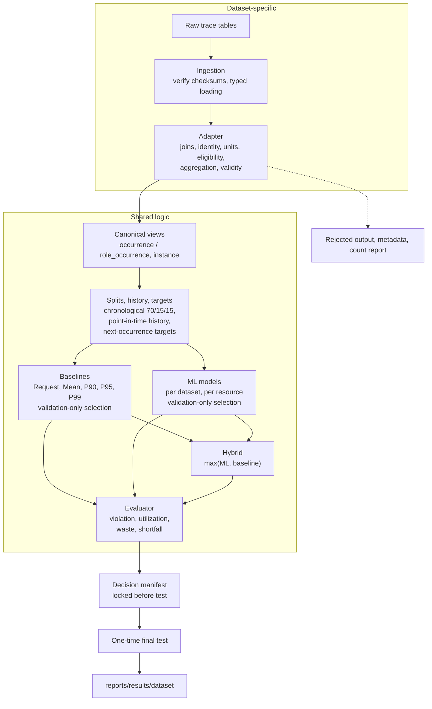

### 4.2 Layers and ownership

| Layer | Owns | Never does | Code |
|---|---|---|---|
| Ingestion | Reading and verifying source files | Mapping to canonical names | `src/sources/`; Google Notebook 01 |
| Adapter | Identity, units, eligibility, aggregation, validity, rejected output, provenance | Splits, targets, history, recommendations, metrics | `src/adapters/`; Google Notebooks 02–03 build the occurrences that the Google adapter maps |
| Canonical schema | Field names, vocabularies, profiles, validation | Dataset-specific logic | `src/canonical/schema.py` |
| Target builder | `split`, history, `actual_*`, target statuses | Reading raw source columns | `src/features/target_builder.py`; Google Notebook 04 |
| Policies | Baseline, ML and Hybrid recommendations | Scoring | `src/baselines/`, Task 7, `src/policies/hybrid.py`; Notebooks 04–06 |
| Evaluator | Metrics on canonical names, profile-driven reporting | Choosing or ranking policies | `src/evaluation/` |
| Selection and lock | Choosing baseline, `min_runs`, models; freezing decisions | Reading test targets before the lock | Task 6 and 7 scripts; Notebooks 04–06 |

### 4.3 Core classes

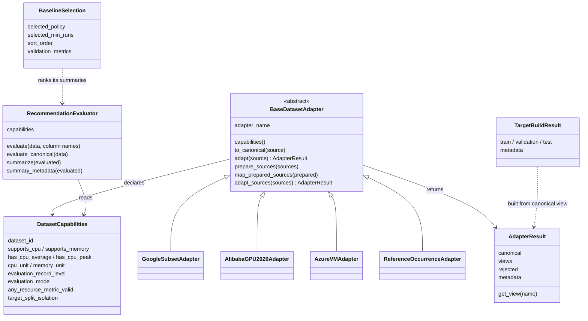

| Class or function | File | Role |
|---|---|---|
| `DatasetCapabilities`, `GOOGLE_CAPABILITIES`, `ALIBABA_GPU_2020_CAPABILITIES` | `src/canonical/schema.py` | What a dataset can provide; drives validation and evaluation |
| `BaseDatasetAdapter`, `AdapterResult` | `src/adapters/base.py` | Adapter contract and its result |
| `validate_adapter_output`, `validate_rejected_output`, `validate_role_instance_linkage` | `src/adapters/validation.py` | Shared adapter checks |
| `build_targets`, `iter_resource_history`, `TargetBuildResult` | `src/features/target_builder.py` | Splits, history and targets for canonical rows |
| `chronological_split` | `src/features/split_utils.py` | 70/15/15 split by time (Google and Alibaba) |
| `select_baseline`, `BaselineSelection`, `build_locked_recommendations` | `src/baselines/alibaba_gpu_2020.py` | Alibaba baseline selection and locked recommendations |
| `RecommendationEvaluator` | `src/evaluation/evaluator.py` | Shared scoring |
| `hybrid_recommendation` | `src/policies/hybrid.py` | Shared Hybrid rule |

---

## 5. Canonical schema

Full specification: `docs/design/canonical_workload_schema.md` (version 0.2.0, frozen). Decisions and reasons: `docs/design/canonical_schema_design_decisions.md`.

### 5.1 Where the schema sits

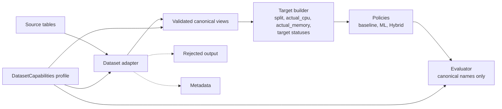

The profile is used three times: to validate the adapter output, to tell the target builder which resources have targets and whether targets must stay within a split, and to tell the evaluator what it may report.

### 5.2 Core rules

- Workload identity and recurrence identity are separate.
- Request, observation, peak, actual and recommendation are separate meanings; average and peak are never interchanged.
- Every value carries an explicit unit; a request and its actual use the same unit.
- Missing values stay null and are never filled with zero. Timestamps are never inferred.
- Data quality (`validity_status`), eligibility (`exclusion_reason`) and dataset capability (the profile) are separate. Ineligible rows stay in the output for audit; nothing is silently deleted.

### 5.3 Record levels

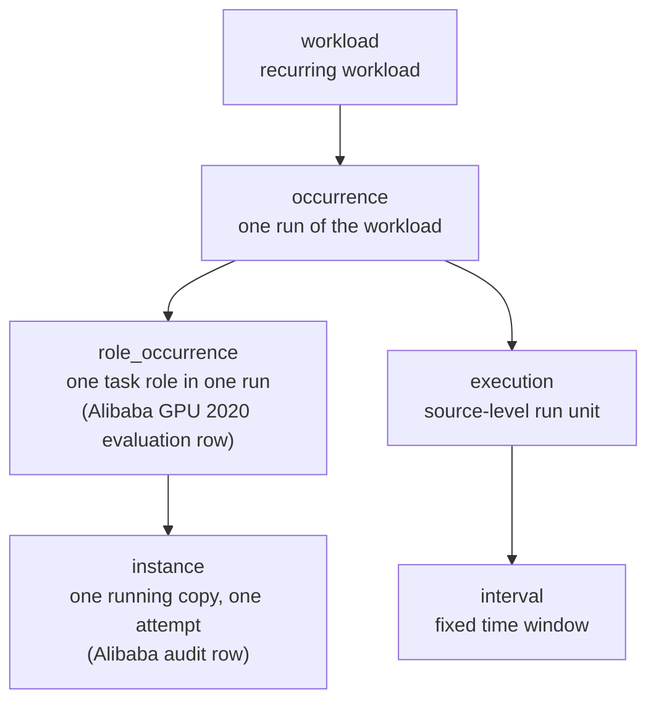

| Dataset | Evaluation row | Unit of evaluation |
|---|---|---|
| Google | `occurrence` | All executions of one recurring workload that start at the same time, summed (full workload) |
| Alibaba GPU 2020 | `role_occurrence` | One task role (for example `worker` or `ps`) within one job; values are per instance of that role |

`role_occurrence` was added in 0.2.0 because one Alibaba job contains several roles that share one occurrence ID.

### 5.4 Identity

| Field | Google | Alibaba GPU 2020 |
|---|---|---|
| `workload_id` | `recurrence_key` | `group` |
| `recurrence_key` | `user\|\|collection_logical_name` (constructed) | `group\|\|task_name` (official tag plus role) |
| `occurrence_id` | `recurrence_key\|\|execution_start_time_us` | `group\|\|job_name` |
| Evaluation key | `occurrence_id` | `role_key = group\|\|job_name\|\|task_name` |

### 5.5 Resources and units

| | Google | Alibaba GPU 2020 |
|---|---|---|
| CPU unit | `ncu` (normalized) | `percent_of_vcpu` (100 = 1 vCPU) |
| Memory unit | `normalized` | `gb` |
| CPU target | Next occurrence's **peak** | Next role-occurrence's **lifetime average** (no CPU peak exists) |
| Memory target | Next occurrence's peak | Next role-occurrence's lifetime peak (`max_mem`) |
| Scope | `full_workload` | `task_role_per_instance` |
| Any-resource metric | Reported | Not reported (`any_resource_metric_valid = false`) |
| Primary resource | Both | Memory |
| Targets within a split | No (`target_split_isolation = false`) | Yes |

Because of these differences, CPU results are never compared numerically across datasets (schema §13).

---

## 6. Adapter framework

Full contract: `docs/design/adapter_framework.md`. Alibaba design: `docs/design/alibaba_gpu_2020_adapter_design.md`. Output contract: `docs/design/alibaba_gpu_2020_output_contract.md`.

### 6.1 Responsibilities

| Adapters own | Adapters do not own |
|---|---|
| Source parsing, joins, timestamp conversion to microseconds, unit tagging, status mapping | Splits |
| Recurrence, occurrence and role construction | Next-occurrence targets and target statuses |
| Eligibility rules and `exclusion_reason` | Point-in-time history |
| Aggregation to the evaluation level, with scope and aggregation columns | Baselines, ML, Hybrid |
| Per-resource and row validity | Metrics and summaries |
| `source_` traceability columns, rejected output, provenance metadata | Final-test decisions |

### 6.2 Single-view path: `adapt()`

Used by the Google and Azure adapters.

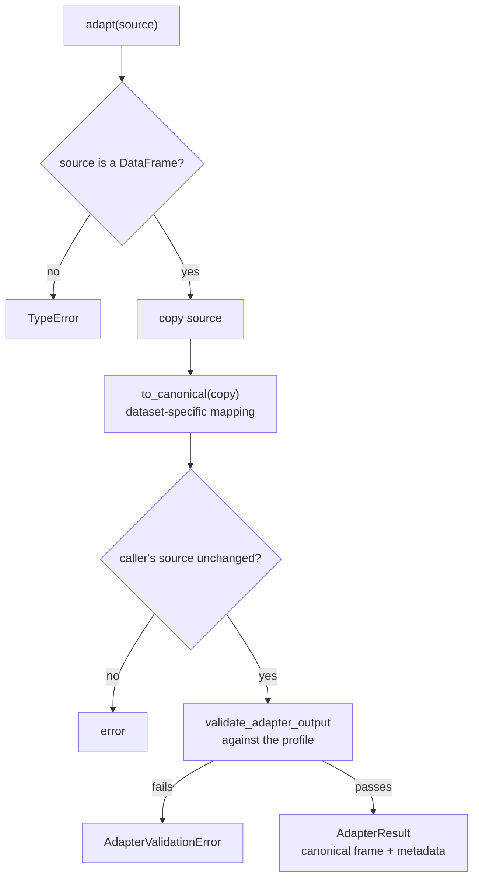

`validate_adapter_output` checks, among others: unique columns, record uniqueness per record level, the dataset ID and profile, required fields, units, vocabularies, capability gating (for example `peak_cpu` must be null when `has_cpu_peak` is false) and that no target-builder column (`split`, `actual_*`, target statuses) is populated.

### 6.3 Multi-source, multi-view path: `adapt_sources()`

Used by the Alibaba GPU 2020 adapter, which needs six source tables and emits two views.

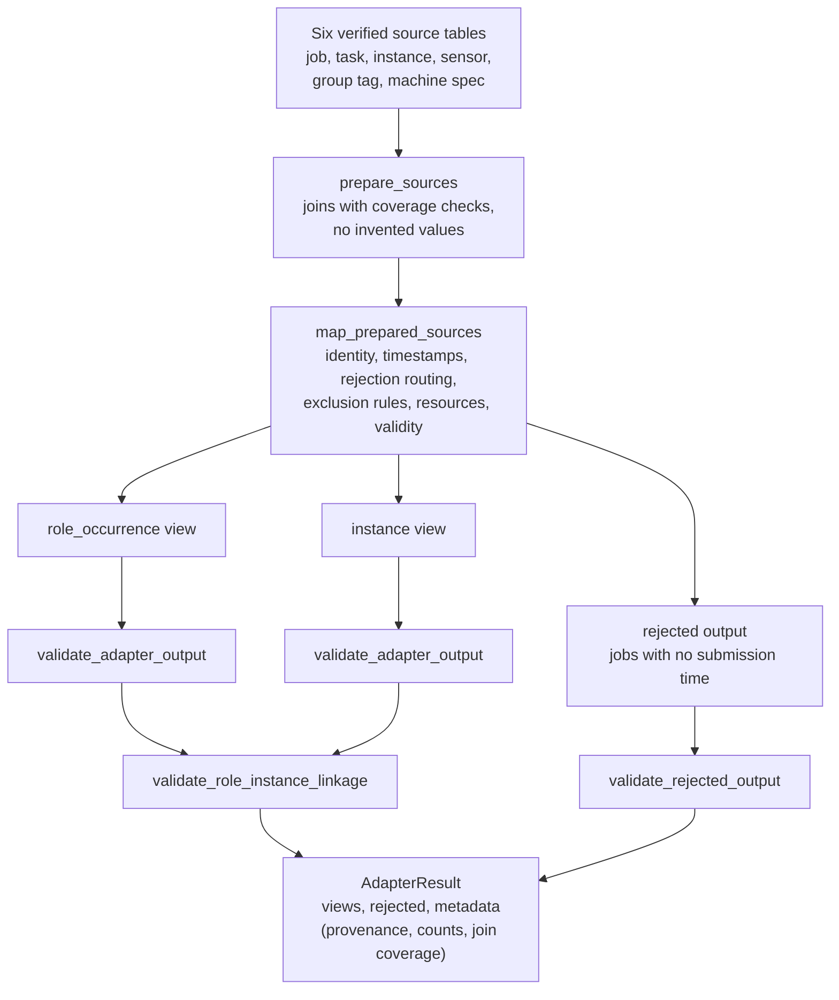

Every source row ends up in a validated view or in the rejected output, and the build script reconciles the counts (`count_report.md`) before publishing.

### 6.4 The adapters

| Adapter | Path | Input | Output | Status |
|---|---|---|---|---|
| `GoogleSubsetAdapter` | `adapt()` | Google occurrence artifacts from Notebook 04 | One `occurrence` view; precomputed targets attached afterwards outside the adapter | Task 13 (§6.6) |
| `AlibabaGPU2020Adapter` | `adapt_sources()` | Six official tables | `role_occurrence`, `instance`, rejected output | Implemented (Task 3) |
| `AzureVMAdapter` | `adapt()` / direct validation | VM table, CPU readings | `instance` and `interval` rows | 0.1.0, deferred |
| `ReferenceOccurrenceAdapter` | `adapt()` | Test fixture | `occurrence` rows | Tests only |

### 6.5 Adding a dataset

1. Write a source loader that verifies and reads the raw tables.
2. Declare a `DatasetCapabilities` profile (in `schema.py` and `config/dataset_capabilities.json`).
3. Subclass `BaseDatasetAdapter`: implement `to_canonical` (one table) or `prepare_sources` and `map_prepared_sources` (several tables).
4. The shared target builder, Hybrid rule and evaluator then apply unchanged; the profile decides what is evaluated and reported.

### 6.6 Google through the adapter framework (Task 13)

The Google pipeline predates the framework: Notebooks 01–04 build Google's occurrences, history and targets themselves. Task 13 adds a thin `GoogleSubsetAdapter` so that Google enters through the same contract as every other dataset.

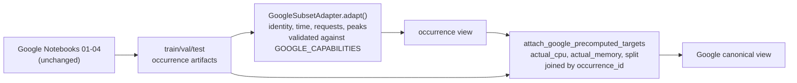

- The adapter maps identity, time fields, current requests and current peaks. It does **not** emit targets or splits, which keeps the framework rule that adapters never create them.
- Google's precomputed next-occurrence targets are joined on afterwards by a helper outside the adapter.
- Google-specific logic (execution reconstruction, aligned-window summing) stays in the notebooks.
- **Results do not change.** Task 13 changes no notebook or artifact, and its acceptance test requires the adapter output plus attached targets to equal the existing Google canonical contract view (`tests/test_google_canonical_contract.py`). The difference is architectural: every dataset then produces a validated `AdapterResult`.

---

## 7. Dataset pipelines

### 7.1 Google subset (`pipelines/google_subset/`)

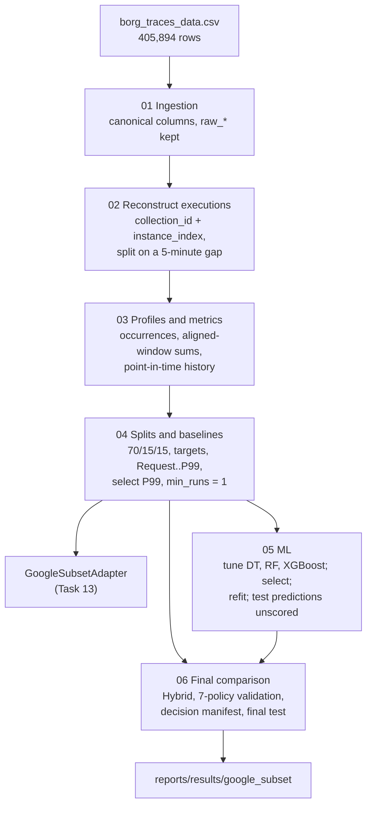

| Notebook | What it does | Main outputs (`data/processed/google_subset_v1/`) |
|---|---|---|
| 00 Data quality review | Loads the full CSV and checks fields, ranges and duplicates | — |
| 01 Data ingestion | Parses usage windows, requests and events; maps raw values to canonical columns, keeping `raw_*` columns | `google_subset_observations_v1.parquet` |
| 02 Reconstruct executions | Builds execution episodes from window observations | `google_subset_executions_v1.parquet` |
| 03 Profiles and metrics | Builds occurrences (`recurrence_key + execution_start_time_us`); sums usage across parallel executions per window and takes the maximum; point-in-time history from completed earlier occurrences | `job_profiles_google_subset_history_v1.parquet`, `job_metrics_v0.parquet` |
| 04 Splits and baselines | Chronological split keeping equal start times together; next-occurrence targets; Request, Mean, P90, P95, P99 at `min_runs` 1, 3, 5, 10; validation-only selection | `{train,val,test}_occurrences.parquet`, `baseline_validation_comparison.csv`, `metadata.json` |
| 05 ML | Feature manifest, label-purged `TimeSeriesSplit` tuning, validation selection, refit on train plus validation, test predictions without scoring. `GroupKFold` by `recurrence_key` is reported as a robustness check (generalization to unseen workloads) and is not used for any decision | `ml_*.csv`, `ml_metadata.json`, `n05_locked_models/`, `{val,test}_ml_predictions.parquet` |
| 06 Final comparison | Hybrid; seven-policy validation comparison; decision manifest; one-time final test | `validation_policy_comparison.csv`, `decision_manifest.json`, `final_test_*` |

Scale: 253,585 execution rows; 3,473 / 675 / 731 train / validation / test occurrences.

### 7.2 Alibaba GPU 2020

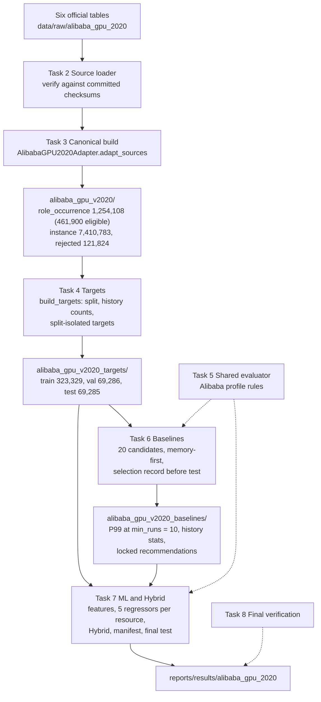

| Task | What it does | Run | Output (`data/processed/`) |
|---|---|---|---|
| 2 Source loading | Verifies the six tables against committed checksums; typed headerless loading in source order | `scripts/verify_data_setup.py --dataset alibaba_gpu_2020` | — |
| 3 Canonical data | Adapter: joins, identity, 14 ordered exclusion rules, resource mapping, aggregation, validity, rejected output | `scripts/build_alibaba_gpu_2020_canonical.py` | `alibaba_gpu_v2020/` |
| 4 Splits and targets | Chronological 70/15/15 split of eligible roles by job submission; history counts; split-isolated next-occurrence targets | `scripts/build_alibaba_gpu_2020_targets.py` | `alibaba_gpu_v2020_targets/` |
| 5 Evaluator | Profile-aware evaluator (memory primary, CPU average-usage label, no any-resource metric) | Used by Tasks 6–7 | — |
| 6 Baselines | Point-in-time Mean, P90, P95, P99; 20-candidate validation comparison; selection; locked recommendations; sensitivity | `scripts/run_alibaba_gpu_2020_baselines.py` | `alibaba_gpu_v2020_baselines/` |
| 7 ML and Hybrid (in progress) | Features from requests, role descriptors, history counts and Task 6 statistics with missing-value flags; five regressors per resource; Hybrid; refit; decision manifest; then a one-time final test | `scripts/run_alibaba_gpu_2020_ml.py` (PR 1) | `alibaba_gpu_v2020_ml/` |
| 8 Final verification | Independent check of Tasks 3–7 outputs and leakage controls | — | — |

Every Alibaba script verifies its inputs' `SHA256SUMS`, builds in a staging folder and publishes only after all checks pass. Each output folder has its own `metadata.json` (input checksums, code commit, library versions) and `SHA256SUMS`.

---

## 8. Shared evaluation layer: policies, evaluator and metrics

### 8.1 How a recommendation is scored

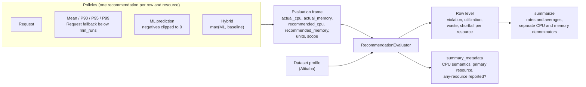

### 8.2 Metrics (`src/evaluation/metrics.py`)

| Metric | Row-level definition | Summary |
|---|---|---|
| Violation | `actual > recommended` | % of valid rows violated |
| Utilization | `actual / recommended`, capped at 100% | Average |
| Waste | `max(recommended − actual, 0)` | Average |
| Shortfall | `max(actual − recommended, 0)` | Average |
| Any-resource violation | CPU or memory violated | % of rows with both resources valid |

- A missing actual or recommendation makes that row **unknown** for that resource; it is left out of that resource's denominator and never counted as a non-violation.
- CPU and memory have **separate valid-row denominators**, reported next to every rate.

### 8.3 The evaluator (`src/evaluation/evaluator.py`)

| Method | Use |
|---|---|
| `evaluate(data, column names)` | Row-level metrics from named columns |
| `evaluate_canonical(data)` | Same, from canonical column names; requires a profile |
| `summarize(evaluated)` | Rates, averages and denominators |
| `summary_metadata(evaluated)` | Profile facts that travel with the numbers: `cpu_result_semantics`, `primary_resource`, `any_resource_metric_reported` |

The evaluator only scores. Selection and ranking happen in the pipelines.

### 8.4 How each dataset uses the shared layer

| | Google | Alibaba GPU 2020 |
|---|---|---|
| Evaluator construction | `RecommendationEvaluator()` (no profile) | `RecommendationEvaluator(capabilities=ALIBABA_GPU_2020_CAPABILITIES)` |
| Entry point | `evaluate()` with Google's target and recommendation columns | `evaluate_canonical()` on canonical columns |
| CPU meaning | Next occurrence's CPU **peak** | Next run's **lifetime average CPU**; every result labeled `cpu_usage_label = average_usage` |
| Memory meaning | Next occurrence's peak (normalized) | Next run's per-instance peak (GB); the **primary** resource |
| Any-resource violation | Reported, and used first in baseline selection | Suppressed (an average and a peak cannot be combined) |
| Scope | Full workload | Per instance of a task role |
| Baselines | Notebook 04 code | `src/baselines/alibaba_gpu_2020.py` |
| Hybrid safeguard | P95 (`max(ML, P95)`) | Selected Task 6 baseline (`max(ML, P99@10)`) |
| Missing safeguard | Hybrid falls back to the ML prediction and the row is flagged (`hybrid_recommendation` returns a `safeguard_missing` flag) | Same |
| Same code | Metric formulas, evaluator, `hybrid_recommendation`, `chronological_split` | Same |

The same formulas and evaluator score both datasets; what changes is the profile, which decides what each number means and what may be reported.

---

## 9. Selection rules and decisions

All selections use validation only. Recorded in `canonical_schema_design_decisions.md` D-19 and in each pipeline's metadata.

| Decision | Google | Alibaba GPU 2020 |
|---|---|---|
| Baseline candidates | Request, Mean, P90, P95, P99 at `min_runs` 1, 3, 5, 10 | Same, but Request is reported only and cannot be selected |
| Baseline ranking | Any-resource violation, worst single-resource violation, CPU plus memory violation, CPU waste, memory waste, lower `min_runs` | Memory violation, memory waste, CPU violation, CPU waste, `min_runs`, policy |
| Selected baseline | P99, `min_runs = 1` | P99, `min_runs = 10` |
| ML candidates | Decision Tree, Random Forest, XGBoost (tuned) | `DummyRegressor`, Decision Tree, Random Forest, HistGradientBoosting, XGBoost |
| ML ranking | Validation RMSE on the `log1p` scale | RMSE, MAE, violation, shortfall, model name |
| Selected ML | Random Forest for CPU and memory | Task 7 (in progress) |
| Hybrid | `max(ML, P95)`; `max(ML, P99)` reported as a supplement | `max(ML, selected baseline)` |

**Why Request is not selectable for Alibaba.** As the Hybrid baseline it would stop Hybrid from ever recommending less than the current request, and its identical rows would fix `min_runs` at 1 instead of choosing it on validation. When it was selectable, it won on memory violation (4.74% against 5.58%) with 2.5 times the memory waste.

**Why ML selection is accuracy-first.** The ML model's job is to predict usage accurately; the Hybrid rule is what keeps violations low. Ranking by violation first rewards models that over-predict and selects the mean `DummyRegressor`.

---

## 10. Leakage controls and reproducibility

### 10.1 Lock and one-time final test

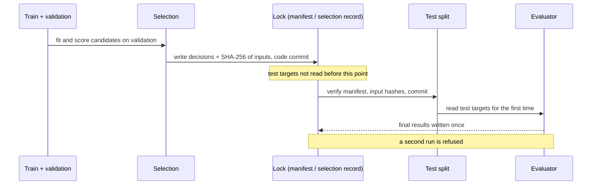

### 10.2 Controls

| Control | How |
|---|---|
| Time order | Chronological splits; no random shuffling |
| Point-in-time history | Only occurrences completed before the current start |
| Pre-execution features | Only requests, role descriptors, history counts and history statistics; targets, current-run observations, identifiers and split labels are excluded and checked (`validate_features` with a dataset-specific exclusion list) |
| Validation-only selection | Baselines, `min_runs`, models and Hybrid are chosen without test data |
| Lock before test | Alibaba Task 6 writes its selection record before opening the test table and reads test with an explicit column list; Google Notebook 06 freezes a decision manifest (decisions, SHA-256 of every input, the code commit and the notebook's code) |
| One-time final test | Scored once; the notebook and scripts refuse to overwrite a final result |
| Input integrity | Every stage re-checks its inputs' `SHA256SUMS` |
| Atomic outputs | Built in a staging folder, published only after all checks pass |
| Environment | One locked environment for all final runs (§2.1); each run records its library versions and code commit |

---

## 11. Earlier Azure baseline experiments

Three experiments on public Azure traces were run as baselines before the TraceAdvisor design was fixed. They are kept for context and were not developed further. Write-ups: `docs/baseline_experiments/`; outputs: `reports/eval/`.

| Experiment | Trace | Unit of analysis | Policies | Main result |
|---|---|---|---|---|
| **Resource Central** | Azure VM trace (the 2017 V1 release; first CPU-readings file, VM, deployment and subscription tables) | Per VM (100,000 VMs, one CPU reading each) | Mean against P95 of CPU utilization; usage buckets (0–25, 25–50, 50–75, 75–100%) | P95 is 6.98 points above the mean on average (median 2.30). The mean puts 87.1% of VMs in the same bucket as P95 but misses most high-demand VMs (recall 0.345 for 75–100%) |
| **Splitwise** | Azure LLM inference trace (code and conversation) | Total tokens per 10-second window; chronological train, validation and test | Fixed capacity at the train Mean, Median, P90, P95, P99 or Max | Code on test: Mean violates 33.3% of windows at 82% utilization; P95 4.2% at 37%; P99 0% at 24%. Conversation: P90 and above never violate |
| **ModServe** | Azure multimodal inference trace (15–22 Oct 2024) | Abstract image and text service units per 5-minute window; train 4 days, validation day 5, test days 6–7 | Fixed Monolith (train P95 of total units), Fixed Decoupled (separate image and text P95), Reactive Decoupled | Test: Fixed Monolith safe in 95.3% of windows but provisions 19 units against 5.4 required; Reactive Decoupled matches the average (5.4) but is safe in only 71.5% of windows. On the burst day (21 Oct) the fixed policies stay above 86% safe |

**What they showed.** The same trade-off TraceAdvisor targets appears in every trace: mean-level sizing is efficient but frequently short, and high percentiles are safe but wasteful.

**Why they were not developed further.** None of them describes recurring jobs with a per-job request and per-job CPU and memory usage:
- Resource Central has no memory usage and no request, only VM capacity buckets, and no recurring job identity; the sample used is V1, not V2 (`docs/data/azure_vm_traceadvisor_feasibility.md`).
- Splitwise and ModServe describe service-level demand per time window, not jobs, so there is nothing to recommend before a job starts.

TraceAdvisor's question, how much to request for the next run of a recurring job, therefore needs Google and Alibaba GPU 2020. The Azure VM trace could later serve as a CPU-only portability check of the adapter framework (feasibility study).

---

## 12. Results

| Dataset | Location | Status |
|---|---|---|
| Google subset | `reports/results/google_subset/` (`googlepipeline_finalrun.md`, `tables/`, decision manifest) | Final, including the one-time test |
| Alibaba GPU 2020 | `reports/results/alibaba_gpu_2020/` (`alibaba_gpu_2020_results_tasks1_6.md`) | Validation results through Task 6; Task 7 pending |

**Google final test (259 occurrences):** Hybrid has the lowest any-resource violation rate (12.36%) and memory violation rate (7.72%), at P95's waste. P99 has the lowest CPU violation rate (9.27%). Request violates on 54.47% of occurrences. ML alone wastes the least but violates on 32.82%.

**Alibaba validation (42,069 rows):** P99 at `min_runs = 10` gives 5.58% memory violations with 8.94 GB average memory waste, against Request's 4.74% with 22.26 GB.

---

## 13. Known limitations

- **Google targets cross split boundaries:** 104 of 330 validation targets start in the test period. The selected baseline is the same on validation-period targets only (P99 any-resource violation 18.30% instead of 21.95%), but Google validation numbers are somewhat optimistic. Documented, not corrected.
- **Alibaba CPU is a lifetime average:** CPU results are average-usage sizing and do not show peak safety.
- **Alibaba selection bias:** only 36.8% of role-occurrences are eligible (completed, fully observed); 98% of evaluated roles are single-instance; telemetry covers about day 19 to day 68.9.
- **Google sample size:** the Kaggle sample covers 31 days; 329 validation and 259 test occurrences.
- **Units:** Google uses normalized units, so waste is not in cores or GB; datasets are not compared numerically.
- **GPU:** GPU fields are kept but not evaluated.
- **Azure experiments:** run on samples (one CPU-readings file; short LLM traces) and not on the TraceAdvisor pipeline, so they are context, not results.
