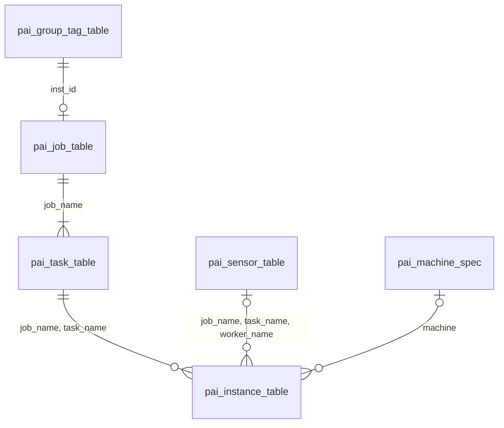
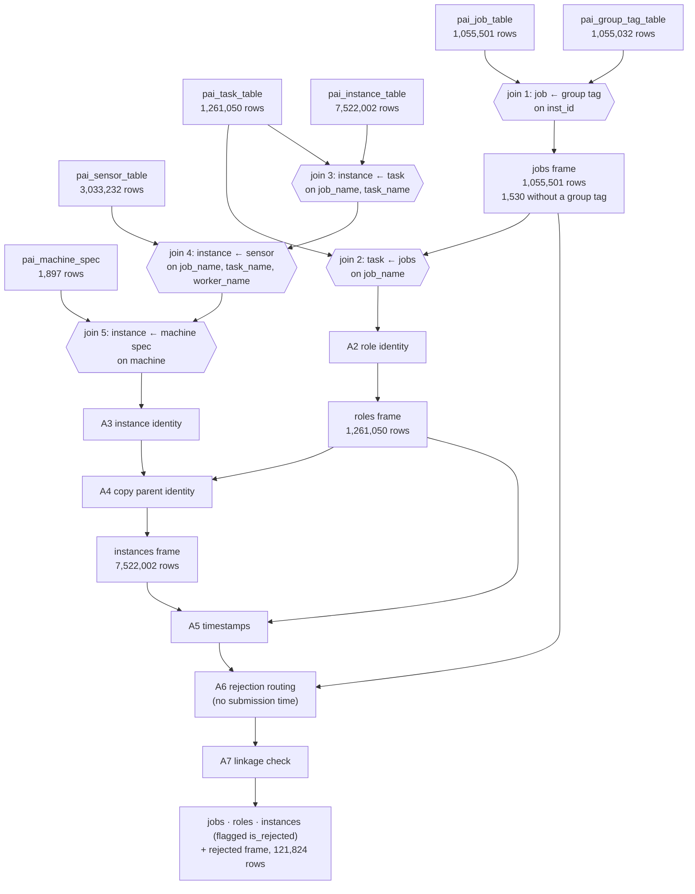
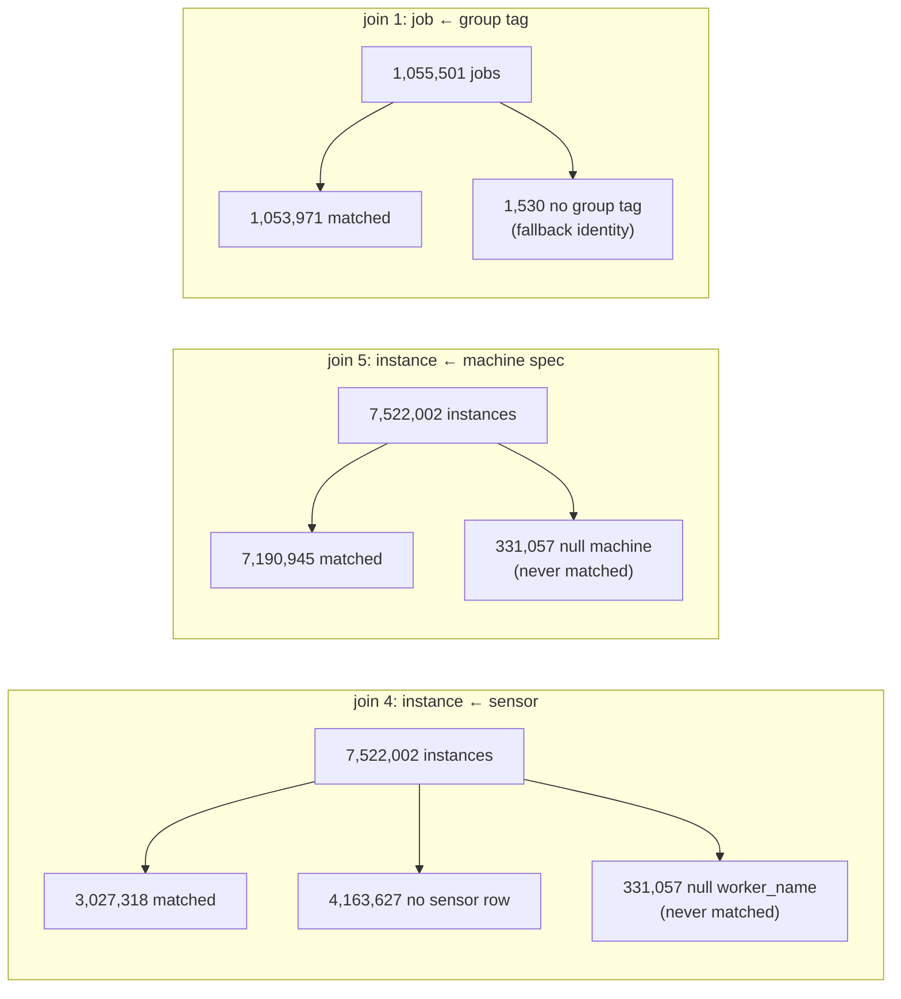

# Task 3: Alibaba GPU 2020 Adapter — System Design and Implementation Plan

**Issue:** #79 · **Schema version:** 0.2.0
**Status (2026-10-24):** Part A is implemented and verified on the full source tables. All design decisions are closed. Part B is next.

| Related document | Role |
|---|---|
| `docs/design/canonical_workload_schema.md` (schema) | The canonical model: record levels, identity, resources, time, validity, exclusion rules |
| `docs/design/canonical_schema_design_decisions.md` (D-xx) | Why the schema is the way it is |
| `docs/design/adapter_framework.md` (framework) | The shared adapter framework: views, validation, linkage, metadata |
| `docs/design/alibaba_gpu_2020_output_contract.md` (output contract) | The output contract that Tasks 4, 6, 7 and 8 rely on |
| `docs/data/alibaba_gpu_2020_source_data_checks.md` (checks report) | Verified properties of the source tables. **Cite for data validation** |
| `docs/data/alibaba_gpu_2020_part_a_results.md` (Part A results) | Measured Part A figures on the full tables. **Cite for pipeline validation** |
| `docs/data/alibaba_gpu_2020_evidence_and_limitations.md` (evidence) | Dataset evidence and reporting limitations |

---

## 1. Overview

### 1.1 Problem

The Alibaba GPU 2020 trace (`cluster-trace-gpu-v2020`) is published as six tables at different levels: jobs, tasks, instances, per-worker sensor summaries, group tags and machine specifications. TraceAdvisor evaluates resource recommendations on **one row per task role per job**, with requests and usage in declared units, a usable time, and a stable identity that links each job to the earlier and later runs of the same workload. None of the source tables has that shape.

The adapter turns the six tables into that shape without losing, inventing or silently changing any source value.

### 1.2 What the adapter produces

| Output | One row per | Purpose |
|---|---|---|
| `role_occurrence` view | Task role of one accepted job | Evaluation rows, read by Task 4 onwards |
| `instance` view | Instance-table row of an accepted job (every retry is its own row) | Audit: traces each role value to the instances behind it |
| Rejected output | Job, role and instance row of a job with no submission time | Audit: rows that have no usable canonical time |
| Metadata and count report | — | Provenance, counts per rule and reason, join coverage |

The exact columns are in the output contract.

### 1.3 Out of scope

Splits, history features, next-occurrence targets (Task 4); baselines, machine learning, Hybrid and evaluator metrics (Tasks 5–7); job-total rows; GPU evaluation; any change to the Google, Alibaba 2018 or Azure adapters.

### 1.4 Design principles

1. **Nothing is invented.** A missing value stays null and is never replaced by zero, a default or another column. No time is inferred, carried forward or substituted.
2. **No row disappears.** Every source row ends up in a view or in the rejected output. Ineligible rows stay in the view with an `exclusion_reason`; invalid rows stay with a `validity_status`.
3. **Joins never change row counts.** Every join is a left join to a unique lookup. An unmatched row keeps nulls and a match flag.
4. **Values are copied, not recomputed.** Instance rows copy their identity from the parent role, so the two can never disagree.
5. **Identity is deterministic.** The same verified source files always produce the same keys, independent of input row order.
6. **Contract violations fail the run.** A duplicate key, a null key, a broken link or a value that contradicts the design raises `AdapterValidationError`; nothing is repaired silently.

### 1.5 Terms

| Term | Meaning here |
|---|---|
| Role (role occurrence) | One `(job_name, task_name)`: one task role within one job, such as `worker` or `ps` |
| Instance slot | One `(job_name, task_name, inst_name)` position; a retried slot has several instance rows |
| Attempt | One instance-table row of a slot |
| Accepted / rejected | A job with / without a submission time. Rejected jobs go whole to the rejected output |
| Excluded / eligible | An accepted role that fails / passes the 14 exclusion rules. Only eligible roles feed history and targets |
| Fallback identity | The identity used for a job with no `group` (§5.2) |

---

## 2. System context

```
Task 2 loader ──► six verified tables (+ source_row_number)
                         │
                         ▼
        ┌──────── Task 3 adapter (on the Task 1 framework) ────────┐
        │ Part A prepare_sources ─► Part B map_prepared_sources    │
        │                        ─► adapt_sources (validation)     │
        └──────────────────────────────────────────────────────────┘
                         │
                         ▼
   role_occurrence · instance · rejected · metadata.json · count_report.md
                         │
       ┌─────────────────┼──────────────────────┐
       ▼                 ▼                      ▼
 Task 4 splits,     Tasks 6–7 (through     Task 8 final
 history, targets   the Task 4 tables)     verification
```

### 2.1 Dependencies

| Dependency | Provides | State |
|---|---|---|
| Task 1 adapter framework | `BaseDatasetAdapter`, `adapt_sources`, the `prepare_sources` / `map_prepared_sources` hooks, rejected output with levels, `validate_role_instance_linkage`, `validate_rejected_output`, `rejected_required_columns`, `build_multiview_metadata` | Available on `main` |
| Capability profile | `ALIBABA_GPU_2020_CAPABILITIES` in `src/canonical/schema.py`, with the 14 exclusion reasons in rule order | Available on `main` |
| Task 2 loader | Loads each table and adds `source_row_number` (int64, 1-based data-line number, unique, non-null); checksum manifest, `verify_sources` and `source_provenance` | Available on `main`. Used only by the build script (B7) |
| Raw data | `data/raw/alibaba_gpu_2020/`, gitignored. 18 of 18 official SHA-256 values verified on 2026-10-23 | Available locally |


### 2.2 Design basis

Task 3 implements the frozen schema; it does not change any of its rules. Each step follows these schema decisions (`canonical_schema_design_decisions.md`) and sections (`canonical_workload_schema.md`, framework = `adapter_framework.md`):

| Step | Schema decisions | Sections |
|---|---|---|
| A1 Joins | D-17 Eligibility and exclusion rules (one sensor row per worker, never aggregated) | Schema §9.3 rule 10; framework §4.2 |
| A2 Role identity | D-03 New record level `role_occurrence`; D-04 Workload and recurrence identity; D-05 Jobs without `group`; D-06 `occurrence_key` is conceptual; D-07 Literal key separators | Schema §4.1, §5.1–§5.3 |
| A3 Instance identity | D-21 Instance identity; D-24 Missing `worker_name` | Schema §5.4 |
| A4 Parent inheritance | D-08 Instance rows inherit their parent linkage | Schema §5.5 |
| A5 Timestamps | D-22 Timestamp contract | Schema §7 |
| A6 Rejection routing | D-23 Rejected output for jobs without a submission time | Schema §9.5; framework §4.4 |
| A7 Linkage | D-08 Instance rows inherit their parent linkage; D-22 Timestamp contract | Schema §5.5; framework §9.2 |
| B1 Exclusion rules | D-17 Eligibility and exclusion rules; D-05 Jobs without `group`; D-24 Missing `worker_name` | Schema §9.3, §9.4 |
| B2 Validity | D-15 Validity, eligibility and capability are separate; D-16 Missing values | Schema §9.1, §9.2 |
| B3 Resource mappings | D-09 Reuse existing field names; D-10 CPU is average-only; D-12 Units; D-13 Per-field semantics; D-20 GPU fields retained, GPU evaluation deferred | Schema §6.1–§6.4, §7 |
| B4 Role aggregation | D-11 Memory is the maximum over eligible workers; D-14 Explicit scope and two aggregation columns | Schema §8 |
| B5 View assembly | D-03 New record level `role_occurrence`; D-18 Splits, history and split-isolated targets (no split or target columns from the adapter) | Schema §4.1; framework §4.3, §7.2 |
| B6 Metadata | — | Schema §10, §14; framework §6 |

The remaining schema decisions (D-01 Dataset scope, D-02 Extend PR #70, D-19 Evaluator and comparability) set the project context and constrain no adapter step directly.

---

## 3. Source data

### 3.1 Tables

| Table | Rows | Grain | Key |
|---|---|---|---|
| `pai_job_table` | 1,055,501 | One job submission | `job_name` |
| `pai_task_table` | 1,261,050 | One task role of a job | `(job_name, task_name)` |
| `pai_instance_table` | 7,522,002 | One instance attempt | None (slots repeat on retries) |
| `pai_sensor_table` | 3,033,232 | Lifetime usage summary of one worker | `(job_name, task_name, worker_name)` |
| `pai_group_tag_table` | 1,055,032 | Group tag of a job | `inst_id` |
| `pai_machine_spec` | 1,897 | One host | `machine` |

### 3.2 Relationships



A job has one or more tasks; a task has zero or more instances; an instance matches at most one sensor row and at most one machine. Several attempts of one worker share its single sensor row.

### 3.3 Verified properties

All checked on the full tables before any adapter logic was written (checks report).

| Property | Result |
|---|---|
| Every lookup key (`job_name`, `(job_name, task_name)`, `inst_id`, `machine`, sensor key) | Unique and non-null |
| Instances without a task, tasks without a job, jobs without tasks | 0 / 0 / 0 |
| Null `job_name`, `task_name` or `inst_name` on instances | 0 |
| `end_time < start_time` on jobs or instances | 0 |
| Negative task requests or sensor values | 0 |
| Instance `machine` not in the machine table | 0 (every non-null machine matches) |

### 3.4 Known source conditions

These are kept as they are and reported, never corrected.

| Condition | Count | Handling |
|---|---|---|
| Jobs without a group tag | 1,530 (1,460 accepted) | Fallback identity; roles excluded as `no_recurrence_key` |
| Jobs without a submission time | 3,663, all `Waiting` (6,942 roles, 111,219 instances) | Rejected whole (A6) |
| Instances without `worker_name` and `machine` (unplaced) | 331,057 | No sensor or machine match; `worker_id` null |
| Instances without their own start time | 1,773,468 (1,673,976 accepted) | `start_time_us` null; placed in time by `event_time_us` |
| Retried slots | 231,632 slots, 906,751 rows | Each attempt its own row; roles excluded as `multi_attempt_worker` |
| Tasks without instance rows | 130, all in rejected jobs | Rejected with their job |
| Telemetry coverage | About day 19 to day 68.9 | Roles outside it have no sensor rows |

---

## 4. Architecture

### 4.1 Pipeline

```
prepare_sources (Part A)                     map_prepared_sources (Part B)
 A1 joins ─► A2 role identity                 B1 exclusion rules
 ─► A3 instance identity ─► A4 inheritance    B2 validity
 ─► A5 timestamps ─► A6 rejection routing     B3 resource mappings
 ─► A7 linkage                                B4 role aggregation
   │                                          B5 view assembly
   └─► jobs · roles · instances · rejected ──►  │
                                                ▼
                     adapt_sources: per-view validation, linkage, rejected checks
                                                │
                     B6 metadata ─► B7 build script ─► artifacts
```

Part A builds four internal frames and checks their structure. Part B decides eligibility and values, and assembles the canonical views. The framework's `adapt_sources` validates the result. Part B reads the prepared frames and never changes an identity, time, join or routing column.

### 4.2 Components

| Step | What it does | Code | State |
|---|---|---|---|
| S1 | Adapter class, profile, rejected-level requirements, export | `AlibabaGPU2020Adapter` | Done |
| A1 | Input checks and the five joins | `prepare_sources`, `_left_join` | Done |
| A2 | Role identity | `_add_role_identity` | Done |
| A3 | Instance identity | `_add_instance_identity` | Done |
| A4 | Parent inheritance | `_inherit_parent_identity` | Done |
| A5 | Timestamps | `_add_timestamps` | Done |
| A6 | Rejection routing and the rejected frame | `_route_rejections`, `_build_rejected` | Done |
| A7 | Role/instance linkage | `_check_linkage` | Done |
| A8 | Part A tests | `tests/test_alibaba_gpu_2020_adapter.py` | Done (116 tests) |
| B1–B5 | Exclusions, validity, mappings, aggregation, views | `map_prepared_sources` | Next |
| B6 | Metadata | `build_multiview_metadata` override | Next |
| B7 | Build script | `scripts/build_alibaba_gpu_2020_canonical.py` | After B1–B6 |
| B8 | Part B tests | Same test module | Next |

All code is in `src/adapters/alibaba_gpu_2020.py`, with Part A and Part B in separate marked sections, and exported from `src/adapters/__init__.py`. `to_canonical` raises `NotImplementedError`: the adapter has only the six-table path.

### 4.3 Internal data model: the prepared frames

`prepare_sources` returns four frames. `jobs`, `roles` and `instances` keep every source row, in source order, flagged with `is_rejected`. Only rows with `is_rejected = False` become views. `jobs` is never a view: it carries the group tag into `roles`, supplies the rejected job rows and supports the job-level reconciliation.

**`jobs`** (one row per job-table row, 12 columns)

| Group | Columns |
|---|---|
| Source (A1) | `job_name`, `job_inst_id`, `user`, `job_status`, `job_start_time`, `job_end_time`, `job_source_row_number` (if supplied) |
| Group tag (A1) | `group`, `workload`, `gpu_type_spec`, `has_group_tag` |
| Routing (A6) | `is_rejected` |

**`roles`** (one row per task-table row, 31 columns)

| Group | Columns |
|---|---|
| Task source (A1) | `job_name`, `task_name`, `inst_num`, `task_status`, `task_start_time`, `task_end_time`, `plan_cpu`, `plan_mem`, `plan_gpu`, `gpu_type`, `task_source_row_number` (if supplied) |
| From `jobs` (A1) | `job_inst_id`, `user`, `job_status`, `job_start_time`, `job_end_time`, `job_source_row_number`, `group`, `workload`, `gpu_type_spec`, `has_group_tag`, `has_job` |
| Identity (A2) | `workload_id`, `recurrence_key`, `occurrence_id`, `role_key` |
| Time (A5) | `start_time_us`, `end_time_us`, `launch_time_us`, `time_basis` (no `event_time_us`) |
| Routing (A6) | `is_rejected` |

**`instances`** (one row per instance-table row, 41 columns)

| Group | Columns |
|---|---|
| Instance source (A1) | `job_name`, `task_name`, `inst_name`, `worker_name`, `inst_id`, `status`, `start_time`, `end_time`, `machine`, `source_row_number` |
| Sensor (A1) | `cpu_usage`, `gpu_wrk_util`, `avg_mem`, `max_mem`, `avg_gpu_wrk_mem`, `max_gpu_wrk_mem`, `has_sensor` |
| Machine spec (A1) | `cap_cpu`, `cap_mem`, `cap_gpu`, `machine_gpu_type`, `has_machine_spec` |
| Task match (A1) | `has_parent_role` |
| Identity (A3) | `instance_slot_key`, `instance_attempt_index`, `instance_id`, `execution_id`, `worker_id`, `source_inst_name`, `source_worker_name`, `source_status`, `source_machine` |
| Inherited (A4) | `workload_id`, `recurrence_key`, `occurrence_id`, `role_key` |
| Time (A5) | `event_time_us`, `start_time_us`, `end_time_us`, `time_basis` |
| Routing (A6) | `is_rejected` |

**`rejected`** (one row per rejected job, role and instance row, 64 columns): `rejection_level` (`job`, `role_occurrence`, `instance`) and `rejection_reason` (`missing_submission_time`) first, then the union of the three frames' columns. A column a level does not have is null.

---

## 5. Part A: canonical preparation (implemented)

Every figure in this section was measured by running `prepare_sources` on the full tables (2026-10-23 and 2026-10-24).

### 5.1 A1 Joins

**Purpose.** Bring every source value a role or instance needs onto one row, without changing any row count.

| Join | Driving ← lookup | Key |
|---|---|---|
| `job_group_tag` | job ← group tag | `inst_id` |
| `task_job` | task ← `jobs` | `job_name` |
| `instance_task` | instance ← task | `(job_name, task_name)` |
| `instance_sensor` | instance ← sensor | `(job_name, task_name, worker_name)` |
| `instance_machine_spec` | instance ← machine spec | `machine` |

**Data preparation flow** (row counts on the full tables):



Every join is a left join to a unique lookup, so each frame keeps exactly its source row count. Match results per join:



**Rules.**
- **Input:** the six tables under their manifest names. A missing table or required column raises.
- **Lookup keys:** every lookup key must be unique and non-null before its join, or the run raises. No uniqueness is required on the driving side, because instances repeat on retries.
- **Null keys never match.** pandas matches null to null in `merge`, so this is prevented explicitly: a driving row with any null key part gets no match, a false flag and null lookup columns.
- **Left joins, `validate="many_to_one"`.** Each driving row matches at most one lookup row. The row counts of `jobs`, `roles` and `instances` must equal their source tables, in source order.
- **Match flags:** `has_group_tag`, `has_job`, `has_parent_role`, `has_sensor`, `has_machine_spec`.
- **Sensor rows are never aggregated.** Every attempt of a retried worker receives that worker's single sensor row; rule 10 later excludes such roles.

**`source_row_number`.**

| Table | Rule | Reason |
|---|---|---|
| Instance | Required: integer, non-null, unique; never renumbered | Part of the instance identity (attempt tie-breaker) and of rejected-row traceability |
| Job, task | Optional; passed through as `job_source_row_number` / `task_source_row_number` | Extra audit detail. Jobs and roles are already traceable by their unique keys |
| Group tag, sensor, machine spec | Dropped | The unique lookup key already identifies the row |

The plain name `source_row_number` always means an instance-file line, so the rejected output never mixes line numbers from different files in one column.

**Column naming.** A column keeps its source name unless two tables in the same frame share it; then each copy takes a table prefix (`job_`, `task_`, `machine_`). All renames come from one explicit map. Any other overlapping column name raises, so no column is silently overwritten.

**Dropped columns.**

| Column | Why |
|---|---|
| Sensor `read`, `write`, `read_count`, `write_count` | Used by no canonical field, rule or extension |
| Sensor `gpu_name` | A device path such as `/dev/nvidia5`, not a resource value |
| Sensor `machine`, `inst_id` | Identical to the instance's own values on all 3,027,318 matched rows |
| Group-tag `user` | Equal to the job `user` wherever both exist; the job `user` is kept |

**Join coverage.** Each call stores two-way counts in `adapter.join_coverage_counts`, built fresh per call and assigned only after every check passes. `driving_unmatched` includes null-key rows.

| Join | Driving matched | Driving unmatched (null key) | Lookup used | Lookup unused |
|---|---|---|---|---|
| `job_group_tag` | 1,053,971 | 1,530 (0) | 1,053,971 | 1,061 |
| `task_job` | 1,261,050 | 0 (0) | 1,055,501 | 0 |
| `instance_task` | 7,522,002 | 0 (0) | 1,260,920 | 130 |
| `instance_sensor` | 3,027,318 | 4,494,684 (331,057) | 3,019,349 | 13,883 |
| `instance_machine_spec` | 7,190,945 | 331,057 (331,057) | 1,897 | 0 |

### 5.2 A2 Role identity

**Purpose.** Give every role a unique key and the recurrence key that links it to the same role in other jobs of its workload.

| Field | Job with a group | Job without a group (fallback) |
|---|---|---|
| `workload_id` | `group` | `job_name` |
| `recurrence_key` | `group\|\|task_name` | Null |
| `occurrence_id` | `group\|\|job_name` | `job_name` |
| `role_key` | `group\|\|job_name\|\|task_name` | `job_name\|\|task_name` |

- A group that is null, empty or whitespace-only counts as missing and is never concatenated into a key.
- `recurrence_key` includes `task_name`, so a worker's history never mixes with a parameter server's (schema §5.3).
- Blank `job_name` / `task_name`, or a key part containing `||`, raises. A duplicate `role_key` raises.
- **Result:** 1,261,050 unique `role_key` values; 1,888 fallback roles (1,788 accepted, 100 rejected).

### 5.3 A3 Instance identity

**Purpose.** Give every instance attempt a stable, unique key, including retries.

| Field | Rule |
|---|---|
| `instance_slot_key` | `job_name\|\|task_name\|\|inst_name` |
| `instance_attempt_index` | 1-based within the slot, by own start time ascending, null starts last, then `source_row_number` |
| `instance_id` | `instance_slot_key\|\|instance_attempt_index` |
| `execution_id` | `job_name\|\|task_name` |
| `worker_id` | `worker_name`; null when missing |
| `source_inst_name`, `source_worker_name`, `source_status`, `source_machine` | Raw values, unchanged |

- `worker_name`, timestamps and the source `inst_id` are never used in the key: `worker_name` is null on 331,057 rows, the own start on 1,773,468, and `inst_id` is a job-level value.
- The order is computed with a stable sort on a positional index, so it does not depend on input row order or index labels.
- **Result:** 7,522,002 unique `instance_id` values; 6,846,883 slots, 231,632 of them retried (906,751 rows); largest attempt index 338.

### 5.4 A4 Parent inheritance

**Purpose.** Let every instance row be joined back to its role.

Instance rows copy `workload_id`, `recurrence_key`, `occurrence_id` and `role_key` from the parent role on `(job_name, task_name)`; they are never recomputed. A guard checks that the copied `role_key` equals `execution_id` (fallback) or `workload_id||execution_id` (grouped). An instance without a parent keeps null parent fields; A7 then fails the run.

**Result:** 0 differences from the parent; 12,810 instances inherit a null `recurrence_key` (all instances of the 1,888 fallback roles).

### 5.5 A5 Timestamps

**Purpose.** Give every row canonical microsecond times without inventing any.

Seconds × 1,000,000, converted exactly into nullable `Int64`; a fractional microsecond raises. `time_basis = trace_relative`.

| Row | `event_time_us` | `start_time_us` | `end_time_us` | `launch_time_us` |
|---|---|---|---|---|
| Role | Not present | Job submission | Job completion, or null | First task launch (lifecycle metadata only) |
| Instance | Parent job submission | Own start, or null | Own end, or null | — |

Task launch and sensor data never replace a missing time. A job without a submission time leaves these times null and is rejected in A6.

**Result (all rows, before rejection):** null role `start_time_us` 6,942, `end_time_us` 324,028, `launch_time_us` 3,714; null instance `event_time_us` 111,219, `start_time_us` 1,773,468, `end_time_us` 2,267,582.

### 5.6 A6 Rejection routing

**Purpose.** Send every job that has no usable canonical time, with all its rows, to the rejected output.

- A job is rejected when `job_start_time` (submission) is null. Its roles and instances are flagged from the job, by `job_name`. An instance that has its own start time is still rejected with its job, so no orphan is left in the view.
- Rejected rows **stay in their frames** with `is_rejected = True` and are also **copied** into the `rejected` frame. This keeps the reconciliation countable from the prepared frames (decision *rejected rows kept in frames*, §7).
- Guards: a role's flag must equal "`start_time_us` is null", and an instance's flag must equal "`event_time_us` is null". A frame that already has `is_rejected` raises.
- The `rejected` frame is checked with `validate_rejected_output` and `rejected_required_columns`: `job` → `job_name`; `role_occurrence` → `job_name`, `task_name`; `instance` → `source_row_number`, `job_name`, `task_name`, `inst_name`. Rejected rows are never zero-filled and receive no `exclusion_reason`.

**Result.**

| Level | Reconciliation |
|---|---|
| Task | 1,261,050 = 1,254,108 accepted + 6,942 rejected |
| Instance | 7,522,002 = 7,410,783 accepted + 111,219 rejected |
| Job | 1,055,501 = 1,051,838 accepted + 3,663 rejected |

0 accepted keys appear in the rejected output. 0 accepted roles or instances lack a canonical time. 1,673,976 accepted instances have no own start time; 11,727 rejected instances do.

### 5.7 A7 Linkage

**Purpose.** Prove that every instance belongs to exactly one role on the same side of the rejection split, with identical identity and time.

| Set | Check |
|---|---|
| Accepted roles + accepted instances | The framework's `validate_role_instance_linkage` with the profile: no orphan; `workload_id`, `recurrence_key`, `occurrence_id` equal to the parent's; `event_time_us` present and equal to the parent `start_time_us` |
| Rejected roles + rejected instances | The same function with the event-time condition turned off (a copy of the profile with `instance_event_time_semantics = None`), because rejected rows have no submission time by definition. Instead, every rejected role must have a null `start_time_us` and every rejected instance a null `event_time_us` |

Checking the sets separately means an instance whose parent is on the other side of the split is an orphan and fails. Errors are prefixed `accepted rows:` or `rejected rows:`. `adapt_sources` checks the final views again.

**Result:** both sets pass with 0 orphans, 0 identity mismatches and 0 event-time mismatches, in about 10 seconds.

---

## 6. Part B: eligibility, resources and artifacts (next)

### 6.1 B1 Exclusion rules

Each accepted role is tested against the 14 rules of schema §9.3, in order. The first failed rule sets `exclusion_reason`; a role that passes all is eligible.

| Order | `exclusion_reason` | Fails when | Expected first-rule count |
|---|---|---|---|
| 1 | `no_recurrence_key` | The job has no group | 1,788 |
| 2 | `job_failed` | Job status is `Failed` | 282,027 |
| 3 | `job_incomplete` | Job is not `Terminated`, or has no completion time | 87,980 |
| 4 | `task_not_terminated` | Task status is not `Terminated` | 0 |
| 5 | `missing_or_invalid_request` | `plan_cpu` or `plan_mem` missing or ≤ 0 | 2 |
| 6 | `instance_failed` | Any instance is `Failed` | 33,022 |
| 7 | `instance_interrupted` | Any instance is `Interrupted` | 31 |
| 8 | `instance_incomplete` | Any instance is otherwise not `Terminated` | 0 |
| 9 | `missing_worker_name` | Any instance has no `worker_name` | 0 |
| 10 | `multi_attempt_worker` | The same non-null `worker_id` on more than one instance | 2,048 |
| 11 | `missing_sensor` | No instance has a sensor row | 287,780 |
| 12 | `partial_sensor_coverage` | Some, not all, instances have a sensor row | 97,018 |
| 13 | `invalid_memory_exceeds_capacity` | Any `max_mem` > `cap_mem`; not failed when `cap_mem` is null | 512 |
| 14 | `invalid_resource` | Any `max_mem` < `avg_mem`, or a negative memory value | 0 |
| — | Eligible | Passes every rule | **461,900** (1,224 with missing CPU) |

- Rules 6–14 look at all instances of the role. A sensor row with missing CPU still counts as coverage (rules 11–12).
- 462,156 roles pass every rule except rule 10, which removes 256 of them.
- The expected counts come from a read-only scratch run on the accepted Part A frames (2026-10-24) and match the design figures exactly. B1 must reproduce them.
- Instance rows get no exclusion reason (schema §9.4).

### 6.2 B2 Validity

`cpu_validity_status`, `memory_validity_status` and row `validity_status` (`valid`, `partial`, `invalid`) on role and instance rows, computed from the values. A missing resource is `partial`; a row with no populated resource is `partial`. Row status: `invalid` if any resource is invalid, else `valid` if every populated resource is valid, else `partial`. Missing CPU makes `cpu_validity_status = partial` and never affects memory.

### 6.3 B3 Resource mappings

| Canonical field | Source | Unit |
|---|---|---|
| `requested_cpu` | Task `plan_cpu` | `percent_of_vcpu` |
| `requested_memory` | Task `plan_mem` | `gb` |
| `requested_gpu` | Task `plan_gpu` (descriptive) | `percent_of_gpu` |
| `observed_cpu` | Sensor `cpu_usage` (lifetime average) | `percent_of_vcpu` |
| `observed_memory` | Sensor `avg_mem` | `gb` |
| `peak_memory` | Sensor `max_mem` (primary evaluated value) | `gb` |
| `observed_gpu` | Sensor `gpu_wrk_util` (descriptive) | `percent_of_gpu` |
| `peak_gpu_memory` | Sensor `max_gpu_wrk_mem` (descriptive) | `gb` |
| `peak_cpu` | Always null: the source has no CPU peak | — |

Missing stays null, never zero. Missing GPU never excludes a role.

### 6.4 B4 Role aggregation

- Role requests are the per-instance task request.
- Role observed and peak values are the **maximum over the role's instances that have sensor rows**, for every role (decision *excluded-role resource values*, §7). `observed_cpu` is null if any of those instances lacks CPU. Worker values are never summed.
- Instance rows keep each worker's own values.
- Scope columns: roles `task_role_per_instance` / `none` / `maximum_over_instances`; instances `instance` / `none` / `none` (`resource_scope`, `request_aggregation_method`, `observed_aggregation_method`).

### 6.5 B5 View assembly

`map_prepared_sources` builds the two views from rows with `is_rejected = False` and the rejected output, with:
- core columns (`schema_version`, `dataset_id`, `record_level`, `time_basis`), identity, time, resources and units, validity, `exclusion_reason` and scope;
- the columns of decision *extension column names* (§7);
- explicit dtypes on the rejected output (decision *rejected-output dtypes*, §7).

`adapt_sources` is called with `primary_view = "role_occurrence"` and runs per-view validation, linkage, rejected-output checks and the view/rejected overlap check.

### 6.6 B6 Metadata

Override `build_multiview_metadata` and call `super()`. Add `join_coverage_counts` from A1, counts per exclusion reason in rule order, roles passing every rule except `multi_attempt_worker`, eligible roles, and eligible roles with missing CPU. The capability `telemetry_window` stays the profile string; the provenance `telemetry_window` is a mapping, for example `{"description": "About day 19 to day 68.9", "start_day": 19, "end_day": 68.9}`.

### 6.7 B7 Build script

`scripts/build_alibaba_gpu_2020_canonical.py`: verify the sources, load the needed columns with the Task 2 loader, build provenance, call `adapt_sources`, and write `role_occurrence.parquet`, `instance.parquet`, `rejected.parquet`, `metadata.json` and `count_report.md` to `data/processed/alibaba_gpu_v2020/` (gitignored). Afterwards, fill in the items marked (Part B) in the output contract.

---

## 7. Design decisions

The choices that the frozen schema left open for Task 3, each with its reason. Dates are when each was approved. The schema's own decisions (D-01 to D-24) are listed in §2.2 and recorded in `canonical_schema_design_decisions.md`.

| Decision | What was decided | Reason | Alternative not chosen |
|---|---|---|---|
| Row-number scope | `source_row_number` is required only on the instance table; optional and prefixed on job and task; dropped on lookups | Only instances need it for identity and rejected traceability; one column never mixes files | Require it on every table |
| Column naming | Rename only on a name clash, from one explicit map; any other overlap raises | Names stay readable; nothing is overwritten silently | pandas `_x` / `_y` suffixes |
| Dropped columns | Drop seven unused sensor and group-tag columns (§5.1) | Not used anywhere, or duplicates verified equal | Keep every column |
| Null join keys | Null driving keys never match; null lookup keys raise | pandas would otherwise match null to null | Rely on `merge` defaults |
| Rejected rows kept in frames | Rejected rows stay in the prepared frames, flagged, and are copied to `rejected` (2026-10-23) | Reconciliation stays countable; the view filter is one flag | Remove them from the frames |
| Split linkage check | Check linkage on accepted and rejected sets separately; event-time check off for rejected rows, null times required instead (2026-10-24) | Catches cross-split links; rejected rows have no time by definition | Check accepted rows only |
| Source anomalies | Not needed: duplicate sensor keys, orphans or null identity parts, `end < start` and negative values all have 0 cases (2026-10-23) | Checked on the full data | — |
| Rule 13 without host capacity | Rule 13 is not failed when `cap_mem` is null (2026-10-24) | 0 roles reach rule 13 with a null `cap_mem` | Fail the rule |
| Excluded-role resource values | Role observed and peak values = maximum over instances with sensor rows, for every role (2026-10-24) | One rule for all roles; keeps audit values on the 387,608 excluded roles with sensor data; identical to the schema for eligible roles | Null values on excluded roles |
| Extension column names | Extension columns keep source names; `source_` prefix only on raw statuses (2026-10-24). Roles: `job_name`, `task_name`, `inst_num`, `gpu_type`, `gpu_type_spec`, `workload`, `launch_time_us`, `source_job_status`, `source_task_status`. Instances: `job_name`, `task_name`, `cap_cpu`, `cap_mem`, `cap_gpu`, `machine_gpu_type`, `avg_gpu_wrk_mem` plus the A3 `source_` columns | Recognisable names; gives Task 7 named role and GPU-type columns | New canonical names |
| Rejected-output dtypes | The rejected output gets each column's source dtype, nullable `boolean` for flags (2026-10-24) | Combining levels would leave 8 `object` columns | Write as is |
| No job totals | No job-total rows | Not in the #79 mapping; a role row cannot carry two scopes | Emit job totals |
| Parquet artifacts | Artifacts in Parquet | Column types preserved; `pyarrow` already required | CSV |

**Corrections found on the full data** (counts only; no design rule changed):
- Jobs without a group: **1,530** (1,460 accepted), not 469. The 469 was the difference between the job and group-tag row counts. The 99.86% coverage figure was correct (99.8612% among accepted jobs). Corrected in the schema, D-05 (Jobs without `group`), `assumptions.md` and the two data records.
- Retried slots: **231,632**, not 231,258. Corrected in the schema and D-21 (Instance identity).

**Reopening the design.** If later data contradicts a frozen rule (for example duplicate sensor keys, or a case needing a new rejection reason), the affected schema section and D-decision are reopened and updated, with the adapter and tests, before the work continues.

---

## 8. Verification

### 8.1 Tests

All in `tests/test_alibaba_gpu_2020_adapter.py`, on small hand-written tables shaped like the loader output, so each rule is triggered by one row.

| Area | Covered (Part A, 116 tests passing) |
|---|---|
| Joins | Matches and unmatched nulls; null keys never match; duplicate and null lookup keys raise; missing tables or columns raise; one row per source row, in order; coverage counts; inputs unchanged |
| Role identity | Grouped and fallback keys; blank and whitespace groups; separator and blank-name errors; uniqueness and its guard |
| Instance identity | Key formats; attempt order with null starts and ties; order independent of input; unique `instance_id`; nullable `worker_id`; raw `source_` columns; no `source_seq_no` |
| Inheritance | Grouped and fallback values; exact copies; guard; alignment under shuffled or duplicate index |
| Timestamps | Role and instance times; `launch_time_us` never replaces a start; nulls stay null; `Int64` dtypes; fractional µs raises |
| Rejection | Whole-job flag; own-start instance still rejected; rows at each level; no zero-filling; flag/time guards; no accepted key in rejected |
| Linkage | Both sets pass; orphan, identity and event-time failures; cross-split parents fail; rejected rows with a time fail |

**Part B (to add):** each of the 14 rules and their order; validity cases; `observed_cpu` null on missing CPU; populated `peak_cpu` rejected; worker values not summed; mappings, units and scope columns; both views pass `adapt_sources`; metadata and rejected counts; existing adapter tests unchanged.

### 8.2 Full-data checks

| Check | Expected | State |
|---|---|---|
| Reconciliation (task / instance / job) | §5.6 | Confirmed (Part A) |
| Linkage orphans / mismatches | 0 / 0 in both sets | Confirmed (Part A) |
| `role_key` / `instance_id` unique | Yes | Confirmed (Part A) |
| Join coverage | §5.1 | Confirmed (Part A) |
| First-rule counts | §6.1 | Scratch run matches; B1 to confirm |
| Eligible roles / with missing CPU | 461,900 / 1,224 | Scratch run matches; B1 to confirm |
| Validity counts, artifact checksums | — | After B7 |

Every difference from an expected value is explained in `count_report.md`, never forced to match.

---

## 9. Implementation status and plan

| Stage | Content | State |
|---|---|---|
| Source checks | Nine checks on the full tables | Done (2026-10-23) |
| Part A | S1, A1–A8 | Done (2026-10-24) |
| Decisions | All of §7 | Closed (2026-10-24) |
| Part B | B1–B6, B8 | Next |
| Build and full-data run | B7, §8.2 | After Part B |

**Delivery.** One Task 3 pull request with the adapter, tests, build script, metadata and count report; full-data artifact generation may follow in a short second pull request.

**Framework limitations noted (separate small change, not needed for correct Task 3 counts):** restore the docstrings and comments in `src/adapters/validation.py`; count exclusions on the view named by `capabilities.evaluation_record_level`, or check that it equals `primary_view` (`base.py:343–344`).

---

## 10. Risks and limitations

| Risk | Mitigation |
|---|---|
| Memory: the `instances` frame takes 9.34 GB | Load only the needed columns; remove the extra deep copy in the default `BaseDatasetAdapter.prepare_sources` if needed |
| Full-data counts may differ from the evidence document | Explained in `count_report.md` |

Results must state the dataset limitations in schema §3: selection bias toward completed, fully observed workloads; CPU is a lifetime average, not a peak; telemetry covers only about 50 of 68.9 days; 96.7% of eligible roles are single-instance; group sizes are very uneven.
