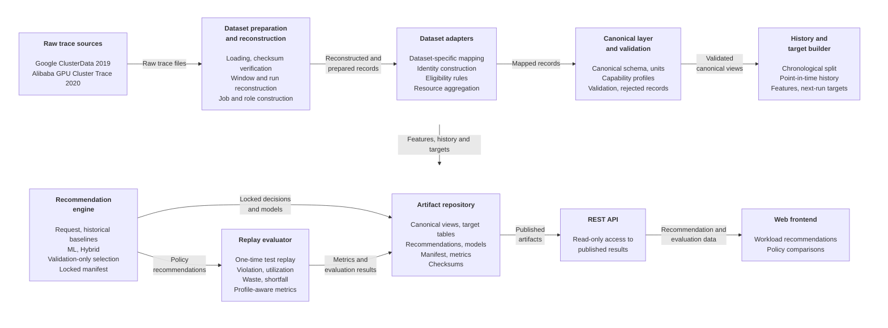

# Chapter 2. Project Architecture

## 2.1 Introduction and System Overview

**The resource-sizing problem.** Before a job runs on a shared cluster, its owner states how much CPU and memory it needs. These requests are often far from actual use. A request that is too low leads to throttling or termination; one that is too high reserves capacity that no other job can use. Many cluster jobs recur, running the same workload repeatedly, so the usage of earlier runs is evidence about the next one.

**Goal.** TraceAdvisor recommends CPU and memory for the next run of a recurring workload, using only information available before that run starts. Seven policies are produced and compared: the user's current request; the mean and the 90th, 95th and 99th percentiles of earlier usage; a machine learning (ML) prediction; and a Hybrid policy that takes the larger of the ML prediction and a historical baseline.

**Datasets.** The system is applied to two datasets. Google ClusterData 2019 is the primary dataset, on which the method was developed. Alibaba GPU Cluster Trace 2020 is the second fully integrated dataset. Of the twelve Alibaba traces examined, it is the only one that provides both an official recurrence tag and a memory peak in the same unit as the memory request. Each dataset has its own pipeline and models, and the datasets are never merged. Three Azure traces (Resource Central, Splitwise and ModServe) were used for earlier baseline experiments. They were not processed through the TraceAdvisor adapter and evaluation pipeline, because none of them describes recurring jobs with a per-job resource request and per-job usage.

**Offline replay.** TraceAdvisor is evaluated offline. Each trace is replayed in time order: for every occurrence of a recurring workload, a recommendation is made from what was known before it started and is then compared with what the next run actually used. Selection decisions are made on a validation period and locked before a held-out test period is scored once.

**Dataset-specific and shared components.** Only the first stages of the system depend on the dataset. Each trace is loaded, reconstructed into runs of recurring workloads and mapped by a dataset adapter into a common canonical schema. From the canonical views onward, every component is shared: the history and target builder, the recommendation engine, the evaluator and the artifact repository. Adding a dataset therefore requires a new loader and adapter, not a new pipeline.

**Artifact-driven workflow.** Each stage reads files written by the previous stage and writes new files. The checksums of the inputs, the code version and the library versions are recorded with the outputs: for every stage of the Alibaba pipeline, and in the decision manifest that governs the final test of the Google pipeline. Any reported number can be traced back to the data, code and environment that produced it.

**Presentation.** A REST API exposes the published results, and a web frontend built on it lets developers browse workloads, view their recommendations and compare policies. Figure 2.1 shows the overall architecture.

**Figure 2.1** TraceAdvisor architecture

## 2.2 Architecture Subsystems

The architecture is divided into six subsystems. Table 2.1 summarizes the contract of each: what it is responsible for, what it consumes and what it produces. The boundaries between them are as important as their responsibilities: adapters never create prediction targets, the evaluator never selects a policy, and no selection step reads test data. The design of each subsystem is described in Chapter 4 and its implementation in Chapter 5.

**Table 2.1** Subsystem contracts

| Subsystem | Main responsibility | Input | Output |
|---|---|---|---|
| Data ingestion and dataset adapters | Load and verify raw traces; map them to the canonical schema | Raw trace files | Validated canonical views, rejected records, provenance metadata |
| Execution reconstruction and occurrence modeling | Build runs of recurring workloads at the evaluation level | Ingested records | Occurrence-level (Google) and role-occurrence-level (Alibaba) records |
| Historical features and time-ordered data | Split chronologically; build point-in-time history and next-run targets | Canonical views | Split tables with history, features and targets |
| Recommendation engine | Produce baseline, ML and Hybrid recommendations; select on validation | Features, history statistics and requests | Recommendations per policy; locked decisions |
| Shared metrics and evaluation framework | Score every policy with the same metrics | Recommendations and actual usage | Metrics, summaries and evaluation reports |
| Artifact repository and presentation layer | Store verified results; expose and display them | Published artifacts | API responses and frontend views |

### 2.2.1 Data Ingestion and Dataset Adapters

This subsystem turns each raw trace into validated canonical views that the shared stages can use without knowing which dataset they came from. Source loading reads and verifies the raw files. A canonical schema defines common field names, units and record levels, and a capability profile for each dataset declares what that dataset can provide. Dataset adapters, built on a shared adapter framework, map the prepared data into the schema and validate it against the profile. The outputs are canonical views, a record of rows that could not be used, and provenance metadata. It is the only subsystem that knows source file layouts and column names, and it never creates prediction targets or split labels.

### 2.2.2 Execution Reconstruction and Occurrence Modeling

Neither trace records the unit that a recommendation is made for, so this subsystem builds it as part of dataset preparation, before canonicalization. For Google, usage windows are reconstructed into executions and then into occurrences of recurring workloads. For Alibaba, each job is broken into its task roles and the instances that ran them. In both datasets a recurrence key links the occurrences of one workload. The output is one evaluation row per occurrence (Google) or per role within a job (Alibaba), which the adapters then map into the canonical views.

### 2.2.3 Historical Features and Time-Ordered Data

Because recommendations must be made before a run starts, this subsystem places every evaluation row in time. It splits the rows chronologically into training, validation and test sets, builds each row's history from earlier completed runs of the same workload, and attaches the next run's usage as the target to be predicted. Its outputs, split tables with history, features and targets, are the only input to the recommendation engine, so every later stage inherits its time ordering.

### 2.2.4 Recommendation Engine

The recommendation engine produces a CPU and a memory recommendation for every row under each of the seven policies: the current request, four historical baselines, an ML prediction and the Hybrid policy. It computes the baselines from each row's point-in-time history and fits the models on the training set, selects among them on the validation set only, and writes the chosen configuration to a decision manifest that is locked before the test set is read. Its outputs are recommendations for every policy and split, the fitted models and the locked decisions.

### 2.2.5 Shared Metrics and Evaluation Framework

A single evaluator scores every policy on both datasets with the same formulas: violation, utilization, waste and shortfall, for CPU and memory separately. The dataset's capability profile decides how results are labeled and which metrics may be reported. The evaluator only scores; selecting policies is left to the recommendation engine. After the decisions are locked, it scores the test set once.

### 2.2.6 Artifact Repository and Presentation Layer

Every stage writes its outputs as files, and the checksums of the inputs, the code version and the library versions are recorded per stage on Alibaba and in the decision manifest on Google, so any result can be traced to the data and code that produced it. The artifact repository holds these outputs, from canonical views to final results. A REST API exposes the published recommendations and evaluation results, and a web frontend built on it lets developers browse workloads, view their recommendations and compare policies. The presentation layer only reads published results; it does not run the pipeline or change any artifact.
