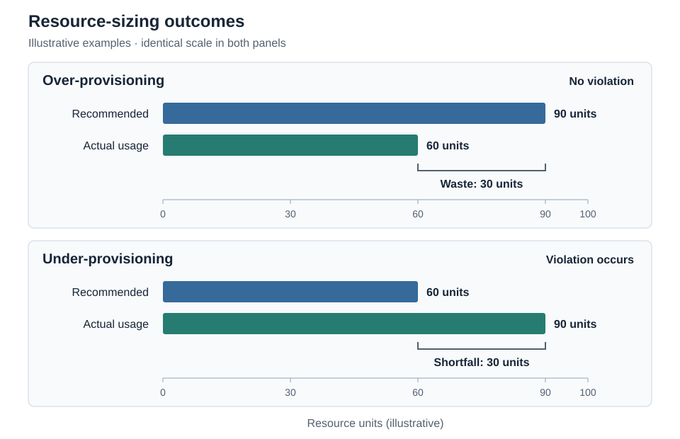

# Chapter 6. Testing and Verification

## 6.1 Data and Pipeline Correctness Checks

Testing and verification are important in TraceAdvisor because the system relies on historical workload data to generate CPU and memory recommendations. Before using this data for training and evaluation, the pipeline must ensure that records are processed correctly, resource measurements are calculated consistently, and missing values are handled appropriately. TraceAdvisor uses schema validation, notebook assertions, automated tests, and saved pipeline reports to verify these steps. Automated tests define expected behavior, while the verification outcomes reported here come from saved notebook outputs and pipeline reports; no fresh test-suite run is claimed.

The shared canonical schema checks required columns, timestamps, resource measurements, validity labels, and dataset identifiers. Additional checks verify record uniqueness, recurrence-key consistency, and rejected records. These validations help maintain a consistent data structure across Google ClusterData2019 and Alibaba GPU 2020, despite differences in their workload information and processing methods.

For Google ClusterData2019, initial data-quality checks examined 405,894 observations and found no duplicate observation keys or cases where peak usage was lower than average usage when both were available. Execution reconstruction checks identified 253,585 unique executions, with no negative runtimes or missing recurrence keys. These results support the internal consistency of the reconstructed data, although they do not independently confirm the accuracy of every workload recurrence.

Historical resource profiles were also verified through independent calculations. Since multiple executions can belong to the same workload occurrence, CPU and memory usage were aggregated across aligned observation windows. The saved checks showed agreement across all 4,879 occurrences and recorded 87,822 historical statistic comparisons. At the Google profile-construction stage, missing resource measurements and unavailable cold-start statistics remained missing rather than being treated as zero usage. Temporal validation is discussed further in Section 6.2.

For Alibaba GPU 2020, verification focuses on source integrity, record linkage, and resource aggregation. Source files are checked using checksums, row counts, and file metadata, while adapter tests verify relationships between jobs, task roles, and worker instances. The saved reconciliation report showed no differences between source counts and accepted-plus-rejected records. It also identified 461,900 eligible role occurrences, including 1,224 with missing CPU measurements, demonstrating the importance of evaluating CPU and memory validity separately.

The datasets also use different aggregation methods. Google calculates workload-level resource peaks across observation windows, while Alibaba uses maximum worker measurements at per-instance task-role scope. Alibaba CPU measurements represent lifetime averages, whereas memory measurements represent lifetime peaks. Tests check these aggregation rules and the preservation of missing resource observations. This differs from Alibaba ML input preparation, which fills missing feature values with zero and adds missingness indicators for historical features.

Finally, saved output checks verify file integrity, row counts, and column structures. However, some limitations remain. Google's production adapter is incomplete, and some local artifacts differ from the recorded final-run manifest. Independent end-to-end verification for Alibaba also remains incomplete. Therefore, the existing checks support the correctness of specific processing steps, but complete reproduction of the final evaluation has not yet been established.

Table 6.1 summarizes the main verification results recorded for both datasets.

**Table 6.1. Summary of saved data and pipeline verification results.**

| Verification Check | Recorded Result |
| --- | --- |
| Google observation uniqueness | 405,894 observations; no duplicate keys |
| Google execution reconstruction | 253,585 unique executions |
| Google occurrence aggregation | 4,879 occurrences checked |
| Google historical statistics | 87,822 comparisons |
| Alibaba eligible role occurrences | 461,900 |
| Alibaba source row reconciliation | Zero count differences |

*Note: Results are based on saved notebook outputs and pipeline reports rather than a newly executed test suite.*

## 6.2 Temporal Leakage and Split Integrity

Temporal correctness is important in TraceAdvisor because resource recommendations should only use information available before a workload begins. To reduce data leakage, the pipeline checks chronological data splits, historical feature eligibility, and the separation between model inputs and prediction targets.

Both Google ClusterData2019 and Alibaba GPU 2020 use chronological training, validation, and test splits of approximately 70%, 15%, and 15%. Records with the same splitting timestamp are kept together, and validation checks ensure that the partitions contain distinct records in chronological order. These checks help prevent future records from being included in earlier training partitions, although workload execution times may overlap across split boundaries.

Historical CPU and memory profiles are calculated using previously completed workload occurrences. For Google, an occurrence must have started earlier and completed before or when the current occurrence begins. Simultaneous occurrences cannot contribute to each other's history. Alibaba follows similar completion requirements but uses deterministic ordering to handle occurrences with identical submission times, including zero-duration executions. Tests verify these conditions and ensure that missing resource measurements are handled separately for CPU and memory.

Additional checks prevent future information from being included in model features. Only approved input columns are used, while outcome-related fields are excluded. Google also applies chronological training-label cutoffs and cross-validation checks to limit the use of future targets during model training. These cutoffs use the successor's start time and do not independently establish that its complete usage measurement was available by the cutoff.

However, a limitation was identified in Google's validation process. Because prediction targets are constructed before splitting, 104 of 329 common validation occurrences have targets that begin in the test period. This means that some test-period outcomes influence validation comparisons and model selection. A preliminary sensitivity analysis examines the remaining 225 occurrences, but it does not fully resolve the limitation.

Alibaba uses stricter target separation by requiring the next eligible workload occurrence to belong to the same data split. If the next occurrence falls into another split, its target is left missing rather than using information from that partition. This helps maintain separation between validation and test outcomes.

Overall, these checks support the temporal consistency of historical features and data partitions. However, the identified Google validation limitation means that the evaluation cannot be considered completely free of temporal leakage.

## 6.3 Model and Baseline Validation

TraceAdvisor validates its recommendation methods by comparing existing resource requests, historical baselines, machine learning predictions, and Hybrid recommendations against recorded workload usage. CPU and memory recommendations are evaluated separately to determine how well each method balances resource-sizing reliability and efficiency.

Baseline comparisons include the original Request baseline and historical Mean, P90, P95, and P99 recommendations calculated from previous workload occurrences. When sufficient usable history is unavailable, historical recommendations fall back to the original request. Validation checks ensure that historical calculations are consistent, missing values are handled correctly, and baseline comparisons use appropriate evaluation records.

Machine learning models are validated using separate training and validation data. For Google ClusterData2019, decision tree, random forest, and XGBoost regression models are evaluated using chronological cross-validation and validation prediction errors. Google selects models using validation root mean squared error (RMSE) on the logarithmic target scale, while Alibaba GPU 2020 primarily uses validation RMSE in the original resource units to compare regression models. CPU and memory models are selected independently because the best-performing model may differ between resources.

Hybrid recommendations combine machine learning predictions with historical safeguards to reduce the risk of under-provisioning. The Hybrid policy selects the larger value between the ML prediction and a historical baseline. Google uses historical P95 as its safeguard, while Alibaba uses its selected P99 baseline. Tests verify that these recommendations follow the intended rule and handle missing or invalid inputs appropriately.

Model and policy selection is intended to use validation data, while the test set is reserved for final evaluation. Saved comparison results and model-selection records document these stages. However, the Google validation-target leakage discussed in Section 6.2 limits the independence of its evaluation. The artifact and verification limitations described in Section 6.1 also constrain claims of complete reproducibility.

## 6.4 Replay Evaluation Metrics

TraceAdvisor evaluates resource recommendations through offline replay by comparing recommended CPU and memory resources against recorded workload usage. A shared evaluator calculates consistent metrics across Request, historical baselines, ML, and Hybrid policies. These metrics help measure resource-sizing reliability and efficiency while accounting for differences between datasets. However, replay evaluation does not simulate actual workload scheduling or application performance.

**Figure 6.1. Illustration of resource waste and shortfall under over-provisioning and under-provisioning.**

*Note: Values are illustrative and do not represent actual TraceAdvisor evaluation results.*

### 6.4.1 Violation and Utilization

A resource violation occurs when actual CPU or memory usage exceeds the recommended amount. Violation rates express insufficient recommendations as percentages of valid comparisons, while utilization measures how much of the recommended capacity is used.

Utilization is calculated as actual usage divided by recommended resources, capped at 100%. Any usage exceeding the recommendation is captured through violation and shortfall metrics rather than utilization.

Google evaluates workload-level resource peaks, while Alibaba uses lifetime-average CPU usage and lifetime-peak memory usage. Therefore, Alibaba CPU results represent average resource usage rather than peak demand. Unlike Google, Alibaba does not report a combined CPU-or-memory violation metric because the measurements have different meanings.

### 6.4.2 Resource Waste

Resource waste measures the amount of recommended capacity that exceeds actual usage. When actual usage is greater than the recommendation, the difference is instead recorded as a resource shortfall. These metrics help distinguish between over-provisioning and under-provisioning.

CPU and memory waste are calculated separately using their respective resource units. The evaluator averages valid record-level differences rather than weighting them by workload duration. Because Google and Alibaba use different measurement methods, their waste values should not be directly compared.

### 6.4.3 Valid-Row Denominators and Missing-Value Handling

TraceAdvisor evaluates metrics using only records with valid resource measurements and recommendations. Different metrics may have different valid record counts depending on their calculation requirements.

Violation calculations include valid comparisons even when the recommendation is zero. However, utilization requires finite inputs and a recommendation above a small positive threshold, excluding zero and extremely small recommendations. Missing or invalid measurements are excluded rather than treated as zero usage.

The evaluator tracks valid record counts for violation and utilization metrics. Waste and shortfall counts are also supported, although some saved evaluation outputs do not explicitly include them. These checks help ensure that reported results reflect available measurements rather than missing or invalid data.
