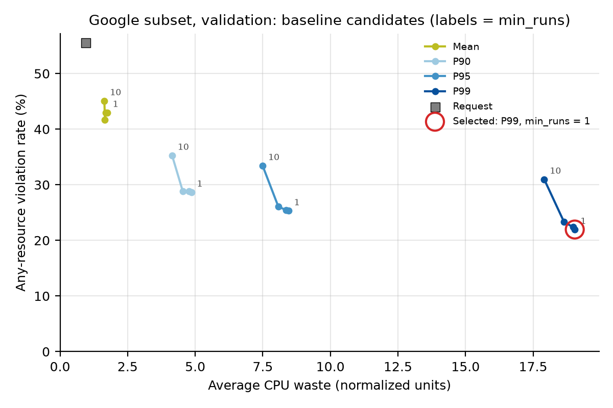
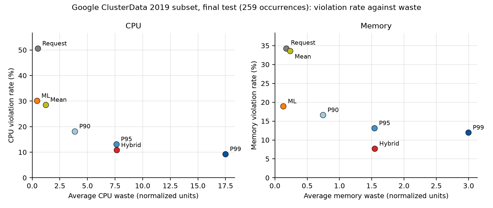

# Chapter 7. Performance, Results, and Discussion

This chapter presents TraceAdvisor’s offline evaluation results, focusing on the tradeoff between under-provisioning and excess resource allocation. Preliminary studies using Azure Resource Central traces examine historical CPU baselines, while Google ClusterData 2019 serves as the primary evaluation dataset and Alibaba GPU 2020 provides a second recurring-workload evaluation. Validation results are used to describe policy and model selection, while final-test results assess the selected approaches. The chapter also compares findings across datasets and discusses evaluation limitations.

## 7.1 Preliminary Baseline Studies on Azure Traces

The preliminary Azure Resource Central study evaluates CPU resource allocation using a sample of 100,000 CPU readings from 100,000 virtual machines. Global Mean, P90, P95, and P99 thresholds were calculated using the sampled average CPU readings and evaluated against the same observations. Because the thresholds were derived from the evaluation sample itself, these results represent an in-sample baseline comparison rather than validation or final-test performance on future workload occurrences.

*Table 7.1. Preliminary Azure Resource Central CPU baseline results. Provisioned CPU is expressed as a percentage, and the utilization proxy is calculated as the mean sampled CPU demand divided by the provisioned threshold.*

| Baseline | Provisioned CPU (%) | Violation rate (%) | Utilization proxy (%) |
| --- | --- | --- | --- |
| Mean | 8.62 | 20.67 | 100.00 |
| P90 | 20.10 | 10.00 | 42.90 |
| P95 | 38.81 | 5.00 | 22.21 |
| P99 | 90.28 | 1.00 | 9.55 |

Higher CPU thresholds reduce the proportion of sampled readings that exceed the provisioned resources, but also lower the utilization proxy. Because these thresholds were calculated from the same sample used for evaluation, the resulting violation rates primarily reflect the distribution of the sampled data. Additionally, the utilization proxy differs from the average bounded utilization metric used in the Google and Alibaba evaluations.

The VM-level analysis shows a mean difference of 6.977 percentage points and a median difference of 2.295 percentage points between P95 and mean CPU usage. Mean-based and P95-based CPU bucket assignments agree for 87.11% of the sampled virtual machines. However, this agreement reflects consistency between the two classification methods rather than predictive accuracy on unseen data.

An important limitation is that each sampled VM contains only one reading. The reported P95 is derived from the reading's maximum CPU field, while the mean is derived from its average CPU field. Consequently, these measurements do not represent long-term historical CPU percentiles for individual VMs. Although these preliminary studies illustrate the tradeoff between resource allocation and utilization, they do not establish recurrence-based memory, ML, or Hybrid evaluation results.

## 7.2 Google ClusterData 2019 Results

The Google experiment uses a Kaggle sample of ClusterData 2019. Resource recommendations are evaluated against the next workload occurrence’s peak CPU and memory usage, expressed in Google’s normalized resource units. The saved evaluation includes 329 validation occurrences and 259 final-test occurrences with valid CPU and memory targets. These results reflect occurrence-level evaluations of the sampled dataset rather than the complete Google trace. Additional evaluation limitations are discussed in Section 7.5.

A violation occurs when actual resource demand exceeds the recommended allocation. An any-resource violation occurs when either CPU or memory demand exceeds its recommendation. Waste measures unused recommended capacity, while shortfall measures demand exceeding the recommendation; both are averaged across valid observations. Utilization is calculated as the ratio of actual demand to recommended resources, capped at 100%. Consequently, high utilization does not necessarily indicate effective resource allocation, as it can occur alongside frequent violations. These metrics evaluate offline resource-sizing performance and do not directly measure application latency, scheduling efficiency, or actual financial savings.

### 7.2.1 Baseline Recommendation Results

The baseline comparison includes Request, Mean, P90, P95, and P99. Request uses the originally declared CPU and memory resource requests, while the remaining policies calculate recommendations using statistics from previously completed workload occurrences. When sufficient historical data is unavailable, these policies fall back to the original resource requests.

During validation, P99 with `min_runs = 1` was selected because it achieved the lowest any-resource violation rate among the evaluated baseline candidates. This selection was based on validation performance and is separate from the final-test results presented in Table 7.2.

*Table 7.2. Google final-test baseline results. Violation rates are expressed as percentages, while average waste is measured in normalized CPU or memory units.*

| Policy | CPU violation (%) | Memory violation (%) | Any-resource violation (%) | CPU waste | Memory waste |
| --- | --- | --- | --- | --- | --- |
| Request | 50.58 | 34.24 | 54.47 | 0.498 | 0.176 |
| Mean | 28.57 | 33.59 | 38.22 | 1.226 | 0.235 |
| P90 | 18.15 | 16.60 | 22.78 | 3.847 | 0.744 |
| P95 | 13.13 | 13.13 | 17.37 | 7.616 | 1.541 |
| P99 | 9.27 | 11.97 | 14.67 | 17.483 | 2.994 |

The final-test evaluation includes 259 workload occurrences. The Request baseline has 257 valid observations for each violation rate, while the remaining baseline policies have 259. Missing recommendations are excluded from the calculations rather than treated as nonviolations.

Request has the highest CPU and memory violation rates, indicating that declared resource requests frequently fall below the next occurrence’s observed peak usage. Mean improves reliability but still results in substantial under-provisioning. Moving from Mean to higher-percentile baselines progressively reduces violation rates while increasing average resource waste. P99 achieves the lowest CPU and memory violation rates among the historical baselines, although its average resource waste is considerably higher than P95.

This tradeoff reflects how percentile-based recommendations are calculated. Higher percentiles account for occasional spikes in historical resource usage by recommending greater capacity, which can reduce the likelihood of under-provisioning. However, this additional capacity may remain unused when actual demand is lower. These findings illustrate the tradeoff between reliability and resource efficiency rather than identifying a single baseline that performs best across all metrics.

Figure 7.1 illustrates the validation results used for baseline selection, while Table 7.2 presents the separate final-test results.

***Figure 7.1.** Google ClusterData 2019 subset validation results showing any-resource violation rate versus average CPU waste for the evaluated baseline candidates. Endpoint labels indicate the `min_runs` parameter, while the red circle highlights the selected P99 candidate with `min_runs = 1`. Validation-target leakage is discussed in Section 7.5.*

### 7.2.2 ML and Hybrid Recommendation Results

Random Forest was selected independently for CPU and memory based on the lowest validation root mean squared error (RMSE) on the log1p scale among the evaluated Decision Tree, Random Forest, and XGBoost models. For CPU, Random Forest achieved a validation RMSE of 0.850, compared with 0.860 for XGBoost and 0.891 for Decision Tree. For memory, Random Forest achieved an RMSE of 0.387, compared with 0.439 for XGBoost and 0.421 for Decision Tree.

Although Random Forest achieved the lowest validation errors among the evaluated models, its predictive performance on the original resource scale was limited, with R² values of −0.005 for CPU and 0.107 for memory. These measurements reflect validation performance and should not be interpreted as final-test regression results.

Following model selection, the selected Random Forest models were retrained using eligible training and validation data before generating final-test predictions. The ML policy uses the model predictions directly, while the Hybrid policy recommends the maximum of the ML prediction and the historical P95 recommendation for each resource. When a historical P95 recommendation is unavailable, Hybrid uses the ML prediction alone. The P95 safeguard was established in advance and differs from the P99 baseline selected during validation.

***Table 7.3.** Google ClusterData 2019 final-test comparison of ML, Hybrid, and historical baseline recommendations. Paired values represent CPU and memory, respectively. Utilization is expressed as a bounded ratio, while waste and shortfall are measured in normalized resource units.*

| Policy | CPU violation (%) | Memory violation (%) | Any-resource violation (%) | Utilization (CPU / memory) | Waste (CPU / memory) | Shortfall (CPU / memory) |
| --- | --- | --- | --- | --- | --- | --- |
| P95 | 13.13 | 13.13 | 17.37 | 0.278 / 0.342 | 7.616 / 1.541 | 0.371 / 0.043 |
| P99 | 9.27 | 11.97 | 14.67 | 0.233 / 0.297 | 17.483 / 2.994 | 0.220 / 0.039 |
| ML | 30.12 | 18.92 | 32.82 | 0.431 / 0.312 | 0.424 / 0.130 | 1.065 / 0.165 |
| Hybrid | 10.81 | 7.72 | 12.36 | 0.242 / 0.190 | 7.637 / 1.546 | 0.365 / 0.042 |

All reported violation rates are based on 259 valid observations. CPU utilization is calculated using 258 observations for P95 and P99 and 259 for ML and Hybrid, while memory utilization is calculated using 259 observations for all four policies.

Hybrid achieves the lowest any-resource violation rate at 12.36%, compared with 14.67% for P99 and 17.37% for P95. It also achieves the lowest memory violation rate among the evaluated policies. Compared with its P95 safeguard, Hybrid reduces violation rates with only a small increase in average resource waste. Compared with P99, Hybrid achieves both lower average waste and fewer any-resource violations. However, P99 maintains a lower CPU violation rate and lower average shortfall for both CPU and memory.

ML alone produces the lowest average CPU and memory waste, but its any-resource violation rate remains high at 32.82%. Its average CPU and memory shortfalls are also substantially greater than those of Hybrid. These findings indicate that reducing resource waste does not necessarily result in reliable recommendations. By incorporating the historical P95 safeguard, Hybrid provides more conservative resource recommendations, although its lower bounded utilization reflects the additional capacity recommended to reduce under-provisioning. These findings are based on the saved final-test evaluation and do not establish statistical significance or generalizability across repeated experiments.

Figure 7.2 illustrates the resource-specific tradeoffs between violation rates and average waste observed during final-test evaluation, complementing the results presented in Tables 7.2 and 7.3.

***Figure 7.2.** Google ClusterData 2019 subset final-test results showing CPU (left) and memory (right) violation rates versus average resource waste in normalized units. The evaluation includes 259 workload occurrences, although the number of valid observations varies by policy and metric. The resource-specific violation rates shown are distinct from the any-resource violation rate.*

### 7.2.3 Feature Importance and Explainability

Feature-importance results were not available in the saved evaluation artifacts. Without verified feature-importance or explainability analyses, it is not possible to determine which features contributed most strongly to the final Google models’ predictions. Therefore, feature-importance analysis remains an incomplete component of the evaluation.

The models use features such as current CPU and memory requests, execution count, request diversity, prior completed occurrence count, and historical CPU, memory, and runtime statistics. These features represent both current resource requirements and patterns observed in previously completed workload occurrences. Although these inputs provide context for the models’ predictions, their inclusion does not establish which features have the greatest influence on the resulting recommendations.

The Hybrid policy provides a degree of interpretability through its explicit decision rule. It uses the historical P95 recommendation as a safeguard, recommending a higher resource amount only when the ML model predicts a greater requirement. Although this rule makes the final resource recommendation easier to interpret, it does not explain how individual features influence the ML model’s predictions. Therefore, no feature rankings or feature-importance figures are presented.

## 7.3 Alibaba GPU 2020 Results

The Alibaba GPU 2020 dataset was evaluated using historical baseline policies, machine learning (ML) predictions, and Hybrid recommendations. The validation dataset contains 42,069 valid memory targets and 41,913 valid CPU targets, while the final-test dataset contains 44,053 valid memory targets and 44,045 valid CPU targets. To preserve chronological separation, next-occurrence targets are restricted to successors within the same data split. The results represent eligible completed workload roles with sufficient memory telemetry.

### 7.3.1 Baseline Recommendation Results

During validation, P99 with `min_runs = 10` was selected using a memory-first ranking that prioritized memory violation rate, memory waste, CPU violation rate, and CPU waste, in that order. Request was included as a reference policy but was not eligible for selection. At the selected history threshold, P99 achieved a validation memory violation rate of 5.58% and average memory waste of 8.941 GB, compared with 4.74% and 22.255 GB for Request. Although P99 reduced average memory waste, Request achieved a lower memory violation rate during validation.

Table 7.4 presents the validation and final-test results separately. All historical baseline policies shown use `min_runs = 10` and fall back to the original resource request when sufficient historical data is unavailable.

***Table 7.4.** Alibaba GPU 2020 baseline, ML, and Hybrid policy results for validation and final-test evaluation. Validation results were used for policy selection, while final-test results were used to evaluate the selected policies. Violation rates are reported as CPU / memory percentages. CPU targets represent the maximum lifetime-average CPU usage across instances within a workload role, while average memory waste is measured in GB per instance. ML and Hybrid results are discussed in Section 7.3.2.*

| Split | Policy | Violation (CPU / memory, %) | Memory waste (GB) |
| --- | --- | --- | --- |
| Validation | Request | 15.52 / 4.74 | 22.255 |
| Validation | Mean | 40.84 / 39.90 | 6.851 |
| Validation | P90 | 12.25 / 12.40 | 7.803 |
| Validation | P95 | 9.00 / 8.46 | 8.260 |
| Validation | P99 | 6.62 / 5.58 | 8.941 |
| Validation | ML | 41.91 / 47.76 | 1.903 |
| Validation | Hybrid | 4.60 / 5.15 | 9.141 |
| Final test | Request | 16.71 / 3.16 | 22.313 |
| Final test | Mean | 41.83 / 37.02 | 6.451 |
| Final test | P90 | 12.41 / 9.89 | 7.440 |
| Final test | P95 | 9.10 / 6.04 | 7.895 |
| Final test | P99 | 6.45 / 3.44 | 8.668 |
| Final test | ML | 47.37 / 44.77 | 1.328 |
| Final test | Hybrid | 3.77 / 3.15 | 8.707 |

### 7.3.2 ML and Hybrid Recommendation Results

HistGradientBoosting was selected independently for CPU and memory based on validation RMSE among candidate models evaluated with fixed settings. The selected models achieved validation RMSE values of 412.94 in percent-of-vCPU units for CPU and 8.98 GB for memory, with R² values of 0.758 and 0.529, respectively. These measurements reflect validation performance used for model selection, not final-test regression performance.

Unlike the Google evaluation, which uses historical P95 as its Hybrid safeguard, Alibaba uses the validation-selected P99 baseline. For each resource, Hybrid recommends the maximum of the ML prediction and the historical P99 recommendation. Following model selection, the selected models were retrained using the combined training and validation data before generating final-test predictions.

During validation, Hybrid achieved CPU and memory violation rates of 4.60% and 5.15%, compared with 41.91% and 47.76% for ML alone. Because these results were obtained from the model-selection split, they should not be interpreted as independent test evidence. The separate final-test results in Table 7.4 show that Hybrid maintains lower violation rates for both resources, while ML alone remains substantially more prone to under-provisioning.

In the final-test evaluation, Hybrid achieved a memory violation rate of 3.15%, compared with 3.44% for P99, 6.04% for P95, 9.89% for P90, and 37.02% for Mean. Request achieved a similar memory violation rate of 3.16%, but produced substantially greater average memory waste at 22.313 GB, compared with 8.707 GB for Hybrid and 8.668 GB for P99.

Hybrid also achieved a CPU violation rate of 3.77%, compared with 6.45% for P99, 16.71% for Request, and 47.37% for ML. However, Alibaba CPU targets represent the maximum lifetime-average CPU usage across instances within a workload role, rather than peak CPU demand. Therefore, these results evaluate average-usage resource sizing and do not establish protection against CPU usage peaks.

ML alone produced the lowest average memory waste at 1.328 GB, but had a substantially higher memory violation rate of 44.77%. Hybrid also achieved a lower average memory shortfall of 0.197 GB, compared with 0.233 GB for P99 and 1.046 GB for ML.

Overall, the saved final-test results indicate that Hybrid improves reliability relative to its P99 safeguard with only a small increase in average memory waste. Although Request achieves a similar memory violation rate, its average memory waste is substantially higher. These findings are limited to the evaluated target definitions, and no combined CPU-or-memory violation rate is reported for Alibaba.

## 7.4 Analysis Across Datasets

*Table 7.5. Measurement definitions and evaluation scope across the reference and supporting datasets.*

| Dataset | Demand definition and scope | Saved evaluation scope | Interpretation boundary |
| --- | --- | --- | --- |
| Google ClusterData 2019 sample | Full-workload occurrence CPU and memory peaks in normalized units | Baseline, ML, Hybrid; validation and final test | Validation targets cross into the test period; local frozen-input mismatches remain |
| Alibaba GPU 2020 | Per-role maximum instance lifetime-average CPU, in percent of one vCPU; maximum instance lifetime memory peak, in GB | Baseline, ML, Hybrid; split-isolated targets and final test | CPU peak demand is unavailable; eligible completed roles with memory telemetry |
| ModServe | Image/text demand converted into required capacity units per window | Fixed and reactive capacity replay, including saved validation and test summaries | Capacity proxy experiment; no equivalent CPU/memory ML–Hybrid validation |
| Splitwise | Token demand per window | Fixed train-derived capacity baselines with saved test results | Token capacity differs from measured CPU or memory demand |
| Resource Central | Sampled VM CPU readings and derived CPU summaries | Descriptive CPU baselines and a separate classifier prototype | No equivalent recurring-workload memory and Hybrid final evaluation |

A key finding across the evaluated datasets is the tradeoff between resource reliability and efficiency. Historical percentile-based recommendations generally reduce resource violations at the cost of increased resource waste, while Hybrid combines ML predictions with historical safeguards to balance these objectives. However, violation rates cannot be directly compared across datasets because their resource targets, measurement units, aggregation methods, filtering criteria, and Hybrid safeguards differ.

ModServe provides fixed and reactive capacity replay experiments with separate saved validation and test summaries. Its image and text demand is converted into capacity units rather than measured as recurring-workload CPU or memory demand. Splitwise evaluates fixed capacities derived from training data against token-demand windows. Resource Central provides the preliminary CPU studies described in Section 7.1 and a separate classifier prototype. These experiments offer supporting evidence for demand analysis and resource-sizing tradeoffs, but they do not provide an equivalent end-to-end evaluation of baseline, ML, and Hybrid recommendations for the same resource prediction task as Google and Alibaba.

## 7.5 Discussion of Findings

The results show that historical baselines provide a useful reference for reliability, while ML alone reduces resource waste at the cost of higher violation rates. Hybrid achieves lower violation rates than its historical safeguard in both primary datasets. This is consistent with its design: by selecting the maximum of the ML prediction and the historical recommendation, Hybrid cannot recommend fewer resources than the safeguard when both are available.

The key consideration is how much additional protection Hybrid provides and how much additional capacity it requires. The results show a favorable tradeoff relative to the selected historical safeguards, although Hybrid does not outperform every alternative across all evaluation metrics.

The effectiveness of resource requests also varies across datasets. In Google, requested resources frequently fall below subsequent workload peaks, while Alibaba's memory requests achieve reliability comparable to Hybrid but produce substantially greater resource waste. These differences suggest that the usefulness of resource requests as a fallback depends on the resource-requesting practices represented in each dataset. Therefore, a single historical threshold or safeguard should not be assumed optimal across different platforms. Additionally, Alibaba's lifetime-average CPU measurements and role-level aggregation prevent direct numerical comparisons with Google's full-workload peak results.

An important limitation of the Google evaluation is temporal leakage during validation. Of the 329 validation occurrences, 104 have targets beginning in the test period because next-occurrence targets were assigned before the chronological split. When the evaluation is restricted to the 225 occurrences whose targets remain within validation, P99's any-resource violation rate changes from 21.95% to 18.30%, while Hybrid's changes from 17.93% to 17.78%. Although the selected baseline remains unchanged in this sensitivity analysis, it is not established whether the ML model-selection decisions would remain the same after correcting the leakage. Furthermore, because test-period outcomes contributed to validation, the final-test evaluation cannot be considered fully independent, even though final-test scoring occurred after the decisions were frozen.

Reproducibility is another limitation. An artifact verification review identified eight local Google files that differ from the frozen evaluation manifest, including occurrence tables, model metadata, prediction tables, and model files. Although the saved manifest matches the hash recorded in the final-test metadata, the current local artifacts do not fully reproduce the original evaluation environment. Consequently, the reported findings rely on the saved evaluation results rather than an independently reproduced execution. This discrepancy also limits the ability to generate additional explanations from the current local models without first verifying their relationship to the original evaluation.

Generalizability is further limited by the relatively small Google test population and its sampled trace. The Alibaba evaluation excludes unsuccessful or incompletely observed roles and primarily represents single-instance roles, limiting conclusions about broader distributed workloads. Additional limitations include the absence of verified feature-importance results and equivalent end-to-end evaluations across the supporting datasets. Furthermore, the available evidence does not include confidence intervals, repeated-seed experiments, or online deployment measurements. Therefore, the results do not establish statistical superiority, production-level performance improvements, or realized financial savings.