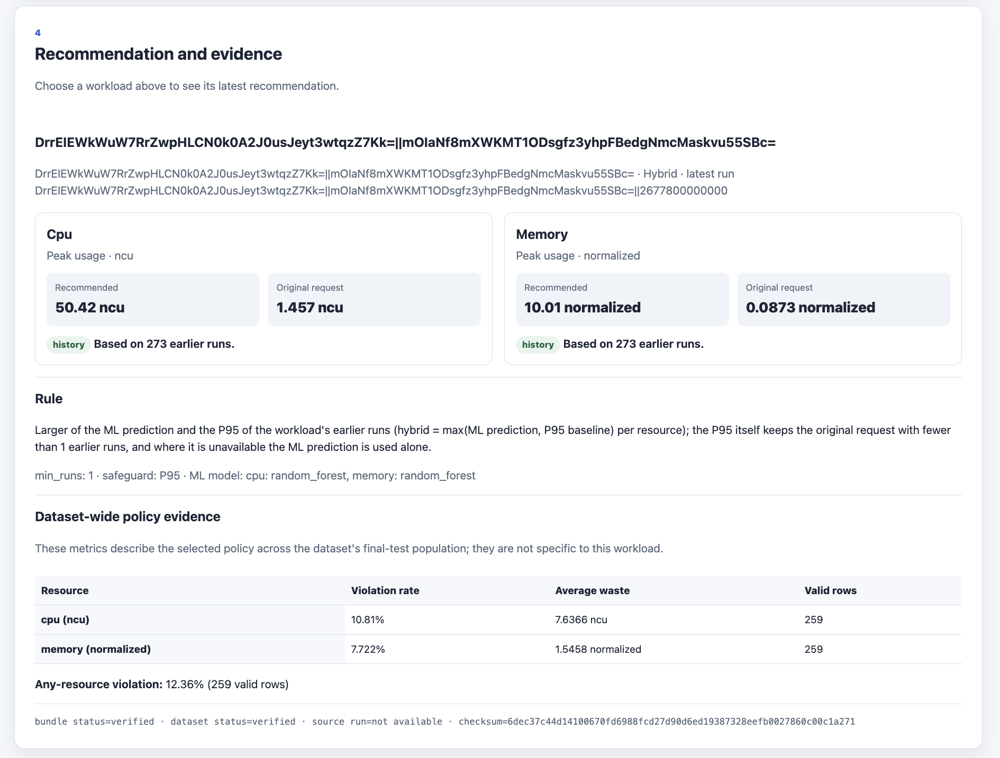
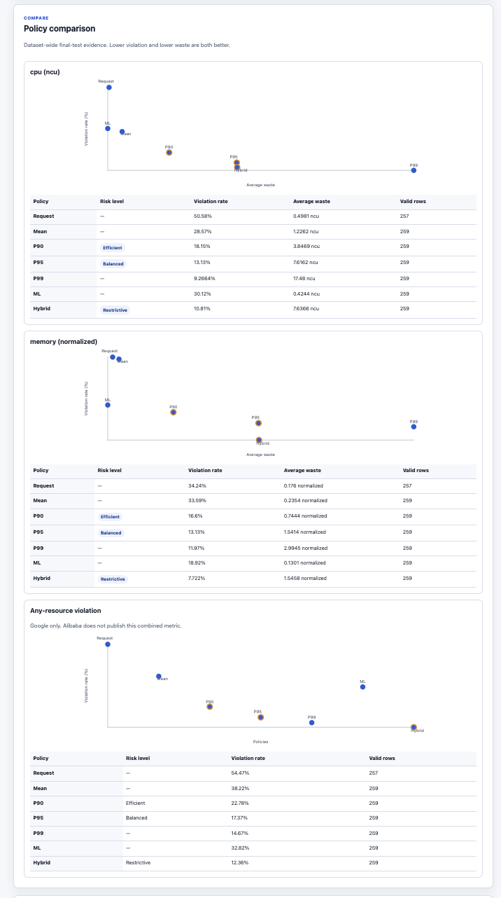

# Chapter 8. Operations, Reproducibility, and Future Deployment

This chapter describes how TraceAdvisor is run and how its reported results can be reproduced. Section 8.1 gives the run order for each dataset and the checks that protect a run, Section 8.2 the environment, repository layout and provenance records needed to reproduce the results, and Section 8.3 the planned developer-facing API and web frontend. The design of the artifact layer is described in Section 4.4 and its implementation in Section 5.6.

## 8.1 Offline Artifact Workflow

TraceAdvisor runs offline as a sequence of stages, each of which reads the outputs of the previous stage from disk and writes its own outputs as files. No stage depends on a running service, so a stage can be rerun or inspected on its own, and every reported number can be traced to the files that produced it.

**Google ClusterData 2019.** The Google pipeline consists of seven notebooks in `pipelines/google_subset/`, run in order with the locked `traceadvisor-lock` kernel. Notebook 00 reviews the quality of the raw Kaggle sample [Wilkes 2019]; Notebooks 01 to 04 ingest it into canonical observations, reconstruct executions, build point-in-time historical profiles, and create the chronological splits, next-occurrence targets and baselines; and Notebook 05 trains and selects the ML models. All outputs are written to `data/processed/google_subset_v1/`. Notebook 06 performs the final comparison in two steps. With `FREEZE_STATUS = "final"`, it writes a decision manifest that records the selected policy, the selected models and the SHA-256 checksums of thirteen inputs, including the prediction tables, the model files and the evaluation code. With `RUN_FINAL_TEST = True`, at the same commit, it then scores the test period once. Before scoring, the notebook checks that the manifest is final, that it was written at the current commit, that only the notebook itself is uncommitted, that the code hash and inputs match the manifest, and that no final-test result already exists (Section 6.2).

**Alibaba GPU 2020.** The Alibaba pipeline consists of five command-line scripts in `scripts/`, run in order from a clean checkout:

```
python scripts/build_alibaba_gpu_2020_canonical.py
python scripts/build_alibaba_gpu_2020_targets.py
python scripts/run_alibaba_gpu_2020_baselines.py
python scripts/run_alibaba_gpu_2020_ml.py
python scripts/run_alibaba_gpu_2020_final_test.py
```

The first script verifies the official tables against their published checksums and builds the canonical views [Alibaba 2020]; the second builds the next-occurrence targets for each split; the third evaluates the historical baselines and selects one on validation; the fourth trains, selects and locks the ML models and writes a decision manifest; and the fifth scores the test period. Because the canonical build reads the full official tables, it was run once and its output was shared with the team; each member then checks a copy with `--verify`, which compares the files against the `SHA256SUMS` file written at build time instead of rebuilding them.

Each script refuses to run on a working tree with uncommitted changes and refuses to overwrite an existing output directory. The options `--allow-dirty` and `--force` override these checks for development runs, and `--out-dir` writes to a different directory. The final-test script adds stricter checks: it verifies the checksums and fields of the decision manifest, requires the ML lock to have been built from a clean tree at the current commit, and records every run in a run log keyed by the manifest's checksum. A second run for the same manifest is refused, whatever the output directory, unless a defect is documented with `--defect-rerun-reason`, and the ML script refuses to replace a lock that has already been tested. These checks make the one-time test an enforced property of the workflow rather than a convention (Section 6.2).

On the reference machine, the published Alibaba run of 30 October 2026 took 56 seconds for the targets, 110 seconds for the baselines, 2 minutes 53 seconds for the ML stage, and 7 seconds for the final test.

## 8.2 Reproducibility and Repository Layout

**Environment.** The Google final run and the first Alibaba run used a locked Python 3.12 environment. The published Alibaba run (Section 6.2) used Python 3.11.15 with pandas 3.0.2, scikit-learn 1.8.0 and XGBoost 3.2.0; these versions are recorded in its decision manifest and differ from the lock file. `requirements-lock.txt` pins the exact version of every package, while `requirements.txt` keeps the minimum versions (Table 3.1). The environment is created as follows:

```
python3.12 -m venv ~/venvs/traceadvisor-lock
~/venvs/traceadvisor-lock/bin/python -m pip install -r requirements-lock.txt
~/venvs/traceadvisor-lock/bin/python -m ipykernel install --user --name traceadvisor-lock
```

The last command registers the kernel used by the Google notebooks. The test suite is run in the same environment with `pytest` (Chapter 6).

**Data.** Raw and processed data are not stored in the repository because of their size. The Google pipeline reads the Kaggle sample from `subset/borg_traces_data.csv`. The Alibaba pipeline reads the official cluster-trace-gpu-v2020 tables, whose archive and file checksums are recorded in `config/alibaba_gpu_2020_sources.json` and checked before any table is read. `scripts/verify_data_setup.py` checks that the data for either dataset is in place.

**Repository layout.** The repository separates reusable code, runnable pipelines, configuration and results:

- `src/`: the shared library, with the canonical schema, dataset adapters and sources, feature construction, baselines, models, policies and evaluation;
- `pipelines/google_subset/`: the Google notebooks;
- `scripts/`: the Alibaba command-line stages and setup checks;
- `config/`: dataset source checksums and capability profiles;
- `tests/`: the automated tests;
- `data/`: raw and processed data, local only;
- `reports/results/`: the final results for both datasets, with tables, figures and copies of the provenance records;
- `reports/eval/`: the earlier Azure baseline experiments (Section 7.1), kept for context and not part of the evaluated system;
- `docs/`: design notes, data analyses and this report.

Code, configuration, documentation and final results are versioned in Git, while data and model files remain local, as described in Section 4.4.

**Provenance records.** Each result can be traced to the data and code that produced it. On Google, the decision manifest records the selections and the checksums of the thirteen inputs, and `final_test_run_metadata.json` records the commit and manifest checksum of the test run. On Alibaba, every stage writes a `metadata.json` and a `SHA256SUMS` file, the canonical build writes a count report that reconciles output rows with the source tables, and the ML stage writes a decision manifest. The run log `ml/final_test_runs.jsonl` and the record `final_test/run_record.json` document the published test run, which is the second execution of the Alibaba final test (Section 6.2). Copies of these records are kept with the results in `reports/results/`.

**Reproduction limits.** Because each final test can be run only once per decision manifest, the published test results cannot be produced again in the same output location. They can be reproduced elsewhere from the same commit: the Google freeze and test from a clean checkout of `e59349e`, and the Alibaba ML lock and final test from a clean checkout of `ea6aa08`, the commit used for the published run, with the library versions recorded in its decision manifest. Building a new Alibaba ML lock produces a new decision manifest, which counts as a new experiment rather than a reproduction of the published one.

## 8.3 Developer-Facing API and Web Frontend

The presentation layer is implemented as a read-only FastAPI service over a versioned, checksummed UI bundle and a static HTML/CSS/JavaScript frontend served by the same process (Section 4.4, Figure 4.4). The frontend uses native SVG charts with accessible tables and reads only the Task 15 `/api/v1` endpoints; it does not calculate recommendations, policy metrics or result numbers in the browser.

The service loads the exported bundle from `reports/results/ui/` by default, verifies its checksums at startup, and exposes dataset metadata, risk mappings, paginated workload lookup, recommendations, workload history, policy metrics and bundle health. Every resource value is returned with its unit and semantics. In particular, Alibaba CPU is labelled as average usage rather than peak, Alibaba memory is presented before CPU, and missing values remain null and are displayed as not available. The service never runs the evaluation pipeline or modifies published results.

The web frontend lets a developer select Google ClusterData 2019 or Alibaba GPU 2020, search for a recurring workload and choose how much risk to accept (Figure 8.1). It offers three configuration-driven risk levels:

- **Restrictive** maps to Hybrid and is the default;
- **Balanced** maps to P95;
- **Efficient** maps to P90.

For the selected workload, the recommendation view places recommended CPU and memory beside the original request and explains the basis of each resource independently: history, request fallback or ML-only. It also shows the history count, the policy rule, the dataset-wide violation and waste evidence returned by the API, and provenance for the loaded bundle. When all risk levels produce the same answer because the workload does not yet have enough history, the interface says so explicitly rather than implying that the control changes the recommendation. The history view compares the recommendation made at run *i* with the observed usage of run *i + 1* and never plots a missing actual value as zero.



**Figure 8.1** Risk-based recommendation view from the verified bundle: selected workload, risk level, recommended CPU and memory, original request, per-resource basis, rule and dataset-wide policy evidence

A separate policy-comparison view shows all seven evaluated policies for the selected dataset (Figure 8.2). CPU and memory are presented separately; Google also includes the supported any-resource violation view. Restrictive, Balanced and Efficient are marked on the plots and the same values are repeated in accessible tables with valid-row denominators. The two datasets are never combined or ranked against each other.



**Figure 8.2** Policy comparison from the verified Google bundle: all seven policies with risk mappings, violation rates and valid-row counts

The UI can be run locally with one command, `uvicorn --factory src.service.api:create_app`, and uses the committed verified bundle for final screenshots and demonstrations. A fixture-backed development mode is available for automated tests and edge-case checks; development bundles are visibly marked and are not used for report figures. Because the presentation layer depends only on the published bundle, it remains decoupled from the raw traces and the evaluation pipeline. A later shadow-mode deployment could reuse the interface while comparing advisory recommendations with observed usage without changing the resources actually allocated (Section 9.3).
