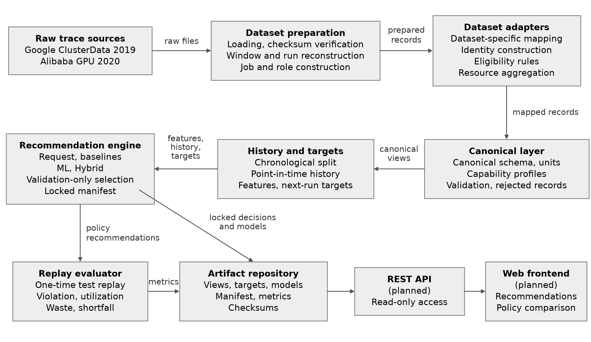
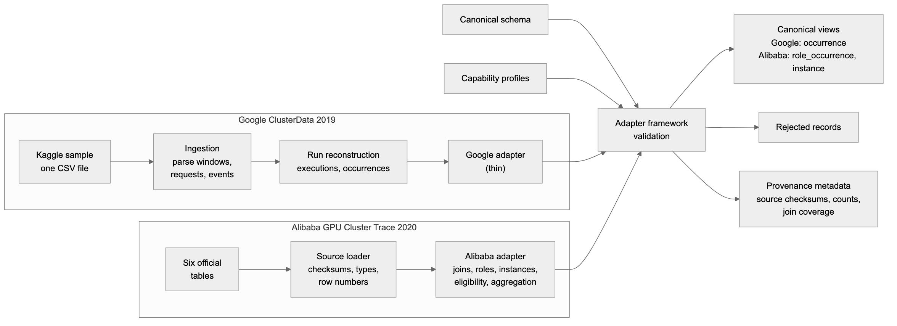
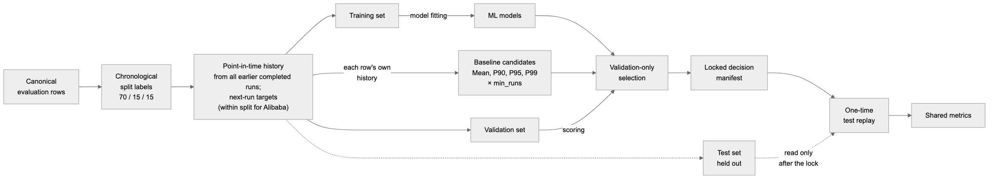
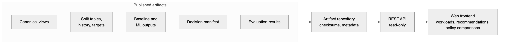

```{=openxml}
<w:p><w:r><w:br w:type="page"/></w:r></w:p>
```

# Abstract

Cloud and AI clusters often experience inefficient resource utilization because users must estimate CPU and memory requirements before execution. To avoid under-provisioning, which can lead to out-of-memory events, evictions, or job failures, users tend to request more resources than their workloads actually need. This results in over-provisioning and unused resource capacity in shared clusters. Although existing resource management approaches aim to improve resource efficiency, many operate at runtime, require scheduler modifications, or depend on online experimentation rather than providing recommendations before job submission.

This project presents TraceAdvisor, an offline, trace-driven system that generates pre-execution CPU and memory recommendations for recurring cluster workloads. The framework uses historical execution data to identify recurring workloads, reconstruct execution histories, and analyze resource usage patterns. TraceAdvisor compares original resource requests with historical statistical baselines, machine learning predictions, and a Hybrid recommendation policy. Historical statistics, including mean usage and high-percentile estimates such as P90, P95, and P99, help account for variations in resource demand. The Hybrid policy takes the larger of the machine learning prediction and a historical percentile, so that the prediction can raise but never lower the historical safeguard.

TraceAdvisor uses Google ClusterData 2019 as its primary dataset and Alibaba GPU 2020 as a second production dataset covering recurring machine learning workloads. The framework applies dataset-specific processing and evaluation methods to account for differences in workload structure and available CPU and memory measurements. Recommendations are evaluated through chronological trace replay using violation rate, shortfall, waste, and utilization to examine the trade-off between over-provisioning and under-provisioning, with every selection made on a validation period before a held-out test period is scored once. On the Google test period, the Hybrid policy had the lowest rate of CPU or memory violations, 12.36%, compared with 14.67% for the 99th percentile and 54.47% for the original requests. On Alibaba GPU 2020, it reduced the violation rate of its 99th-percentile safeguard from 6.45% to 3.77% for average CPU usage and from 3.44% to 3.15% for memory at almost the same memory waste. By using historical workload behavior without requiring changes to existing schedulers, TraceAdvisor provides a practical approach to supporting resource allocation decisions before execution.

**Keywords:** cluster workloads, CPU and memory recommendations, resource allocation, production traces, machine learning

```{=openxml}
<w:p><w:r><w:br w:type="page"/></w:r></w:p>
```

# Chapter 1. Project Overview

## 1.1 Introduction

Modern cloud and AI clusters often experience inefficient resource utilization because users must estimate CPU and memory requirements before execution. To avoid under-provisioning, which can lead to out-of-memory (OOM) events, eviction, or job failure, users tend to request more resources than their workloads actually need. This results in over-provisioning and unused resource capacity in shared clusters [1].

Production workload traces provide historical resource usage information that can help improve future allocation decisions. Studies such as Resource Central demonstrate that workload behavior can remain consistent across executions, making historical data useful for resource prediction [2]. Similarly, Accordia shows that recurring workloads can be optimized using information from previous executions [3]. These findings support the use of historical workload data to guide resource allocation decisions.

TraceAdvisor addresses resource allocation inefficiencies by providing CPU and memory recommendations before job submission. The framework uses historical execution data to identify recurring workloads, analyze resource usage patterns, and generate recommendations that account for higher resource demands. By providing guidance before execution rather than relying on runtime adjustments, TraceAdvisor aims to reduce unnecessary resource allocation while maintaining workload reliability.

## 1.2 Problem Statement

Existing resource management approaches attempt to address inefficient resource allocation through runtime optimization, provider-side scheduling, and configuration recommendations. For example, Flex proposes a runtime resource manager that uses oversubscription to improve resource utilization [1]. However, this approach operates after job submission and does not provide users with resource recommendations before execution. Similarly, QoS-Based Pricing and Scheduling focuses on provider-side pricing and scheduling rather than resource estimation before job submission [4].

Configuration recommendation systems also use historical workload behavior to improve resource allocation. Accordia, for example, optimizes cloud configurations for recurring batch workloads using Gaussian Process Upper Confidence Bound (GP-UCB) [3]. However, this approach relies on configuration search and online experimentation rather than directly providing resource recommendations from historical execution data.

Although existing studies demonstrate that historical workload data can support resource prediction and optimization, many approaches operate at runtime, require scheduler integration, or depend on online experimentation. As a result, there remains a need for a lightweight, offline system that uses historical data from recurring workloads to provide CPU and memory recommendations before job submission without requiring scheduler modifications or online profiling.

## 1.3 Literature Review

### 1.3.1 Over-Provisioning and Resource Allocation

Multiple trace studies show that users frequently request more resources than their workloads actually consume, leading to inefficient resource utilization. For example, Flex analyzes Google cluster traces and identifies significant differences between requested and actual resource usage [1].

Similarly, Google Cluster Deep Dive analyzes ClusterData 2019 and identifies relationships between job failures, user behavior, and inefficient resource management [5]. The Azure Waste Case Study also examines production workloads and identifies widespread resource underutilization across Azure infrastructure [6]. Together, these studies show that resource inefficiencies can be identified and measured using historical workload traces.

The QoS-Based Pricing and Scheduling study further explains how uncertainty in resource requirements encourages users to over-provision to avoid job failures or performance issues [4]. Although the study focuses on provider-side pricing and scheduling, it highlights how resource decisions made before job submission contribute to inefficiency. These findings support TraceAdvisor's approach of providing pre-execution CPU and memory recommendations to reduce unnecessary resource allocation while maintaining workload reliability.

### 1.3.2 Datasets and Trace Foundations

Production workload traces provide historical resource usage data that can be used to understand workload behavior and support future resource allocation decisions. Resource Central, a large-scale Microsoft study of Azure production VM workloads, demonstrates that historical workload behavior can support resource prediction and management [2].

The primary dataset used in TraceAdvisor is Google ClusterData 2019 [7], which contains job and task lifecycle events, resource requests, and observed resource usage from production clusters. This project uses a publicly available 31-day sample of it [8]. These records allow TraceAdvisor to reconstruct workload executions, identify recurring jobs, and analyze CPU and memory usage patterns to support resource recommendations.

Alibaba GPU 2020 [19] serves as a second production dataset, extending the evaluation to recurring machine learning workloads. Weng et al. [9] examined Alibaba's Platform for Artificial Intelligence (PAI) workload traces and highlighted resource management challenges, such as low GPU utilization, varying workload demands, and CPU bottlenecks. TraceAdvisor uses Alibaba's recurring workload information and available CPU and memory measurements to evaluate resource recommendations in a different production environment.

Other production trace studies provide further evidence of resource allocation inefficiencies. Azure VM traces provide additional production workload data [10]. The Philly GPU Cluster study also identifies GPU underutilization and scheduling challenges in deep learning workloads [11]. Splitwise and ModServe also demonstrate that AI workloads have different resource demands across processing stages [12], [13]. These studies highlight the importance of understanding workload behavior when making resource allocation decisions.

Together, these studies show that historical workload traces can provide useful information for identifying recurring patterns, measuring resource usage, and improving resource allocation decisions. By using Google ClusterData 2019 and Alibaba GPU 2020, TraceAdvisor applies historical workload profiling and pre-execution resource recommendation methods to two different production workload environments.

### 1.3.3 Existing Resource Recommendation Approaches

Existing resource recommendation approaches focus on trace-driven workload optimization, optimizing configurations for recurring workloads, and using historical data and percentiles to improve resource management. Trace-driven studies show that execution traces can support batch workload optimization offline, even when live deployment is not feasible [14]. However, such studies do not provide CPU and memory recommendations before execution.

Configuration optimization studies such as Accordia, CherryPick, and Scavenger use search-based optimization to identify suitable cloud configurations [3], [15], [16]. Accordia focuses on recurring batch workloads, while Scavenger extends configuration optimization to machine learning workloads. However, these approaches rely on configuration search or online experimentation, whereas TraceAdvisor uses historical execution data to generate resource recommendations without requiring additional workload executions.

Other studies demonstrate the value of historical resource usage and percentile-based methods. Resource Central uses historical Azure VM workload data to support resource management decisions [2]. Azure downsizing research also uses percentile-based CPU estimates to guide resource allocation decisions [17]. Similarly, TailGuard demonstrates the importance of high-percentile objectives, such as P95 and P99, for managing rare performance events [18]. These findings support TraceAdvisor's use of historical resource profiles and percentile-based safeguards.

However, existing approaches often focus on runtime scheduling, configuration optimization, or provider-side resource management. TraceAdvisor differs by combining historical profiling, statistical baselines, and machine learning predictions into an offline framework that provides CPU and memory recommendations before job submission.

### 1.3.4 Research Gap

The literature establishes three consistent findings: (1) over-provisioning and slack are widespread across major cloud platforms such as Google and Azure; (2) production traces contain historical resource usage data, and recurring workloads often show predictable patterns across executions; and (3) offline trace-driven evaluation provides a practical way to study resource allocation at scale.

However, a gap remains in existing resource management approaches. Although these approaches demonstrate that historical data and percentile-based methods can improve resource management, they do not directly address the need for lightweight, offline resource recommendations before job submission. In particular, the reviewed literature does not establish an approach that combines historical profiling of recurring workloads, CPU and memory recommendations, and percentile-based safeguards without requiring scheduler modifications or online profiling.

TraceAdvisor addresses this gap by using historical workload traces to identify recurring jobs, analyze resource usage patterns, and generate CPU and memory recommendations with a historical safeguard before execution. The framework uses historical percentiles to account for higher resource demands while aiming to reduce unnecessary resource allocation. By operating independently of existing schedulers, TraceAdvisor provides a way to evaluate pre-execution resource recommendations across different production workload environments without requiring changes to the scheduling system.

## 1.4 Project Objectives and Scope

The primary objective of TraceAdvisor is to develop an offline, trace-driven decision support system that generates pre-execution CPU and memory resource recommendations for recurring cluster workloads. The goal is to reduce over-provisioning and improve resource efficiency while maintaining a low risk of under-provisioning to support workload reliability.

TraceAdvisor processes historical workload records into structured datasets containing resource requests, observed resource usage, execution duration, and recurring workload identifiers. The recommendations are the mean and the 90th, 95th and 99th percentiles of earlier usage, a machine learning (ML) prediction from historical statistics such as usage variability, and a Hybrid policy that takes the larger of the ML prediction and a historical percentile. The project also aims to evaluate the effectiveness of these resource recommendations through chronological trace replay. Performance is measured using violation rate, shortfall, waste, and utilization metrics to assess the balance between resource efficiency and workload reliability.

The project uses Google ClusterData 2019 as the primary reference dataset and Alibaba GPU 2020 as a second production workload dataset. Google ClusterData 2019 supports historical profiling and peak CPU and memory resource recommendations for recurring workloads. Alibaba GPU 2020 extends the framework to recurring machine learning workloads, using available CPU and memory measurements to evaluate resource recommendations in a different cluster environment; because Alibaba records CPU only as an average over each instance's lifetime, its CPU results describe average-usage sizing rather than peak demand. Since the datasets differ in workload structure and resource measurements, the framework uses dataset-specific processing and evaluation methods. TraceAdvisor operates as a non-intrusive advisory system using offline historical data and does not require modifications to existing schedulers.

## 1.5 Project Contributions

TraceAdvisor contributes a trace-driven framework that provides pre-execution CPU and memory resource recommendations for recurring cluster workloads. By using historical workload behavior, the framework aims to reduce unnecessary resource allocation while accounting for the risk of under-provisioning.

A primary contribution is the development of a workload processing and profiling pipeline using Google ClusterData 2019. Raw trace records are transformed into structured occurrence-level summaries containing resource requests, observed CPU and memory usage, execution duration, and recurring workload identifiers. These profiles support the comparison of original user-requested resources (Request), historical baselines, machine learning predictions, and Hybrid recommendation policies that combine learned predictions with historical safeguards.

TraceAdvisor also extends the original Google ClusterData 2019 pipeline by incorporating the Alibaba GPU 2020 production workload trace. A dataset-specific adapter was developed to transform Alibaba's job, task, instance, and resource monitoring records into a standardized format while preserving differences in resource measurements. The integration includes workload eligibility filtering, handling of missing data, validation of source and output records, and reproducible dataset generation. The adapter was run on the full official Alibaba tables, and its output was reconciled with the source row counts, providing a foundation for applying historical profiling and resource recommendation methods to a second production workload environment.

Finally, TraceAdvisor includes a time-aware evaluation framework that compares resource recommendations against observed workload demand. Chronological training, validation, and test splits are used to preserve temporal consistency, and every selection decision is locked before the test period is scored once. The evaluation also accounts for differences in CPU and memory measurements across datasets, allowing each workload environment to be evaluated using its available resource information. On both datasets, the Hybrid policy had fewer violations than its historical safeguard at almost the same waste. Together, these contributions establish a reproducible framework for generating and evaluating pre-execution resource recommendations across different production workloads.

The rest of the report is organized as follows. Chapters 2 and 3 present the architecture and the technologies and datasets, Chapters 4 and 5 the design and implementation, and Chapter 6 testing and verification. Chapter 7 presents and discusses the results, Chapter 8 covers operations and reproducibility, and Chapter 9 concludes.

```{=openxml}
<w:p><w:r><w:br w:type="page"/></w:r></w:p>
```

# Chapter 2. Project Architecture

## 2.1 Introduction and System Overview

**The resource-sizing problem.** Before a job runs on a shared cluster, its owner states how much CPU and memory it needs. These requests are often far from actual use. A request that is too low leads to throttling or termination; one that is too high reserves capacity that no other job can use. Many cluster jobs recur, running the same workload repeatedly, so the usage of earlier runs is evidence about the next one.

**Goal.** TraceAdvisor recommends CPU and memory for the next run of a recurring workload, using only information available before that run starts. Seven policies are produced and compared: the user's current request; the mean and the 90th, 95th and 99th percentiles of earlier usage; a machine learning (ML) prediction; and a Hybrid policy that takes the larger of the ML prediction and a historical baseline.

**Datasets.** The system is applied to two datasets. Google ClusterData 2019 is the primary dataset, on which the method was developed. Alibaba GPU Cluster Trace 2020 is the second fully integrated dataset. Of the twelve Alibaba traces examined, it is the only one that provides both an official recurrence tag and a memory peak in the same unit as the memory request. Each dataset has its own pipeline and models, and the datasets are never merged. Three Azure traces (Resource Central, Splitwise and ModServe) were used for earlier baseline experiments. They were not processed through the TraceAdvisor adapter and evaluation pipeline, because none of them describes recurring jobs with a per-job resource request and per-job usage.

**Offline replay.** TraceAdvisor is evaluated offline. Each trace is replayed in time order: for every occurrence of a recurring workload, a recommendation is made from what was known before it started and is then compared with what the next run actually used. Selection decisions are made on a validation period and locked before a held-out test period is scored once.

**Dataset-specific and shared components.** Only the first stages of the system depend on the dataset. Each trace is loaded, reconstructed into runs of recurring workloads and mapped by a dataset adapter into a common canonical schema. From the canonical views onward, every component is shared: the history and target builder, the recommendation engine, the evaluator and the artifact repository. Adding a dataset therefore requires a new loader and adapter, not a new pipeline.

**Artifact-driven workflow.** Each stage reads files written by the previous stage and writes new files. The checksums of the inputs, the code version and the library versions are recorded with the outputs: for every stage of the Alibaba pipeline, and in the decision manifest that governs the final test of the Google pipeline. Any reported number can be traced back to the data, code and environment that produced it.

**Presentation.** A planned REST API will expose the published results, and a web frontend built on it will let developers browse workloads, view their recommendations and compare policies. Figure 2.1 shows the overall architecture.



**Figure 2.1** TraceAdvisor architecture

## 2.2 Architecture Subsystems

The architecture is divided into six subsystems. Table 2.1 summarizes the contract of each: what it is responsible for, what it consumes and what it produces. The boundaries between them are as important as their responsibilities: adapters never create prediction targets, the evaluator never selects a policy, and no selection step reads test data. The design of each subsystem is described in Chapter 4 and its implementation in Chapter 5.

**Table 2.1** Subsystem contracts

| Subsystem | Main responsibility | Input | Output |
|---|---|---|---|
| Data ingestion and dataset adapters | Load and verify raw traces; map them to the canonical schema | Raw trace files | Validated canonical views, rejected records, provenance metadata |
| Execution reconstruction and occurrence modeling | Build runs of recurring workloads at the evaluation level | Ingested records | Occurrence-level (Google) and role-occurrence-level (Alibaba) records |
| Historical features and time-ordered data | Split chronologically; build point-in-time history and next-run targets | Canonical views | Split tables with history, features and targets |
| Recommendation engine | Produce baseline, ML and Hybrid recommendations; select on validation | Features, history statistics and requests | Recommendations per policy; locked decisions |
| Shared metrics and evaluation framework | Score every policy with the same metrics | Recommendations and actual usage | Metrics, summaries and evaluation reports |
| Artifact repository and presentation layer | Store verified results; expose and display them | Published artifacts | API responses and frontend views |

### 2.2.1 Data Ingestion and Dataset Adapters

This subsystem turns each raw trace into validated canonical views that the shared stages can use without knowing which dataset they came from. Source loading reads and verifies the raw files. A canonical schema defines common field names, units and record levels, and a capability profile for each dataset declares what that dataset can provide. Dataset adapters, built on a shared adapter framework, map the prepared data into the schema and validate it against the profile. The outputs are canonical views, a record of rows that could not be used, and provenance metadata. It is the only subsystem that knows source file layouts and column names, and it never creates prediction targets or split labels.

### 2.2.2 Execution Reconstruction and Occurrence Modeling

Neither trace records the unit that a recommendation is made for, so this subsystem builds it as part of dataset preparation, before canonicalization. For Google, usage windows are reconstructed into executions and then into occurrences of recurring workloads. For Alibaba, each job is broken into its task roles and the instances that ran them. In both datasets a recurrence key links the occurrences of one workload. The output is one evaluation row per occurrence (Google) or per role within a job (Alibaba), which the adapters then map into the canonical views.

### 2.2.3 Historical Features and Time-Ordered Data

Because recommendations must be made before a run starts, this subsystem places every evaluation row in time. It splits the rows chronologically into training, validation and test sets, builds each row's history from earlier completed runs of the same workload, and attaches the next run's usage as the target to be predicted. Its outputs, split tables with history, features and targets, are the only input to the recommendation engine, so every later stage inherits its time ordering.

### 2.2.4 Recommendation Engine

The recommendation engine produces a CPU and a memory recommendation for every row under each of the seven policies: the current request, four historical baselines, an ML prediction and the Hybrid policy. It computes the baselines from each row's point-in-time history and fits the models on the training set, selects among them on the validation set only, and writes the chosen configuration to a decision manifest that is locked before the test set is read. Its outputs are recommendations for every policy and split, the fitted models and the locked decisions.

### 2.2.5 Shared Metrics and Evaluation Framework

A single evaluator scores every policy on both datasets with the same formulas: violation, utilization, waste and shortfall, for CPU and memory separately. The dataset's capability profile decides how results are labeled and which metrics may be reported. The evaluator only scores; selecting policies is left to the recommendation engine. After the decisions are locked, it scores the test set once.

### 2.2.6 Artifact Repository and Presentation Layer

Every stage writes its outputs as files, and the checksums of the inputs, the code version and the library versions are recorded per stage on Alibaba and in the decision manifest on Google, so any result can be traced to the data and code that produced it. The artifact repository holds these outputs, from canonical views to final results. A planned REST API will expose the published recommendations and evaluation results, and a web frontend built on it will let developers browse workloads, view their recommendations and compare policies (Section 8.3). The presentation layer will only read published results; it will not run the pipeline or change any artifact.

```{=openxml}
<w:p><w:r><w:br w:type="page"/></w:r></w:p>
```

# Chapter 3. Technology Descriptions

## 3.1 Data Processing and Analysis Stack

TraceAdvisor is implemented in Python 3.12. Python was chosen because its data and machine learning libraries cover every stage of the pipeline, from loading raw traces to fitting and evaluating models, without moving data between tools.

Tabular processing uses pandas and NumPy. pandas holds each table in memory and provides the joins, group-wise aggregations and time-ordered operations that the pipeline relies on, such as summing parallel executions within a time window or collecting a workload's earlier occurrences. NumPy provides the vectorized arithmetic underneath, including the metric calculations. The largest Alibaba source table has about 7.5 million rows, so the source loader can also read a table in fixed-size chunks and load only the columns a step needs.

Intermediate and final tables are stored in the Apache Parquet format through PyArrow. Parquet is a compressed columnar format that preserves column types, including nullable integers and strings, so a table read back by a later stage has exactly the types it was written with. This matters for TraceAdvisor, where a missing value must remain missing rather than becoming zero or an empty string.

The two pipelines are run in different ways. The Google pipeline, the first to be developed, is a sequence of Jupyter notebooks, which keep each step's code, its checks and their outputs together for review. The Alibaba pipeline is a set of command-line scripts, one per stage, that verify their inputs, build their outputs and publish them only when all checks pass; scripts suit this dataset better because each stage runs for a long time on large inputs and must be repeatable without manual steps. Figures are produced with Matplotlib and Seaborn.

The shared code is tested with pytest. The test suite covers the canonical schema, the adapter framework and both adapters, the source loader, the split and target builder, the metrics and evaluator, the baselines, the Hybrid rule and the build scripts. Table 3.1 lists the main libraries and the versions used for all final runs.

**Table 3.1** Main libraries and versions

| Purpose | Library | Version |
|---|---|---|
| Language | Python | 3.12 |
| Tabular processing | pandas | 2.3.3 |
| Numerical computing | NumPy | 2.5.4 |
| Columnar storage | PyArrow | 23.0.1 |
| Machine learning | scikit-learn | 1.9.1 |
| Gradient boosting | XGBoost | 3.4.1 |
| Model persistence | joblib | 1.6.0 |
| Figures | Matplotlib, Seaborn | 3.11.2, 0.13.2 |
| Notebooks | JupyterLab | 4.6.5 |
| Testing | pytest | 9.2.0 |

## 3.2 Machine Learning Libraries and Models

The ML policy is built with scikit-learn and XGBoost. scikit-learn provides the regression models, hyperparameter search and cross-validation utilities, and a common interface that lets different model families be tuned and compared in the same way. XGBoost provides a gradient-boosted tree implementation that is widely used for tabular regression.

Tree-based models were chosen because the features are tabular, mix requests, counts, history statistics and, on Alibaba GPU 2020, categorical job descriptors, on very different scales, and relate to usage non-linearly. Tree models need no feature scaling, handle such mixtures well and can report which features they rely on. Four model categories are used, with gradient boosting implemented in two ways:

- **Decision tree:** a single regression tree. It is easy to interpret and serves as the simplest non-trivial model.
- **Random forest:** an average of many trees, each trained on a random sample of rows and features. Averaging reduces the variance of a single tree.
- **Gradient-boosted trees:** trees added one at a time, each correcting the errors of the previous ones. XGBoost is used on both datasets, and scikit-learn's histogram-based gradient boosting is also compared on Alibaba GPU 2020.
- **Constant predictor:** scikit-learn's `DummyRegressor`, which always predicts one value from the training data (the median on Google; the mean on Alibaba GPU 2020). It has no predictive skill and is included as the floor that any selected model must beat; it is never selected.

On Google, each model family is tuned over a small grid of hyperparameters, and the tuning respects time order: scikit-learn's grid search is run on the training set with time-series cross-validation, in which each fold is validated only on rows later than those it was trained on, and rows whose next-run targets fall in a fold's validation period are removed from its training data. On Alibaba GPU 2020, which has far more rows, each model family is used with one fixed configuration, fitted on the training set and scored on the validation set. On Google, models are trained on the `log1p` transform of usage, which reduces the influence of a few very large workloads, and predictions are transformed back before evaluation. A separate model is fitted for each dataset and each resource. Fitted models are saved with joblib so that the locked models can be reloaded for the final test without refitting.

## 3.3 Dataset and Trace Sources

### 3.3.1 Primary Dataset: Google ClusterData 2019

Google ClusterData 2019 is a public trace of Google's Borg cluster management system. TraceAdvisor uses a publicly available sample of it published on Kaggle, a single CSV file with 405,894 rows and 34 columns spanning about 31 days. All Google results in this report are based on this sample.

Each row describes one task instance over one usage window of up to five minutes. It identifies the collection the task belongs to, the instance's index within it, the machine it ran on, its user and the collection's logical name, and it records the task's CPU and memory request together with its average and maximum CPU and memory usage in that window, the window's start and end times, and the scheduling event. Resource values are normalized in the trace, with CPU in normalized compute units and memory in normalized units, so they are relative quantities rather than cores or bytes.

The sample has no explicit run or recurrence identifiers. TraceAdvisor reconstructs runs from the usage windows and identifies a recurring workload by the combination of its user and collection logical name. The main limitation is size: the 31-day sample yields 3,473 training, 675 validation and 731 test occurrences, so results on Google are based on hundreds rather than thousands of evaluated occurrences.

### 3.3.2 Second Dataset: Alibaba GPU Cluster Trace 2020

The Alibaba GPU Cluster Trace 2020 (`cluster-trace-gpu-v2020`) is a public trace of a production cluster running machine learning jobs on Alibaba's Platform for AI (PAI). It records jobs, the task roles within each job, the individual instances that ran each role, per-instance resource measurements and the specifications of the machines. TraceAdvisor uses six of its seven official tables (Table 3.2); the seventh, a machine-level metric table, is outside the project's scope. The tables are distributed as compressed archives of headerless CSV files, and their column names come from separate header files.

**Table 3.2** Alibaba GPU 2020 source tables used

| Table | Rows | Contents |
|---|---|---|
| `pai_job_table` | 1,055,501 | One row per job: user, status, start and end times |
| `pai_task_table` | 1,261,050 | One row per task role in a job: requested CPU, memory and GPU, instance count |
| `pai_instance_table` | 7,522,002 | One row per running instance of a role |
| `pai_sensor_table` | 3,033,232 | Per-instance measurements: average CPU, average and peak memory, GPU usage |
| `pai_group_tag_table` | 1,055,032 | The `group` recurrence tag, one row per job identifier (`inst_id`); 1,053,971 rows match a job and 1,061 match none |
| `pai_machine_spec` | 1,897 | Machine CPU, memory and GPU specifications |

The trace was selected after twelve Alibaba traces were examined. It is the only one that provides both an official recurrence tag, the `group` field, present on 99.86% of jobs (1,530 of the 1,055,501 jobs have no tag; the difference in row counts between the job and tag tables is not the untagged count, because 1,061 tag rows match no job), and a memory peak recorded in the same unit as the memory request, which together make next-run memory recommendation possible. It also has limitations. CPU usage is available only as an average over an instance's lifetime, not as a peak. Only 36.8% of role occurrences are eligible for evaluation, because the remainder did not complete or were not fully observed. Most evaluated roles have a single instance, and the measurements cover only about day 19 to day 69 of the trace.

### 3.3.3 Earlier Baseline Traces: Azure Resource Central, Splitwise and ModServe

Before the TraceAdvisor design was fixed, three public Microsoft Azure traces were used for baseline sizing experiments. They motivated the design, but they were not processed through the TraceAdvisor adapter and evaluation pipeline; their results are summarized in Section 7.1.

**Resource Central** is a trace of virtual machines on Azure (the 2017 release). It was used to compare each virtual machine's mean CPU utilization with its 95th percentile.

**Splitwise** is a trace of large language model inference requests on Azure, for code and conversation services. Fixed capacities set at the mean, median and upper percentiles of token demand in a training period were tested on later windows.

**ModServe** is a trace of multimodal inference on Azure over one week in October 2024. Fixed and reactive provisioning policies for image and text serving were compared.

All three experiments showed the trade-off that TraceAdvisor addresses. None of the traces, however, describes recurring jobs with a per-job resource request and per-job CPU and memory usage. Resource Central has no memory usage and no per-job request, and Splitwise and ModServe describe service-level demand per time window rather than individual jobs, so there is no job to make a pre-execution recommendation for. TraceAdvisor's evaluation is therefore based on Google ClusterData 2019 and Alibaba GPU 2020.

## 3.4 Dataset Adapters and Unit Normalization

Each dataset records resources in its own units, so values must be labelled consistently before any shared stage uses them. The canonical schema defines a fixed vocabulary of resource units, and every resource field in a canonical view carries a unit from that vocabulary. A request and the usage it is compared with must use the same unit, and values are kept in their source unit rather than converted, because no reliable conversion exists for normalized data.

For Google, CPU is kept in the trace's normalized compute units and memory in its normalized units. The original values are kept alongside the parsed ones, and timestamps, which the trace records in microseconds, are kept at that resolution. Because the units are normalized, Google results describe relative sizing, and waste is not expressed in cores or gigabytes.

For Alibaba GPU 2020, requested and measured CPU are expressed as a percentage of one virtual CPU, where 100 means one full vCPU, and memory is expressed in gigabytes. Timestamps are converted from seconds to microseconds to match the canonical time resolution. The adapter maps the requested CPU, memory and GPU from the task table, and each instance's average CPU, average memory and peak memory from the sensor table. Because the trace has no CPU peak, the canonical CPU peak field is left empty and the dataset's capability profile records that only an average is available. GPU request and usage fields are carried through with their own units but are not evaluated.

The capability profile is what allows the shared stages to treat the datasets correctly without dataset-specific code. It records each dataset's CPU and memory units, whether CPU is a peak or an average, and the level at which values are measured, and the adapter's output is rejected if any of its units or fields disagree with the profile. Because the two datasets measure CPU differently and use different units, their results are reported side by side but never compared numerically.

## 3.5 Artifact Storage, Reproducibility, and Presentation Technologies

TraceAdvisor stores its outputs as ordinary files in standard formats: Parquet for tables, JSON for metadata and decision manifests, and CSV for the result tables included in reports. Each output folder of the Alibaba pipeline contains a checksum file listing the SHA-256 hash of every file in it, and each stage recomputes the hashes of its inputs before running and stops if any differs, so a result can only be produced from the exact inputs it records. The Google notebooks record the SHA-256 hashes of every input to the final test in the decision manifest instead, and the final test stops if any of them has changed. The pipeline scripts first write outputs to a temporary staging folder and move them into place only after all checks pass, so an interrupted or failed run never leaves a partial output.

Each Alibaba run also records its provenance in a metadata file: the checksums of its inputs, the Git commit of the code that produced it and the versions of the libraries used. On Google, the same information is recorded in the decision manifest. All final runs use one locked environment, defined by a file that pins the exact version of every installed package. Together these records make it possible to trace any reported number back to the data, code and environment that produced it.

Git is used for version control of the code, documentation, configuration and final results (reports and result tables). The raw traces and intermediate tables, which together amount to several gigabytes, are kept outside Git; the committed checksums of the official Alibaba source files let anyone who downloads the traces confirm that they have the same data.

The presentation layer is planned as two components (Section 8.3). A REST API will serve the recommendations and evaluation results held in the artifact repository over HTTP, returning them in JSON so that any client can use them. A web frontend built on this API will present the results to developers in a browser, allowing them to look up a workload, see its recommended CPU and memory, and compare the policies. The presentation layer will only read published results; it will not run the pipeline or modify any artifact.

```{=openxml}
<w:p><w:r><w:br w:type="page"/></w:r></w:p>
```

# Chapter 4. Project Design

This chapter presents the design of TraceAdvisor and the reasoning behind it. Chapter 2 introduced the subsystems and how they connect; here each design decision is stated together with the problem it addresses, the alternatives considered and the reasons for the choice. Implementation details and measured outputs follow in Chapter 5.

Three requirements shape the design. The first is pre-execution validity: a recommendation may use only information available before the run it sizes, because any path by which future information reaches a recommendation, directly or through the evaluation procedure, produces results that cannot be achieved in practice. The second is asymmetric risk: a job whose memory is exceeded can be killed and rerun, whereas an over-provisioned job only wastes capacity, so under- and over-provisioning must be treated separately rather than averaged. The third is dataset heterogeneity: production traces differ in what they record, at what level and in which units [7], [19], and policies must be compared fairly within each dataset without assuming that the datasets measure the same thing.

These requirements also position TraceAdvisor relative to existing approaches, which are reviewed in Chapter 1. Runtime resource managers reclaim slack after jobs have been admitted, inside provider-controlled infrastructure, and leave the submission-time request unchanged; configuration optimizers search for good configurations through repeated online experimentation. TraceAdvisor instead acts at submission and learns only from historical traces, so it needs neither scheduler modification nor online profiling. Because no recommendation can be tested live, the credibility of the system rests on an offline evaluation that faithfully reproduces the information available at submission time, and much of the design serves that purpose.

## 4.1 Data Pipeline Design

The data pipeline turns two structurally different traces into evaluation rows that later stages can treat identically. Its central decision is to confine dataset-specific logic to the start of the pipeline and to make the meaning of every value explicit where the datasets meet. Figure 4.1 shows the two ingestion paths.



**Figure 4.1** Data ingestion and canonicalization

### 4.1.1 Canonical Data Model

Google ClusterData 2019 records task usage in short time windows with normalized resource values [7], whereas the Alibaba GPU 2020 trace records jobs, task roles and instances with lifetime summaries in physical units [19]. A separate pipeline per dataset would duplicate the splitting, history, recommendation and evaluation logic, and any divergence between the copies would undermine cross-dataset conclusions. Converting both datasets to common physical units is not possible, because the publisher normalizes the Google values. The adopted design therefore maps each dataset into one canonical data model that standardizes field names and record levels while keeping each dataset's units and semantics explicit.

Four rules govern the model, each preventing a specific error. Requests, observed averages, observed peaks, targets and recommendations are stored as separate fields, because an average never exceeds its peak, and evaluating against average usage where the peak determines failure would understate every violation rate. Every value carries its unit, and a request must share a unit with the corresponding usage, so that ratios and differences are well defined; values keep their source scale, which preserves traceability. Missing values are never replaced with zero: a missing actual value set to zero could never be violated, and a missing history set to zero would tell a model that a workload used no resources. Finally, data quality is recorded per resource, eligibility as an exclusion reason and dataset capability in a profile, because a single validity flag would, for example, discard a valid memory measurement whenever the CPU value is missing.

### 4.1.2 Dataset Capability Profiles

Each dataset declares a capability profile that states its supported resources, whether CPU is recorded as a peak or an average, the unit of each resource, the evaluated record level, whether a combined CPU-or-memory metric is meaningful, and whether targets must stay within one split. The profile is consulted when adapter output is validated, when targets are built and when results are reported. The alternative, dataset-specific conditions scattered through shared code, would allow a new dataset to be evaluated under assumptions that hold only for another; the profile declares a dataset's properties once and enforces them throughout.

### 4.1.3 Dataset Preparation and the Adapter Framework

All processing that depends on the source format, namely parsing, joins, timestamp conversion, unit tagging, recurrence and occurrence construction, eligibility, aggregation and traceability, belongs to the dataset-preparation layer. On Google, runs are reconstructed before the adapter; on Alibaba, roles and instances are built within it. Neither preparation code nor adapters may compute splits, history, targets, recommendations or metrics, and the framework rejects any adapter output that contains split labels or targets. This boundary guards against leakage, the use of information unavailable at prediction time, which is a common cause of overly optimistic results, and it ensures that all time-dependent logic is implemented and tested once, in shared code.

The framework offers a single-table path for sources delivered as one table and a multi-table path that joins several tables and produces several validated views and a rejected output. Every source row must appear in a view or in the rejected output, and counts are reconciled before publication, so any loss of data is detected. Because the Google pipeline predates the framework and its results had already been validated, its reconstruction logic was not migrated into an adapter. A thin adapter instead maps the occurrences it produces into the canonical form, and an acceptance test requires the result to equal the existing Google canonical view.

### 4.1.4 Evaluation Units

A recommendation must be produced for the unit for which a user requests resources; otherwise it answers a different question from the one the user faces. In the Google trace, the tasks of a job are submitted together as one collection and share its request [7], so the unit is the full workload occurrence: executions of the same workload that start together. Because these executions run in parallel, their usage is summed within each aligned time window and the maximum of this sum is the occurrence peak. The sum of individual peaks was rejected because tasks rarely peak simultaneously, so it would overstate the combined peak.

An Alibaba job comprises roles, such as workers and parameter servers, with very different resource profiles, so one recommendation for the whole job would suit none of them. Requests are specified per instance, so the unit is one role within one job, with values per instance. The role's memory peak is the maximum over its instances, which represents what each instance of the role requires; a sum of instance peaks was rejected because, without time-aligned usage, it is only an upper bound on the combined peak. The number of instances is treated as given and is not predicted.

### 4.1.5 Workload Identity and Recurrence

History-based recommendation depends on correctly identifying repeated runs of the same workload. Google provides no recurrence tag, so recurrence is constructed from the user and the job's logical name, which the trace provides to group executions of the same program. Alibaba provides an official `group` tag, which is combined with the task role so that the histories of different roles are kept apart. No recurrence is inferred where a dataset does not record one, because an incorrect key would merge unrelated workloads into one history; Alibaba jobs without a `group` tag keep a fallback identity for auditing but are not evaluated.

### 4.1.6 Eligibility Criteria

An Alibaba role is evaluated only when its measurements fully describe a completed run: it has a recurrence key, its job and task completed, its request is valid, every instance ran once and completed with sensor data, and its resource values are valid. Fourteen rules check these conditions in a fixed order, from job-level to task, instance, attempt, sensor and memory checks, and each ineligible role records the first rule it fails, which makes every recorded reason informative and every count deterministic. A worker that ran more than once is excluded because the sensor table holds one row per worker, which cannot be attributed to a particular attempt. A role lacking sensor data for some instances is excluded because a maximum over only some instances would be an unlabelled lower bound on its peak. Restricting evaluation to completed, fully observed runs biases the sample towards well-behaved workloads; this is accepted because evaluating against incomplete measurements would be less reliable, and it is discussed as a limitation in Chapter 9.

### 4.1.7 Temporal Data Design

Cluster workloads are non-stationary, and random cross-validation on time-ordered data lets a model learn from runs that occur after those it is evaluated on, which overstates accuracy. Three rules enforce temporal validity. Rows are ordered by start time and split 70/15/15 into training, validation and test sets, with boundaries only between groups of equal start time, so that runs starting together, such as the roles of one Alibaba job, are never divided. The history of a row contains only earlier eligible occurrences of the same workload that had completed at or before its start, because a run still in progress has not yet revealed its peak. The target is the usage of the next eligible occurrence, and when it is unavailable a status records why (no next occurrence, an unusable value, a next occurrence in another split or an unsupported resource), so missing targets are explained rather than silently dropped.

On Alibaba, a target must lie in the same split as its row, so validation never uses an outcome from the test period. The Google pipeline does not enforce this rule, and some Google validation targets fall in the test period. No future information enters a Google recommendation, because history and features use only earlier data, but Google validation results are somewhat optimistic; the capability profile records this limitation, and its effect is measured by a sensitivity analysis (Section 4.3).

## 4.2 Recommendation Model Design

Seven policies are compared. They span the status quo, simple rules used in production systems and learned models, so that any benefit of learning is measured against strong simple alternatives rather than against the user's request alone. Every choice among them is made on the training and validation sets only, and every policy is scored by the same evaluator.

### 4.2.1 Historical Percentile Baselines

For a recurring workload, its own earlier runs are the most direct evidence of what the next run will need, and production resource managers commonly size workloads from statistics of past usage, as reviewed in Chapter 1. History-based rules are transparent, need no training and perform well on stable workloads, so they represent what a practitioner could deploy today. The Request policy, the user's current request, is the status quo against which every other policy is measured and the fallback when no history exists. The Mean policy represents sizing for typical usage, since the mean minimizes squared error for a stable workload, and it quantifies the cost of ignoring variability: it is exceeded whenever a run is above average.

The 90th, 95th and 99th percentiles of past usage size for the tail of a workload's own distribution. If a workload's runs are assumed exchangeable, so that their order carries no information, order statistics give a direct interpretation: the probability that the next run exceeds the k-th smallest of n past values is (n + 1 − k)/(n + 1). A recommendation at the q-th percentile of a long history is therefore exceeded with probability close to 1 − q, so the percentile expresses the accepted risk directly. Percentiles are computed by linear interpolation between ordered values.

The same result shows the limitation of short histories. With n past runs, even the largest past value is exceeded with probability 1/(n + 1), one half after one run and one eleventh after ten, so with few runs the 99th percentile cannot deliver its nominal coverage. Each baseline therefore uses history only when a workload has at least `min_runs` earlier runs and otherwise falls back to the request. The best threshold depends on the quality of the fallback: where requests are generous, waiting for longer history costs little, and where they are often exceeded, even a short history is better. The threshold is therefore selected on validation from 1, 3, 5 and 10. CPU and memory are handled independently, so a missing CPU history never affects a memory recommendation.

Candidates are ranked on validation by a fixed sequence of criteria rather than a weighted score, because a weighted score would require a price ratio between a violation and a unit of waste that is not known for these traces. The lexicographic ranking encodes the agreed priority, avoiding under-provisioning first and reducing waste second. On Google, where CPU and memory are both peaks, the order is the combined CPU-or-memory violation rate, the worst single-resource violation rate, the sum of both violation rates, CPU waste, memory waste and the lower `min_runs`. On Alibaba, where memory is the primary resource, it is the memory violation rate, memory waste, CPU violation rate, CPU waste, `min_runs` and policy name.

On Alibaba, Request is scored and reported but cannot be selected as the baseline. As the Hybrid safeguard (Section 4.2.3) it would prevent Hybrid from ever recommending below the submitted request, limiting the waste reduction Hybrid can achieve. Request also does not depend on history, so its candidates are identical across thresholds, and selecting it would fix `min_runs` by a tie-break rather than from data.

### 4.2.2 Machine Learning Forecasting

A percentile rule uses only one workload's own history. It cannot help a workload with a short history, cannot use the request just made, and cannot learn patterns shared across workloads, such as how usage relates to request size. A regression model trained across all workloads can use this information. The task is defined as forecasting the next run's usage of each resource from information available before the current run starts, with a separate model per dataset and resource, because features, units and targets differ.

Only pre-execution information is used. On Google, the 24 features describe the occurrence's CPU and memory requests, its number of executions and the variety of their requests, the number of earlier completed occurrences, and the count, mean, standard deviation and 90th, 95th and 99th percentiles of earlier CPU peaks, memory peaks and runtimes. On Alibaba, the features are the CPU, memory and GPU requests, the number of instances, the GPU type, its specification and the workload label recorded with the job, the counts of earlier runs, and the point-in-time history statistics computed for the baselines, each with a missing-value indicator. The history statistics give the model the same information as the baselines, so it can in principle reproduce one, while the requests, counts and job descriptors add information the baselines ignore. Everything that could reveal the outcome is excluded, including targets, current-run measurements, split labels, exclusion and validity fields and identifiers, and a check rejects any feature list that contains an excluded column, so that the exclusion does not rely on convention.

The data are tabular, the features mix requests, counts, statistics and categorical job descriptors on very different scales, and the relationship between features and usage is non-linear and heavy-tailed. Tree-based models suit these conditions: they are invariant to monotone rescaling, capture non-linear effects and interactions without manual feature engineering, and work well on medium-sized tabular data. Deep sequence models were not adopted because most workloads have too few occurrences to learn per-workload sequences, and the Google training set has only a few thousand. The candidates represent distinct bias-variance trade-offs. A decision tree is the simplest non-linear model and easy to interpret, but high in variance. A random forest averages many decorrelated trees, which reduces variance and makes it robust to hyperparameter choices. Gradient-boosted trees fit trees sequentially to earlier residuals, which reduces bias; XGBoost is used on both datasets for its regularized objective, and histogram-based gradient boosting is also compared on Alibaba GPU 2020, where binning feature values makes training efficient on several hundred thousand rows. A constant predictor always predicts one value from the training data. It has no predictive skill and is the floor that a selected model must beat; without it, an accuracy figure has no reference point. On both datasets it is reported but never selected.

Next-run usage is strongly right-skewed, and with squared error on raw values the few largest workloads dominate training. On Google, models are therefore trained on log(1 + usage), which makes errors approximately relative, and predictions are transformed back with exp(·) − 1. This back-transformation biases predictions low, towards the median, which the design accepts deliberately: protection against under-prediction is the task of the Hybrid safeguard, not of the accuracy-oriented model. Negative predictions are clipped to zero on both datasets.

Missing history statistics are informative, because they signal a new or rarely seen workload, and both designs preserve that information. On Google, missing values are passed to models that handle them natively. On Alibaba, a missing-value indicator is added for each history statistic before the statistic is filled with zero, so that zero usage and absent history remain distinguishable. Imputing a typical value was rejected because it would make a new workload look like an average one.

On Google, a row is used for fitting only when its target starts at or before the end of the period the model may learn from, which is the end of training during model selection and the end of validation for the final refit, so no training label comes from a period on which the model is evaluated. On Alibaba, the CPU model is trained only on rows with an available CPU target and the memory model only on rows with an available memory target, so that a missing CPU value never removes a row from memory training.

On Google, hyperparameters are chosen by grid search with time-series cross-validation on the training set. A training row near a fold boundary can have its target inside the following validation fold, so such rows are purged from the fold's training data, a technique known as purged cross-validation. A second cross-validation grouped by workload is reported as a check of generalization to unseen workloads but is not used for any decision. On Alibaba, which has far more rows, each model family is used with one fixed configuration, fitted on the training set and scored on the validation set, which preserves time order. On Google, small, explicit grids were preferred to adaptive search methods for reproducibility: every evaluated configuration is recorded.

On Google, the selected model for each resource is the candidate with the lowest validation root mean squared error on the log-transformed target, with mean absolute error on the original scale as the only tie-breaker. On Alibaba, the selected model is the candidate with the lowest validation root mean squared error, followed by mean absolute error, with violation rate and average shortfall used only to break remaining ties. Selecting by violation rate was rejected because it rewards over-prediction: a model that systematically predicts too high has few violations, and a violation-first ranking would select the constant predictor, which has no skill. Keeping an accurate model separate from the safety rule makes the source of any improvement identifiable.

Training models to predict a high quantile of next-run usage directly, by quantile regression, was considered and not adopted. A model per quantile level would multiply the number of models to tune and validate, and coverage on non-stationary data is not guaranteed without further calibration, whereas an accurate point forecast combined with an explicit historical floor gives a rule whose effect can be stated exactly (Section 4.2.3). Direct quantile modelling is discussed as future work in Chapter 9.

After selection, the chosen model for each resource is refitted on the training and validation sets together. Under non-stationarity the most recent period is the most informative about the test period, so discarding it would weaken the final model. Hybrid is validated using predictions from the models fitted on training data only, since predictions from the refitted models would be in-sample.

### 4.2.3 Hybrid Safeguard Layer

The two families of policies fail in opposite directions. An accurate model predicts close to typical usage, and with a log-transformed target it tends to predict low, so on its own it under-provisions often. A high historical percentile rarely falls short but often over-provisions, and it cannot react to information outside the workload's own history. The Hybrid policy combines them, for each resource, as

> Hybrid recommendation = max(ML prediction, safeguard baseline).

If the baseline is unavailable for a row, Hybrid uses the ML prediction and the row is flagged.

Because Hybrid is never below its baseline, any row on which Hybrid is violated is also violated by the baseline wherever the baseline exists, so Hybrid never has more violations than its baseline, and for the same reason its waste on each row is at least the baseline's. The rule can be read as the baseline plus upward corrections: the model raises the recommendation where it expects the next run to exceed what the workload's history suggests, for example when the request has grown, and has no effect elsewhere. The value of Hybrid is therefore the number of violations these corrections remove relative to the waste they add. The safeguard controls under-provisioning deterministically rather than probabilistically: the accepted risk is set by the choice of baseline through the percentile interpretation of Section 4.2.1, and the rule estimates no per-workload failure probability and adds no safety margin. For this reason the layer is described as a safeguard rather than a risk model.

The rule has no tunable parameters, so it cannot be fitted to the validation period. The baseline it uses differs by dataset. Google uses the 95th percentile, a rule fixed in advance in the project plan and deliberately not tuned; a floor below the 99th percentile selected for the baseline policy also leaves room for the model's corrections, which would rarely exceed a very high floor. A variant using the 99th percentile is reported as a supplement. Alibaba uses the baseline selected on validation in Section 4.2.1, at its selected `min_runs`, so the floor always comes from real history.

Alternative combination rules were rejected. A weighted average of model and baseline can fall below the baseline and so loses the guarantee above. A learned combination, such as a second model deciding when to trust the first, or an added safety margin would introduce parameters tuned on validation, and each tuned parameter increases the risk that the rule fits the validation period rather than the workloads. The maximum rule was chosen because it is parameter-free and its behaviour can be stated exactly.

## 4.3 Replay and Evaluation Framework Design

TraceAdvisor is evaluated by replaying historical traces, the only feasible method when online experiments on production clusters are not possible. For every evaluation row, each policy's recommendation is computed from information available before the row started and compared with the actual usage of the workload's next run. Because the risks are asymmetric, the evaluation reports both sides of the trade-off rather than one combined score (Figure 4.2):

- Violation: actual usage exceeds the recommendation, reported as a percentage of valid rows; this is the event that can cause throttling or termination.
- Shortfall: the amount by which actual usage exceeds the recommendation, which distinguishes a narrow miss from a large one.
- Waste: the amount by which the recommendation exceeds actual usage, which measures reserved but unused capacity.
- Utilization: actual usage divided by the recommendation, capped at 100% so that violated rows do not inflate the average.
- Combined violation: a row counts as violated if either resource is violated and as not violated only if both resources are valid and neither is violated; otherwise it is unknown.


**Figure 4.2** Waste and shortfall for an over-provisioned and an under-provisioned run (illustrative values)

A row with a missing actual value or recommendation is unknown for that resource, is excluded from that resource's denominator and is never counted as a success; counting unknown rows as successes would make every policy look safer and would favour policies that produce missing recommendations. CPU and memory have separate denominators, and every rate is reported with its denominator. The capability profile decides what may be reported and how it is labelled. Alibaba CPU results are labelled as average-usage sizing, and the combined violation rate is reported only for Google, because on Alibaba it would combine an average-based CPU result with a peak-based memory result and have no clear meaning.

The evaluator computes metrics but never ranks or selects, so the same scoring code is applied to validation and test and to every policy, whatever rule chose it. All policies are compared on the same rows, a population frozen before any scoring, so that differences reflect the policies rather than the rows each could score. On Google, the population contains rows with both targets; on Alibaba, rows with at least one target, each resource evaluated over its own valid rows, because requiring both targets would discard valid memory evaluations whenever CPU is missing. Sensitivity analyses test whether conclusions depend on particular subsets without changing any decision: on Alibaba, rows whose next run was submitted in the same second, roles with more than one instance, and a weighting that counts each recurring workload equally, which tests whether a few very large workloads dominate; on Google, validation restricted to targets within the validation period, which measures the effect of the missing split isolation.

Repeatedly evaluating design choices against the same data and adjusting them overfits that data even when no single step looks improper, so the test set is used exactly once, after every decision has been frozen (Figure 4.3). The training set is used to fit the ML models; the baselines are not fitted, because each row's baseline values come from its own point-in-time history. The validation set is used only to choose among policies, history thresholds and models. All selection decisions are then written to a decision manifest together with the checksums of every input, the code commit and the library versions; on Alibaba the baseline selection record is written before the test table is opened. The final test reads the test targets for the first time, scores all seven policies once and writes a run record; a second run is refused. A rerun is permitted only to correct a documented defect, whose reason is recorded, with every locked decision unchanged and the original results preserved. The procedure plays the role of pre-registration in experimental science: the analysis is fixed before the outcome is seen.



**Figure 4.3** Time-ordered selection and final test

## 4.4 Artifact and Presentation Layer Design

Each stage reads files written by earlier stages and writes its own (Figure 4.4). Keeping every intermediate result as a file makes each stage inspectable and independently rerunnable, and allows any result to be shared and checked without rerunning the pipeline.



**Figure 4.4** Artifact repository and presentation layer

On Alibaba GPU 2020, every published output folder contains a checksum file listing the SHA-256 hash of each file, and each stage recomputes its inputs' hashes before running and stops if any differs, so a result can only be produced from the exact inputs it records. Outputs are written to a staging folder and moved into place only after all checks pass, so an interrupted run never leaves a partial output, and the raw source tables are verified against checksums committed with the code, so anyone who downloads the public trace can confirm they hold identical data. The Google pipeline, run as notebooks, applies these checks where they matter most for the results: its decision manifest records the hash of every input to the final test, including the split tables, ML predictions, locked models and evaluation code, and the final test refuses to run if any has changed. Each output also records the code commit and library versions, and all final runs use one locked software environment, because model results can change with library versions. Together with the decision manifest, these records make every reported number traceable to the data, code, environment and decisions behind it.

Tables are stored in Parquet, which preserves column types, including nullable integers and strings, so missing values survive every stage unchanged; CSV would not distinguish a missing value from an empty string. Metadata, selection records and manifests are stored in JSON and reported result tables in CSV. Raw and intermediate data remain local because of their size, while code, documentation, configuration and final results are versioned in the project repository.

The presentation layer is designed but not yet implemented (Section 8.3). A REST API exposes the published recommendations and evaluation results over HTTP in JSON, organized by dataset, workload and policy, and a web frontend built on it lets developers look up a workload, see its recommended CPU and memory under each policy and compare policies. The API is read-only: it serves only published, locked results and never runs the pipeline or modifies an artifact, so developers see exactly what was evaluated. Because it depends only on published files, it is decoupled from the pipeline and can be developed and deployed independently. Units and dataset labels, such as the fact that Alibaba CPU results describe average usage, are returned with each result, so the frontend never presents a value without the information needed to interpret it. Deployment is described in Chapter 8.

## 4.5 Summary of Dataset-Specific Design Choices

The design is shared across datasets wherever possible, but some choices must follow differences in what the traces record. Table 4.1 summarizes these choices, which matter for interpreting the results in Chapter 7.

**Table 4.1** Design choices that differ between the datasets

| Design choice | Google ClusterData 2019 | Alibaba GPU 2020 |
|---|---|---|
| Evaluation unit | Full workload occurrence | One task role within one job, per instance |
| CPU target | Next occurrence's peak | Next role occurrence's lifetime average |
| Memory target | Next occurrence's peak | Next role occurrence's per-instance peak |
| Primary resource | CPU and memory | Memory |
| Targets kept within one split | No (known limitation) | Yes |
| Baseline ranking | Combined violation first | Memory violation first |
| Hybrid safeguard | P95, fixed in advance | Baseline selected on validation |
| Evaluation population | Rows with both targets | Rows with at least one target |

```{=openxml}
<w:p><w:r><w:br w:type="page"/></w:r></w:p>
```

# Chapter 5. Project Implementation

This chapter describes how the design of Chapter 4 was implemented and what each stage produced on the two datasets; the reasons behind the design are given in Chapter 4, testing in Chapter 6 and evaluation results in Chapter 7. The two pipelines share their core code but are run differently. The Google ClusterData 2019 pipeline [7] is a sequence of seven Jupyter notebooks, numbered 00 to 06, that call shared modules for splitting, feature preparation, the Hybrid rule and evaluation. The Alibaba GPU 2020 pipeline [19] is a sequence of command-line scripts, one per stage, each of which verifies its inputs, builds its outputs in a staging folder and publishes them only when every check passes.

## 5.1 Data Pipeline

### 5.1.1 Ingestion, Unit Normalization, and Dataset Adapters

The Google input is the Kaggle sample of ClusterData 2019, a single CSV file of 405,894 rows and 34 columns, which Notebook 00 reviews without modifying it and Notebook 01 ingests. Notebook 01 parses the serialized request and usage dictionaries into CPU and memory columns prefixed `raw_req_`, `raw_avg_` and `raw_peak_`, so that every value can be traced to its source field, converts timestamps to integer microseconds, and turns three event times holding the maximum 64-bit integer, a sentinel rather than a time, into missing values. The request is absent on 774 rows (0.19%) and the peak memory on 1.21% of rows; no value is filled and no row is dropped. Resource values keep the publisher's normalized scale, labelled `ncu` for CPU and `normalized` for memory (Section 4.1.1).

The Alibaba trace consists of six tables: jobs, tasks, instances, sensor measurements (3,033,232 rows), group tags (1,055,032 rows) and machine specifications (1,897 rows). The source loader verifies each table against `config/alibaba_gpu_2020_sources.json`, which records its size, SHA-256 hash, number of data lines and header, and stops at the first mismatch. It reads each table with explicit column types and adds a source row number, so that every canonical and rejected row can be traced to a line of the original file.

The Alibaba adapter implements the multi-table path of the adapter framework (Section 4.1.3) in two phases. The preparation phase joins the tables and records the coverage of each join: 1,530 of the 1,055,501 jobs have no group tag, and 4,825,741 instances have no sensor row, which later becomes the main cause of exclusion. Times are converted from seconds to integer microseconds, and a value that is not a whole number of microseconds raises an error. The mapping phase applies the fourteen eligibility rules of Section 4.1.6 in their fixed order, records the first rule each ineligible role fails, and maps resource values to canonical fields without filling, clipping or summation: CPU in percent of one virtual CPU (`percent_of_vcpu`) and memory in gigabytes, both per instance. GPU fields are not evaluated as targets; the GPU request and GPU type are used as ML features (Section 5.3.1).

The adapter produces the `role_occurrence` view used for evaluation, an `instance` view and a rejected output. Every source row of the job, task and instance tables appears in exactly one of them, and the counts are reconciled at each level before publication (Table 5.1). Of the 1,254,108 accepted role occurrences, 461,900 (36.8%) are eligible. Most exclusions are caused by missing sensor data (287,780 roles), failed jobs (282,027), partial sensor coverage (97,018) and incomplete jobs (87,980). A further 1,224 eligible roles lack a usable CPU value and are evaluated for memory only.

**Table 5.1** Reconciliation of the Alibaba canonical build

| Level | Source rows | Accepted | Rejected (no submission time) |
|---|---|---|---|
| Job | 1,055,501 | 1,051,838 | 3,663 |
| Role occurrence | 1,261,050 | 1,254,108 | 6,942 |
| Instance | 7,522,002 | 7,410,783 | 111,219 |

The Google adapter implements the single-table path. It maps the occurrences produced by Notebooks 02 and 03 under the Google capability profile, which declares CPU and memory as peaks, permits the combined CPU-or-memory metric and records that Google targets are not split-isolated; an acceptance test confirms that its output equals the canonical view used by the notebooks, so no Google result changes.

Before writing, both adapters pass the same framework checks: every required field is present with its declared type, units belong to the allowed set, each request shares a unit with its usage, no split label, target or recommendation column is present, and, for Alibaba, every instance links to exactly one role. The Alibaba build refuses to run from a working tree with uncommitted changes unless explicitly allowed, and records the code commit in its metadata.

### 5.1.2 Execution Reconstruction and Dataset-Specific Temporal Features

A row of the Google sample is one usage window of one task instance on one machine. Notebook 02 groups the windows by collection and instance index and starts a new execution whenever the gap after a window exceeds the five-minute observation window; the smallest positive gap in the sample is 25 minutes, so the rule is unambiguous. The result is 253,585 executions, each with a recurrence key formed from the user and the job's logical name [7]; the sample contains 2,280 keys, of which 1,504 recur. Notebook 03 combines executions that share a key and a start time into 4,879 occurrences, 3,307 of which contain more than one execution.

Notebook 03 then builds the point-in-time history: for each occurrence, the count, mean, standard deviation and 90th, 95th and 99th percentiles, by linear interpolation, of the CPU peaks, memory peaks and runtimes of earlier occurrences of the same key that had completed by its start. An independent recomputation confirms these values for all 4,879 occurrences. Notebook 04 applies the shared `chronological_split` function to the executions ordered by start time; boundaries fall only between groups of equal start time, so no occurrence is divided, and the occurrences split into 3,473 training, 675 validation and 731 test rows. The target of each occurrence is the CPU and memory peak of the next occurrence of its key. Because that occurrence may fall in a later split (Section 4.1.7), its start time is kept so that training rows can be selected by label period (Section 5.3.1).

On Alibaba, a job with a group tag receives a recurrence key formed from the group and the task role name, an occurrence identifier formed from the group and the job name, and a role key combining all three. A job without a group tag keeps a role key but no recurrence key, so it remains auditable but is excluded by the first eligibility rule.

The shared function `build_targets` adds the time-dependent fields to the eligible role occurrences. It applies the same `chronological_split` function to submission times, so that all roles of a job share a split, and streams the point-in-time history: within each recurrence, rows are processed in order of start time, and a priority queue ordered by end time releases a run into the history once it has completed. Histories are thus built in O(n log n) time without a copy per row, and CPU and memory histories are kept separately, so a missing CPU value never removes a run from the memory history. For each row and resource, the target is the value of the next eligible occurrence of the same recurrence if it lies in the same split; otherwise a status records the reason. Rows whose next occurrence was submitted in the same whole second are flagged and kept. Before writing, the function checks that a target value is present exactly when its status is `available` and that no occurrence spans two splits (Table 5.2).

**Table 5.2** Split sizes and next-occurrence targets

| | Train | Validation | Test |
|---|---|---|---|
| **Google** occurrences | 3,473 | 675 | 731 |
| CPU target available | 2,010 | 330 | 259 |
| Memory target available | 1,983 | 329 | 259 |
| **Alibaba** role occurrences | 323,329 | 69,286 | 69,285 |
| Next occurrence in the same split | 220,832 | 42,069 | 44,053 |
| CPU target available | 220,299 | 41,913 | 44,045 |
| Memory target available | 220,832 | 42,069 | 44,053 |
| Next occurrence in a later split (no target) | 8,842 | 7,736 | 0 |
| Same-second successors (flagged, kept) | 2,006 | 245 | 251 |

The remaining Alibaba rows without a target are the last runs of their recurrences. The same-second successors are analysed separately in the sensitivity results of Chapter 7.

### 5.1.3 Usage Aggregation and Resource Metrics

Because the executions of a Google occurrence run in parallel, Notebook 03 computes the occurrence peak in two steps (Section 4.1.4): it sums the maximum-usage values of the windows that share the same aligned start and end times, and takes the maximum of these sums. A sum or maximum is computed only when all of its inputs exist, because a partial sum would understate the peak without indicating it. CPU peaks are complete for all 4,879 occurrences and memory peaks are missing for 60; requests, summed under the same rule, are missing for 73. The largest occurrence, with 6,921 executions, has a combined CPU peak of 91.88 normalized units, far above that of any single execution.

On Alibaba, each instance has at most one sensor row, which gives its lifetime average CPU, average memory and peak memory. Each role value is the maximum over the role's instances, or missing if any of them lacks the value; values are never summed, because the evaluation unit is the role per instance. The trace contains no CPU peak, so the CPU peak field is left empty and the evaluator labels every Alibaba CPU result as average-usage sizing.

## 5.2 Baseline Recommenders

### 5.2.1 Request-As-Is

The Request policy copies the canonical request of each resource into its recommendation and is evaluated with every other policy on both datasets. On Alibaba it is marked as not selectable, so only the history-based candidates are ranked (Section 4.2.1). When it was still selectable during development, it ranked first on Alibaba validation with a memory violation rate of 4.74% against 5.58% for P99 at `min_runs = 10`, but at an average memory waste of 22.26 GB per row against 8.94 GB; its average memory utilization of 0.26 means that the typical request was about four times the next run's peak. As the Hybrid safeguard, it would also have prevented Hybrid from ever recommending less than the user's request.

### 5.2.2 Mean and Percentile Recommendations

On Google, the history statistics are those computed in Notebook 03. On Alibaba, the baseline module computes them from the same history stream as `build_targets`, so both stages apply one history rule. Each row's current history is materialized as an array, its mean and 90th, 95th and 99th percentiles are computed with NumPy's linear interpolation, and the array is discarded, which keeps memory bounded where retaining every history would require about 176 million values per resource. The module checks that the number of values used for each row equals the history count written by `build_targets`.

For each threshold `min_runs` in {1, 3, 5, 10} and each history policy, the recommendation for a resource is the history statistic when the row has at least `min_runs` earlier values and the request otherwise, and a flag records which case applies. Every candidate is scored on a fixed validation population (Section 5.5), 329 occurrences on Google and 42,069 role occurrences from 9,712 recurrences on Alibaba, and ranked by the dataset's lexicographic order (Section 4.2.1). The selected configurations are P99 at `min_runs = 1` on Google and P99 at `min_runs = 10` on Alibaba.

On Google, the selection is stored in the Notebook 04 metadata and copied into the decision manifest (Section 5.6). On Alibaba, the baseline script writes its selection record, `baseline_selection.json`, before it opens the test table, and then reads only an explicit list of test columns that excludes every target, target status and the same-second flag. It recomputes the history statistics with the test rows included and checks that the training and validation statistics are unchanged, which confirms that no test row enters an earlier history, and writes the recommendations of all five policies at the selected `min_runs` for every split, labelled with their units and CPU semantics.

### 5.2.3 Cold-Start Handling and Fallbacks

A row has a cold start when its workload has no earlier completed run; every history policy then falls back to the request, as it does when the row has fewer than `min_runs` earlier values, and CPU and memory fall back independently. A row that lacks usable history for a resource is therefore exactly a row whose recommendation for that resource is the request.

On Google, 1,801 of the 3,473 training occurrences (51.9%), 239 of the 675 validation occurrences and 240 of the 731 test occurrences are cold starts. Far fewer reach evaluation, because many belong to workloads that never recur and therefore have no target (Table 5.3). Some Google requests are missing, so a fallback does not always produce a value; the evaluator counts such rows as unknown, not as successes (Section 4.3), and they are the only rows on which Hybrid lacks its safeguard.

**Table 5.3** Source of the selected Google baseline (P99, `min_runs = 1`) on the evaluation populations

| | Train | Validation | Test |
|---|---|---|---|
| Evaluated occurrences | 1,983 | 329 | 259 |
| From history (CPU / memory) | 1,372 / 1,368 | 303 / 301 | 250 / 250 |
| Request fallback (CPU / memory) | 611 / 615 | 26 / 28 | 9 / 9 |
| No value: fallback with missing request (CPU / memory) | 7 / 9 | 1 / 1 | 0 / 0 |

On Alibaba, the share of validation rows that fall back to the request rises with the threshold, from 7.6% at `min_runs = 1` to 16.4% at 3, 20.3% at 5 and 25.7% at 10, equally for CPU and memory, while the median validation row has 31 earlier completed runs. Requests are present on every eligible Alibaba row, so every fallback produces a value (Table 5.4).

**Table 5.4** Source of the selected Alibaba baseline (P99, `min_runs = 10`)

| | Train | Validation | Test |
|---|---|---|---|
| Rows with at least one available target | 220,832 | 42,069 | 44,053 |
| From history (CPU / memory) | 134,097 / 134,239 | 31,243 / 31,251 | 33,006 / 33,017 |
| Request fallback (CPU / memory) | 86,735 / 86,593 | 10,826 / 10,818 | 11,047 / 11,036 |
| No safeguard value, so Hybrid uses ML alone (CPU / memory) | 0 / 0 | 0 / 0 | 0 / 0 |

## 5.3 Machine Learning Recommender

### 5.3.1 Feature and Target Preparation

The 24 Google features are defined once, in a fixed order, in the shared feature configuration. Five describe the occurrence at submission: its CPU and memory requests, its number of executions and the number of distinct CPU and memory requests among them. The other nineteen describe its history: the number of earlier completed occurrences and the count, mean, standard deviation and 90th, 95th and 99th percentiles of earlier CPU peaks, memory peaks and runtimes. The configuration also lists the columns that may never be features and the forbidden prefixes `target_`, `rec_` and `uses_history_`; an audit function checks the list against these rules and writes it to `ml_feature_manifest.json`. Missing values are passed to the models, and targets are trained as log(1 + y) and transformed back with exp(y) − 1, clipped at zero. The label-period rule (Section 4.2.2) keeps 1,672 CPU and 1,649 memory training rows for model selection, and 2,108 and 2,082 rows for the final refit.

The 25 Alibaba features are defined in a separate configuration: the per-instance CPU, memory and GPU requests, the number of instances, the GPU type requested by the task, the GPU type specification and workload label from the group-tag table, the CPU and memory history counts, and the mean and 90th, 95th and 99th percentiles of earlier CPU and memory values, each statistic with a missing-value indicator added before any value is filled. Targets, current-run measurements, split, exclusion and validity fields, the same-second flag and all identifiers are excluded, and the shared `validate_features` function checks every table against this list. The three categorical fields are one-hot encoded with a column for missing values, the remaining missing values are set to zero, and the resulting 43 columns are aligned across splits and saved in `feature_order.json`. Each resource's model is trained only on rows with an available target for that resource, on the original scale of the target.

### 5.3.2 Model Training and Selection

On Google, Notebook 05 tunes a decision tree, a random forest and XGBoost for each resource, each with a fixed random seed, over grids of 16, 27 and 32 configurations, 150 in total across the two resources, and records every result. Tuning uses scikit-learn's `GridSearchCV` with five time-ordered folds from the project's `purged_time_series_folds` function, which keeps rows with equal start times in the same fold and removes from each fold's training data every row whose target starts in or after the fold's validation period; the score is RMSE on the log scale. The best configuration of each family is also scored with `GroupKFold` grouped by recurrence key, as a check that is not used for any decision. A `DummyRegressor` with the median strategy is reported as a reference and is not selectable.

Each tuned candidate is fitted on the training-period rows and scored on the 329 validation occurrences, and the lowest log-scale RMSE selects the random forest for both resources, with 300 trees, the square root of the number of features per split, a minimum leaf size of 10 and a maximum depth of 10 for CPU and 6 for memory. Validation predictions for ML and Hybrid come from these models, and test predictions from the models refitted with the validation rows and saved with joblib; Notebook 05 drops every test target column when it loads the test occurrences.

**Table 5.5** Google ML validation comparison (329 occurrences; models fitted on training-period rows)

| Resource | Model | RMSE (log scale) | RMSE | MAE |
|---|---|---|---|---|
| CPU | Random forest (selected) | 0.850 | 9.559 | 2.824 |
| CPU | XGBoost | 0.860 | 9.600 | 2.851 |
| CPU | Decision tree | 0.891 | 9.686 | 2.852 |
| CPU | Median reference | 1.048 | 9.914 | 2.756 |
| Memory | Random forest (selected) | 0.387 | 1.255 | 0.454 |
| Memory | Decision tree | 0.421 | 1.313 | 0.488 |
| Memory | XGBoost | 0.439 | 1.306 | 0.528 |
| Memory | Median reference | 0.472 | 1.393 | 0.425 |

On Alibaba, the ML script, `run_alibaba_gpu_2020_ml.py`, verifies the checksums of the target and baseline folders and reads only the training and validation tables. Its candidates, each with one fixed configuration and a fixed random seed, are a constant predictor (`DummyRegressor` with the mean strategy), a decision tree, a random forest with 100 trees, histogram-based gradient boosting, and XGBoost with 300 trees of depth 6, a learning rate of 0.05 and row and column subsampling of 0.8. Every candidate is fitted on the training rows and scored on the validation rows of each resource, with predictions clipped at zero, by RMSE, MAE and R² and, through the shared evaluator, violation rate and average shortfall. Each resource's model is selected by validation RMSE, then MAE, with violation rate and average shortfall used only to break remaining ties; the constant predictor is recorded but excluded from selection. Histogram-based gradient boosting, with scikit-learn's default 100 iterations, learning rate of 0.1 and 31 leaves per tree, is selected for both resources (Table 5.6). The selected models are refitted on the training and validation rows and saved, while validation results for ML and Hybrid use the models fitted on training rows only; the selections and every candidate's results are written to `model_selection.json` and `candidate_models.csv`.

**Table 5.6** Alibaba ML validation comparison (models fitted on training rows; CPU in percent of one vCPU on 41,913 rows, memory in GB on 42,069 rows)

| Resource | Model | Settings | RMSE | MAE | Selected |
|---|---|---|---|---|---|
| CPU | Histogram gradient boosting | 100 iterations, learning rate 0.1, 31 leaves | 412.94 | 135.72 | Yes |
| CPU | XGBoost | 300 trees, depth 6, learning rate 0.05, subsampling 0.8 | 415.04 | 134.48 | |
| CPU | Random forest | 100 trees | 425.97 | 134.67 | |
| CPU | Decision tree | No depth limit | 519.17 | 167.49 | |
| CPU | Mean reference | Constant | 858.95 | 566.23 | Not selectable |
| Memory | Histogram gradient boosting | 100 iterations, learning rate 0.1, 31 leaves | 8.98 | 3.14 | Yes |
| Memory | XGBoost | 300 trees, depth 6, learning rate 0.05, subsampling 0.8 | 9.09 | 3.22 | |
| Memory | Random forest | 100 trees | 9.16 | 3.21 | |
| Memory | Decision tree | No depth limit | 10.34 | 3.62 | |
| Memory | Mean reference | Constant | 13.28 | 9.23 | Not selectable |

### 5.3.3 Validation-Based Model Comparison

On Google, tuning improved every model family over its starting configuration, and the random forest was the best tuned candidate for both resources on every accuracy measure (Table 5.5). The median reference has a lower MAE than every tuned model but a much higher log-scale error and RMSE: it predicts the typical occurrence well and fails on the large ones, which matter most for sizing. The grouped cross-validation gave similar mean errors to the time-ordered folds but a spread about five times larger (± 0.285 against ± 0.054 for CPU), so accuracy on unseen workloads depends strongly on which workloads are held out.

On Alibaba, the three ensemble models are within about 3% of one another in RMSE, and the decision tree without a depth limit is clearly the weakest learner (Table 5.6). Every model beats the constant predictor on MAE, and the selected models reach an R² of 0.76 for CPU and 0.53 for memory. The constant predictor nevertheless has the lowest violation rate of all candidates, 11.97% for CPU and 24.79% for memory against 41.91% and 47.76% for the selected models, because the mean of a heavy-tailed target lies above most of its values; a violation-first ranking would therefore have selected it (Section 4.2.2).

## 5.4 Hybrid Safeguard Recommender

The Hybrid rule of Section 4.2.3 is implemented once, in the shared function `hybrid_recommendation`, which returns the Hybrid recommendation for one resource together with a flag for rows whose safeguard is missing. It requires its two inputs to have the same shape and, when they are pandas Series, the same index, so that a prediction can never be paired with another row's safeguard, and it requires finite, non-negative predictions. The combination uses NumPy's `fmax`, which ignores a missing safeguard, so such a row receives the ML prediction.

On Google, Notebook 06 uses the P95 recommendation at `min_runs = 1` as the safeguard, which is missing on one validation row per resource and on no test row (Section 5.2.3), and also computes the supplementary `Hybrid_P99` variant, which is not used in any decision. The Alibaba ML script uses the locked recommendation of the selected baseline, P99 at `min_runs = 10`, joined to the validation rows by role key with a one-to-one check, and scores the five baselines, ML and Hybrid together on the 42,069 validation rows in `validation_policy_comparison.csv`. The number of rows on which Hybrid falls back to the ML prediction is recorded in the script's `metadata.json` and in the final-test run record; it is zero on both validation and test, because the safeguard falls back to the request, which every eligible row has (Table 5.4).

## 5.5 Shared Metrics and Evaluation Framework

The metrics of Section 4.3 are implemented as vectorized NumPy functions that return one value per row, or a missing value when either input is missing or not finite. A violation is one when the actual value exceeds the recommendation; the combined violation is one when either resource is violated, zero only when both are known and neither is violated, and missing otherwise. Utilization is capped at one and is missing when the recommendation is below 10⁻¹², and waste and shortfall are the positive parts of the difference between recommendation and actual value in each direction. No function fills or drops missing values.

The `RecommendationEvaluator` class applies these functions to a table of recommendations and targets. Its `evaluate` method returns row-level metrics without modifying its input, and `summarize` aggregates each metric over the rows on which it is defined, reporting every rate with its denominator. Constructed with a capability profile, the evaluator masks unsupported resources as unknown, computes the combined violation only where the profile permits it and labels CPU results as `average_usage` where the dataset has no CPU peak; `summary_metadata` returns these labels, the units and the reason for any suppressed metric. The evaluator contains no ranking or selection logic.

Each pipeline fixes its evaluation population before any policy is scored. On Google, it consists of the occurrences with both targets, 329 in validation and 259 in test; Notebook 04 confirms that every candidate is scored on the same occurrence identifiers, and Notebook 06 additionally scores a sensitivity population whose targets fall within the validation period (Section 4.1.7). On Alibaba, the function `freeze_common_validation_population` selects the 42,069 validation rows with at least one available target, reading only validation target statuses; memory is scored on all of them and CPU on the 41,913 with a CPU target. The Alibaba baseline script produces the sensitivity results of Section 4.3 on validation, namely same-second successors excluded and alone, multi-instance roles and equal weighting of recurrences, and the final-test script repeats them for all seven policies on the test set. The tests of this implementation are presented in Chapter 6.

## 5.6 Artifact Storage and Developer-Facing Outputs

Each stage writes its outputs to its own folder under `data/processed/`, and later stages read only from these folders (Table 5.7).

**Table 5.7** Main artifacts by stage

| Stage | Google (`google_subset_v1/`) | Alibaba |
|---|---|---|
| Canonical data | Observation table | `alibaba_gpu_v2020/`: three views, metadata, count report |
| Splits and targets | Occurrence tables per split | `alibaba_gpu_v2020_targets/` |
| Baselines | Validation comparison | `alibaba_gpu_v2020_baselines/`: selection record, locked recommendations |
| ML and decisions | Feature manifest, locked models, predictions, `decision_manifest.json` | `alibaba_gpu_v2020_ml/`: feature order, candidate comparison, locked models, `decision_manifest.json` |
| Final test | Policy comparison, row-level results, run record | `alibaba_gpu_v2020_final_test/`: policy comparison, sensitivity results, row-level predictions, run record |

Every Alibaba output folder contains a `SHA256SUMS` file, and each script re-hashes its input folders against these files before reading them. Outputs are written to a staging folder and installed by two renames, the previous output being restored if the second rename fails, so a destination always holds a complete output, and an existing output is replaced only when explicitly forced. A verification mode of the canonical build script lets a team member who downloads a shared build confirm that it matches the published one.

On Google, Notebook 06 freezes the decisions in `decision_manifest.json` together with the Git commit, a flag confirming a clean working tree, a hash of the notebook's code, the library versions and the SHA-256 hashes of thirteen inputs, including the split tables, ML predictions, locked models and the evaluator, metric and Hybrid source files. Before it reads any test target, the final-test cell checks that the manifest has final status, that the commit and notebook code match the frozen ones, that no other file has uncommitted changes and that every input hash matches, and it refuses to run if a final-test result already exists. It then scores the seven policies on the 259 test occurrences and writes a run record containing the hash of the manifest.

On Alibaba, the ML script writes its decision manifest after selection and refit, before the test table has been opened. It records the baseline selection and the hash of its record, the input checksums, the selected models with their hyperparameters and file hashes, the feature list and order, the Hybrid and clipping rules, the selection order, the random seed, the library versions, the result semantics and the code commit. The final-test script, `run_alibaba_gpu_2020_final_test.py`, opens the test table only after it has verified every input against the manifest, confirmed that the manifest was built from a clean working tree at the current commit and logged the run, and it refuses a second run for the same manifest whatever output folder is requested (Section 6.2). It then loads the locked models without refitting, scores the seven policies on the 44,053 test rows with at least one available target, and writes the comparison, the sensitivity results, row-level predictions and a run record.

Raw and processed data remain outside version control because of their size, while the final results of each dataset, including the decision manifests and run records, are committed under `reports/results/`, and all final runs use the locked environment of `requirements-lock.txt` (Table 3.1). The REST API serves the published recommendation and result files as JSON, organized by dataset, workload and policy and labelled with their units, and the web frontend presents them to developers; neither component runs a pipeline stage or modifies an artifact (Section 4.4).

```{=openxml}
<w:p><w:r><w:br w:type="page"/></w:r></w:p>
```

# Chapter 6. Testing and Verification

This chapter describes how the implementation of Chapter 5 was verified: what each check tests, how it tests it and what it found. The design that the checks protect is given in Chapter 4, and the evaluation results are presented in Chapter 7. Verification in TraceAdvisor takes three forms. Automated tests run the shared modules and the Alibaba GPU 2020 scripts [19] on small constructed inputs whose correct outputs are known; checks inside the Google ClusterData 2019 notebooks [7] and the Alibaba scripts stop a stage when a condition fails on the real data; and the saved outputs of every stage record counts and checksums that later stages verify. The full test suite was run on 30 October 2026 at the final commit in the locked environment: 699 tests passed and one was skipped. Of these, 658 cover the two datasets in scope; the remainder belong to adapters for other traces that are not evaluated in this report. The skipped test loads the full official Alibaba tables and runs only when they are downloaded and explicitly enabled. Table 6.1 summarizes the checks by stage.

**Table 6.1** Verification by pipeline stage

| Stage | Automated tests | Checks on the real data |
| --- | --- | --- |
| Canonical schema and adapter framework | 147 | Alibaba accepted and rejected records validated against the schema at build time |
| Google canonical contract | 5 | Saved Google occurrence tables mapped to the schema |
| Alibaba source loading, adapter and canonical build | 259 | Source checksums; zero difference between source rows and accepted plus rejected records; 461,900 eligible role occurrences |
| Splits, histories and targets | 86 | Timestamp groups kept within one split; Google histories and profiles recomputed independently for 4,879 occurrences |
| Baselines | 28 | Training and validation histories unchanged when test rows are added |
| ML preparation, selection and final test | 48 | Test targets never read before the decision manifest; one recorded final-test run per dataset |
| Hybrid rule | 10 | No row with a missing safeguard on Alibaba |
| Metrics and evaluator | 75 | Google Notebook 06 reproduces the Notebook 04 baseline metrics exactly |

## 6.1 Data and Pipeline Correctness Checks

The canonical schema is the contract between the dataset-specific stages and the shared ones, so it is tested most heavily. The schema tests construct records that violate one rule at a time, such as a missing identifier, a timestamp in the wrong unit, a resource value with an undeclared meaning or a validity label that contradicts the value, and confirm that each is rejected with a specific message while valid records pass unchanged. The adapter framework tests add the rules that span records: unique keys, consistent recurrence keys, a rejected record for every excluded input and a valid parent for every child record.

For Google, the notebooks verify each reconstruction step on the data itself. Notebook 00 found 405,894 observations with no duplicate observation keys, and Notebook 01 found no observation whose peak usage was below its average usage when both were recorded. Notebook 02 reconstructed 253,585 executions with no negative runtime and no missing execution or recurrence key. Because an occurrence combines several executions, Notebook 03 recomputes each occurrence's peaks, runtime, requests and history statistics by a separate, simpler calculation and compares them with the pipeline's values; all 4,879 occurrences and 87,822 history statistics agreed, and statistics that are undefined for a workload's first runs remained missing rather than zero. These checks establish that the reconstruction is internally consistent; they cannot establish that every reconstructed recurrence corresponds to the workload a user submitted, since the trace records no such ground truth. The Google canonical contract tests map the saved Google occurrence tables to the shared schema, which confirms that the notebook outputs satisfy the same contract as the Alibaba adapter even though Google has no production adapter.

For Alibaba, verification starts at the source files. The loader checks each official table against its recorded checksum, size, line count and header before any row is parsed, and the adapter tests cover the joins between jobs, task roles and worker instances, the exclusion reasons and the aggregation rules. Two aggregation rules are tested directly because an error in either would change every result without failing elsewhere: a role's resource value is the maximum over its covered workers, never their sum, and a missing value on a covered worker makes the role's value missing rather than zero. The canonical build reconciles its counts on the real data, and the saved report shows no difference between the number of source rows and the number of accepted plus rejected records. Of the 461,900 eligible role occurrences, 1,224 have no CPU measurement but a valid memory measurement, which is why CPU and memory validity are recorded separately.

Every Alibaba stage writes a `SHA256SUMS` file with its outputs, and each later stage verifies the files it reads against that list before using them; the target builder also checks the row counts and column order of the canonical tables. A file altered, truncated or regenerated after a stage completed therefore stops the next stage. The independent verification planned in Task 8, a separate script that re-validates every artifact and reproduces the pipeline in a fresh environment, was not completed; the evidence for the Alibaba pipeline is therefore the per-stage verification above, the end-to-end tests of Section 6.2 and the logged final run.

## 6.2 Temporal Leakage and Split Integrity

A recommendation for a run may use only information available when that run starts, so the checks in this section test that no future information reaches a feature, a baseline, a model or a selection decision. Both pipelines split their rows chronologically into approximately 70%, 15% and 15% for training, validation and test. The split tests construct rows that share a timestamp and confirm that they are never separated, that the partitions contain distinct identifiers and that every training row starts before every validation row, and every validation row before every test row. On Alibaba the target builder additionally refuses an occurrence whose roles would fall into different splits. A chronological split orders rows by start time; it does not prevent a training run from still executing when a validation run starts, which is why history eligibility is checked separately.

History eligibility is tested against independent calculations. A run may enter another run's history only if it completed at or before that run started. Notebook 03 checks this rule on every Google occurrence, and the Alibaba target builder is compared with a brute-force calculation that, for each row, scans all earlier rows and applies the rule directly. Further tests cover the boundary cases: a predecessor that completes exactly at the current start is eligible, an overlapping unfinished predecessor is not, a zero-duration predecessor with the same submission time is ordered deterministically, and CPU and memory histories are built independently so that a missing CPU value does not remove a memory value. A separate test changes every measurement in a later split and confirms that no feature or target of an earlier split changes. The Alibaba baseline script repeats this check on the real data: it computes the training and validation history statistics with and without the test rows and stops if they differ.

Target isolation differs between the datasets. Alibaba assigns a target only when the next eligible occurrence is in the same split; otherwise the target is left missing with the status `next_occurrence_in_other_split`, and tests confirm that histories may draw on earlier splits while targets may not. Google builds its next-occurrence targets before splitting, so the check measures the effect rather than preventing it: 104 of the 329 validation occurrences have a target that starts in the test period. These validation targets are therefore not independent of the test period, and they were used to select the Google baseline and models. Notebook 06 rescored validation on the 225 occurrences whose targets remain in the validation period. The selected baseline and the order of the core policies were unchanged (Chapter 7), but this sensitivity analysis measures the limitation rather than removing it.

Model inputs are checked against a list of approved features. Google audits its feature manifest against the known outcome columns and trains with folds that are purged at the start time of each training label's target, and Alibaba validates the training, validation and test feature tables against its list of leaky columns. Google's purge uses the start time of the target occurrence, which does not establish that the target's complete usage was available by the cutoff.

The final test is protected by checks that run before the test targets are read. On Google, Notebook 06 freezes every decision into a decision manifest in one run and evaluates the test set in a second run. The evaluation run refuses to start unless the manifest is final, the current commit equals the frozen commit, the only uncommitted change is the notebook itself, the notebook's code hash and every hashed input still match, and no final-test result already exists. The recorded run evaluated the 259 test occurrences with both targets once. On Alibaba, the baseline script writes its selection record before it opens the test table, and then reads only an allowed list of test columns that excludes the targets. The ML script never opens the test table: its end-to-end test records every table the script reads and fails if the test table is among them. The final-test script then runs its checks in a fixed order. It verifies the checksums of the target, baseline and ML outputs against the manifest, including the hash of the test table, and checks that the manifest's fields are complete. It confirms that the manifest was built from a clean working tree at the current commit. It then reads its run log, which is keyed by the hash of the decision manifest and kept with the locked models rather than in the output folder, and refuses a second run for the same manifest whatever output folder is requested. Only then does it append the run to the log and open the test table, so a run that fails after reading the test set is still counted. A rerun is allowed only with a documented defect reason; it is logged, and the previous output is preserved. The ML script in turn refuses to replace a lock that has already been evaluated on the test set. Each of these refusals has its own test, which also confirms that the test table was not opened, and an end-to-end test runs the baseline, ML and final-test scripts in sequence, then confirms that a second final-test run and a replacement of the lock are both refused. On the real data the run log contains a single entry, with no prior run and no defect reason.

## 6.3 Model and Baseline Validation

The baseline tests verify the history statistics, the fallback rule and the selection. They confirm that each row's history count matches the number of eligible predecessors and that a mismatch is rejected. They also confirm that a row with fewer than `min_runs` usable runs for a resource falls back to its request for that resource only, that every candidate is scored on the same population and that the ranking follows the order of Section 4.2.1, including that Request is never selected on Alibaba. On Google, Notebook 04 checks that Request gives identical results at every `min_runs`, since it does not use history, and Notebook 06 recomputes the baseline validation metrics and confirms that they equal those of Notebook 04 exactly.

The model checks verify that selection uses validation data only and that the selected models are the ones evaluated on test. Google tunes each candidate with purged time-ordered folds on the training set and selects per resource by validation RMSE on the logarithmic scale; the notebook records the full tuning results and the selection in its metadata, and both selected models are random forests. Alibaba compares fixed configurations of a decision tree, a random forest, histogram gradient boosting and XGBoost, together with a constant mean predictor, and selects per resource by validation RMSE in the original units. Its tests confirm that all candidates fit and predict, that the constant predictor is reported but never selected, and that selection fails if no other candidate remains. They also confirm that the models refitted on training and validation, which are locked for the test, differ from the models fitted on training alone, which are used for the validation comparison. Histogram gradient boosting was selected for both resources. The final-test script loads the locked model files, checks their hashes against the manifest and does not refit them.

The Hybrid rule takes the larger of the ML prediction and the safeguard, so its tests check the property on which its interpretation depends: the recommendation is never below either input. They also check that a missing safeguard falls back to the ML prediction, and that negative or non-finite inputs and misaligned rows are rejected. Google uses P95 as its safeguard, and Alibaba the selected baseline, P99 with `min_runs` of 10. The count of rows on which the safeguard was missing is recorded for each run: on Google one CPU and one memory row fell back to the ML prediction on validation, and on Alibaba no row did, on validation or on test. The saved final results are consistent with the property: Hybrid has fewer violations than its safeguard on every resource on both datasets (Chapter 7).

## 6.4 Replay Evaluation Metrics

Both pipelines score their policies with the same evaluator, which compares each recommendation with the recorded usage of the next occurrence and is defined in Section 4.3. The evaluator tests use small hand-computed cases whose correct metrics are known, and contract tests check its behavior under each dataset's capability profile. Replay measures whether a recommendation would have covered the recorded usage; it does not simulate scheduling or measure application performance.

### 6.4.1 Violation and Utilization

The violation tests fix the boundary cases of the definition. Usage equal to the recommendation is not a violation, usage strictly above it is, and a recommendation of zero is a valid comparison that is violated by any positive usage. If either value is missing or non-finite the result is unknown rather than a non-violation. The combined Google metric has three states: violated if either resource is violated, not violated only if both are known not to be, and unknown otherwise. The utilization tests confirm that utilization is the ratio of usage to recommendation capped at one, and that it is undefined for a recommendation of zero or near zero rather than infinite. The contract tests confirm that the Alibaba profile labels CPU results as lifetime-average usage, identifies memory as the primary resource and suppresses the combined metric, because a combined rate would mix an average with a peak; the saved Alibaba results carry these labels.

### 6.4.2 Resource Waste

The waste tests confirm that waste is the amount by which the recommendation exceeds usage and zero otherwise, and that shortfall is the amount by which usage exceeds the recommendation, so that exactly one of the two is positive on any violated or over-provisioned row. Both are unknown when either input is missing, and the tests confirm that unknown values are excluded from the averages rather than counted as zero. Waste is averaged per row without weighting by run duration, and is reported separately for CPU and memory in each dataset's own units, so it is not compared across the datasets.

### 6.4.3 Valid-Row Denominators and Missing-Value Handling

Each metric is averaged over the rows on which it is defined, so different metrics can have different denominators within the same policy. The denominator tests confirm that the evaluator returns these counts and that a row with an unknown outcome is not counted as a non-violation. On Google, the population is the occurrences with both targets, but a policy can still lack a recommendation on some of them: of the 329 validation occurrences, Request has a value on 326, and of the 259 test occurrences, 257 have a Request CPU and memory violation outcome and 254 a CPU utilization value. On Alibaba, a row enters the population if either target is available, and each resource is scored on its own rows, so that a missing CPU target does not remove a valid memory target: validation has 42,069 memory and 41,913 CPU outcomes, and test 44,053 and 44,045. The Alibaba ML features fill missing history values with zero and add an indicator for each, but this applies only to model inputs; a missing target is never scored as zero usage. The saved comparison tables export the violation and utilization counts but not the waste and shortfall counts, which the profiled evaluator computes but the scripts do not write.

```{=openxml}
<w:p><w:r><w:br w:type="page"/></w:r></w:p>
```

# Chapter 7. Performance, Results, and Discussion

This chapter presents TraceAdvisor’s offline evaluation results, focusing on the tradeoff between under-provisioning and excess resource allocation. Preliminary studies on three Azure traces examine historical baselines, while Google ClusterData 2019 [7] serves as the primary evaluation dataset and Alibaba GPU 2020 [19] provides a second recurring-workload evaluation. Validation results are used to describe policy and model selection, while final-test results assess the selected approaches. The chapter also compares findings across the two datasets and discusses evaluation limitations.

## 7.1 Preliminary Baseline Studies on Azure Traces

Before the TraceAdvisor design was fixed, baseline sizing experiments were run on three Azure traces: Resource Central, Splitwise, and ModServe (Section 3.3.3). None describes recurring jobs with a per-job request and per-job CPU and memory usage, so they establish the tradeoff that motivated the design rather than results for the recommendation policies.

The Resource Central study uses a sample of 100,000 CPU readings from 100,000 virtual machines. The VM-level analysis shows a mean difference of 6.977 percentage points and a median difference of 2.295 percentage points between P95 and mean CPU usage. Mean-based and P95-based CPU bucket assignments agree for 87.11% of the sampled virtual machines. However, this agreement reflects consistency between the two classification methods rather than predictive accuracy on unseen data. An important limitation is that each sampled VM contains only one reading. The reported P95 is derived from the reading's maximum CPU field, while the mean is derived from its average CPU field. Consequently, these measurements do not represent long-term historical CPU percentiles for individual VMs.

The Splitwise study evaluates fixed capacities derived from a training period against later token-demand windows. For code requests, a capacity at the training mean was exceeded in 33.3% of the 24 test windows, while P95 and P99 capacities were exceeded in 4.2% and 0% of windows at average utilizations of 0.37 and 0.24, compared with 0.82 for the mean.

The ModServe study compares fixed and reactive capacity policies for image and text serving, with demand converted into capacity units per window. Over 720 test windows, the fixed policy provisioned 19 units against an average requirement of 5.4 and was safe in 95.3% of windows, while the reactive policy provisioned close to the average requirement but was safe in only 71.5% of windows.

All three studies show the same pattern: sizing near average demand is efficient but frequently short, while sizing at a high percentile is safe but wasteful. They do not evaluate memory, recurrence-based prediction, or the ML and Hybrid policies.

## 7.2 Google ClusterData 2019 Results

The Google experiment uses a Kaggle sample of ClusterData 2019 [7]. Resource recommendations are evaluated against the next workload occurrence’s peak CPU and memory usage, expressed in Google’s normalized resource units. The saved evaluation includes 329 validation occurrences and 259 final-test occurrences with valid CPU and memory targets. These results reflect occurrence-level evaluations of the sampled dataset rather than the complete Google trace. Additional evaluation limitations are discussed in Section 7.5.

Violation rate, waste, shortfall, and bounded utilization are defined in Section 4.3; an any-resource violation occurs when either CPU or memory demand exceeds its recommendation. These metrics evaluate offline resource-sizing performance and do not directly measure application latency, scheduling efficiency, or actual financial savings.

### 7.2.1 Baseline Recommendation Results

The baseline comparison includes Request, Mean, P90, P95, and P99. Request uses the originally declared CPU and memory resource requests, while the remaining policies calculate recommendations using statistics from previously completed workload occurrences. When sufficient historical data is unavailable, these policies fall back to the original resource requests.

During validation, P99 with `min_runs = 1` was selected because it achieved the lowest any-resource violation rate among the evaluated baseline candidates. This selection was based on validation performance and is separate from the final-test results presented in Table 7.1.

**Table 7.1** Google final-test baseline results (violation rates in %, average waste in normalized units)

| Policy | CPU violation (%) | Memory violation (%) | Any-resource violation (%) | CPU waste | Memory waste |
| --- | --- | --- | --- | --- | --- |
| Request | 50.58 | 34.24 | 54.47 | 0.498 | 0.176 |
| Mean | 28.57 | 33.59 | 38.22 | 1.226 | 0.235 |
| P90 | 18.15 | 16.60 | 22.78 | 3.847 | 0.744 |
| P95 | 13.13 | 13.13 | 17.37 | 7.616 | 1.541 |
| P99 | 9.27 | 11.97 | 14.67 | 17.483 | 2.994 |

The final-test evaluation includes 259 workload occurrences. The Request baseline has 257 valid observations for each violation rate, while the remaining baseline policies have 259. Missing recommendations are excluded from the calculations rather than treated as nonviolations.

Request has the highest CPU and memory violation rates, indicating that declared resource requests frequently fall below the next occurrence’s observed peak usage. Mean improves reliability but still results in substantial under-provisioning. Moving from Mean to higher-percentile baselines progressively reduces violation rates while increasing average resource waste. P99 achieves the lowest CPU and memory violation rates among the historical baselines, although its average resource waste is considerably higher than P95.

This tradeoff reflects how percentile-based recommendations are calculated. Higher percentiles account for occasional spikes in historical resource usage by recommending greater capacity, which can reduce the likelihood of under-provisioning. However, this additional capacity may remain unused when actual demand is lower. These findings illustrate the tradeoff between reliability and resource efficiency rather than identifying a single baseline that performs best across all metrics.

Figure 7.1 illustrates the validation results used for baseline selection, while Table 7.1 presents the separate final-test results.


**Figure 7.1** Google validation baseline candidates: any-resource violation rate versus average CPU waste, with `min_runs` at the line ends and the selected P99 candidate (`min_runs = 1`) circled

### 7.2.2 ML and Hybrid Recommendation Results

Random Forest was selected independently for CPU and memory based on the lowest validation root mean squared error (RMSE) on the log1p scale among the evaluated Decision Tree, Random Forest, and XGBoost models. For CPU, Random Forest achieved a validation RMSE of 0.850, compared with 0.860 for XGBoost and 0.891 for Decision Tree. For memory, Random Forest achieved an RMSE of 0.387, compared with 0.439 for XGBoost and 0.421 for Decision Tree.

Although Random Forest achieved the lowest validation errors among the evaluated models, its predictive performance on the original resource scale was limited, with R² values of −0.005 for CPU and 0.107 for memory. These measurements reflect validation performance and should not be interpreted as final-test regression results.

Following model selection, the selected Random Forest models were retrained using eligible training and validation data before generating final-test predictions. The ML policy uses the model predictions directly, while the Hybrid policy recommends the maximum of the ML prediction and the historical P95 recommendation for each resource. When a historical P95 recommendation is unavailable, Hybrid uses the ML prediction alone. The P95 safeguard was established in advance and differs from the P99 baseline selected during validation.

**Table 7.2** Google final-test comparison of ML, Hybrid, and historical baselines (paired values are CPU / memory; waste and shortfall in normalized units)

| Policy | CPU violation (%) | Memory violation (%) | Any-resource violation (%) | Utilization (CPU / memory) | Waste (CPU / memory) | Shortfall (CPU / memory) |
| --- | --- | --- | --- | --- | --- | --- |
| P95 | 13.13 | 13.13 | 17.37 | 0.278 / 0.342 | 7.616 / 1.541 | 0.371 / 0.043 |
| P99 | 9.27 | 11.97 | 14.67 | 0.233 / 0.297 | 17.483 / 2.994 | 0.220 / 0.039 |
| ML | 30.12 | 18.92 | 32.82 | 0.431 / 0.312 | 0.424 / 0.130 | 1.065 / 0.165 |
| Hybrid | 10.81 | 7.72 | 12.36 | 0.242 / 0.190 | 7.637 / 1.546 | 0.365 / 0.042 |

All reported violation rates are based on 259 valid observations. CPU utilization is calculated using 258 observations for P95 and P99 and 259 for ML and Hybrid, while memory utilization is calculated using 259 observations for all four policies.

Hybrid achieves the lowest any-resource violation rate at 12.36%, compared with 14.67% for P99 and 17.37% for P95. It also achieves the lowest memory violation rate among the evaluated policies. Compared with its P95 safeguard, Hybrid reduces violation rates with only a small increase in average resource waste. Compared with P99, Hybrid achieves both lower average waste and fewer any-resource violations. However, P99 maintains a lower CPU violation rate and lower average shortfall for both CPU and memory.

ML alone produces the lowest average CPU and memory waste, but its any-resource violation rate remains high at 32.82%. Its average CPU and memory shortfalls are also substantially greater than those of Hybrid. These findings indicate that reducing resource waste does not necessarily result in reliable recommendations. By incorporating the historical P95 safeguard, Hybrid provides more conservative resource recommendations, although its lower bounded utilization reflects the additional capacity recommended to reduce under-provisioning. These findings are based on the saved final-test evaluation and do not establish statistical significance or generalizability across repeated experiments.

Figure 7.2 illustrates the resource-specific tradeoffs between violation rates and average waste observed during final-test evaluation, complementing the results presented in Tables 7.1 and 7.2.


**Figure 7.2** Google final test: CPU (left) and memory (right) violation rate versus average waste in normalized units, 259 occurrences

## 7.3 Alibaba GPU 2020 Results

The Alibaba GPU 2020 dataset [19] was evaluated using historical baseline policies, machine learning (ML) predictions, and Hybrid recommendations. The validation dataset contains 42,069 valid memory targets and 41,913 valid CPU targets, while the final-test dataset contains 44,053 valid memory targets and 44,045 valid CPU targets. To preserve chronological separation, next-occurrence targets are restricted to successors within the same data split. The results represent eligible completed workload roles with sufficient memory telemetry.

### 7.3.1 Baseline Recommendation Results

During validation, P99 with `min_runs = 10` was selected using a memory-first ranking that prioritized memory violation rate, memory waste, CPU violation rate, and CPU waste, in that order. Request was included as a reference policy but was not eligible for selection. At the selected history threshold, P99 achieved a validation memory violation rate of 5.58% and average memory waste of 8.941 GB, compared with 4.74% and 22.255 GB for Request. Although P99 reduced average memory waste, Request achieved a lower memory violation rate during validation.

Table 7.3 presents the validation and final-test results separately. All historical baseline policies shown use `min_runs = 10` and fall back to the original resource request when sufficient historical data is unavailable.

**Table 7.3** Alibaba GPU 2020 validation and final-test results (CPU is the maximum lifetime-average usage across a role's instances, in percent of one vCPU; memory waste in GB per instance)

| Split | Policy | Violation (CPU / memory, %) | CPU waste | Memory waste (GB) |
| --- | --- | --- | --- | --- |
| Validation | Request | 15.52 / 4.74 | 430.06 | 22.255 |
| Validation | Mean | 40.84 / 39.90 | 142.56 | 6.851 |
| Validation | P90 | 12.25 / 12.40 | 235.44 | 7.803 |
| Validation | P95 | 9.00 / 8.46 | 263.08 | 8.260 |
| Validation | P99 | 6.62 / 5.58 | 294.96 | 8.941 |
| Validation | ML | 41.91 / 47.76 | 86.50 | 1.903 |
| Validation | Hybrid | 4.60 / 5.15 | 305.62 | 9.141 |
| Final test | Request | 16.71 / 3.16 | 419.97 | 22.313 |
| Final test | Mean | 41.83 / 37.02 | 138.75 | 6.451 |
| Final test | P90 | 12.41 / 9.89 | 237.57 | 7.440 |
| Final test | P95 | 9.10 / 6.04 | 266.95 | 7.895 |
| Final test | P99 | 6.45 / 3.44 | 306.44 | 8.668 |
| Final test | ML | 47.37 / 44.77 | 72.01 | 1.328 |
| Final test | Hybrid | 3.77 / 3.15 | 326.82 | 8.707 |

### 7.3.2 ML and Hybrid Recommendation Results

HistGradientBoosting was selected independently for CPU and memory based on validation RMSE among candidate models evaluated with fixed settings. The selected models achieved validation RMSE values of 412.94 in percent-of-vCPU units for CPU and 8.98 GB for memory, with R² values of 0.758 and 0.529, respectively. These measurements reflect validation performance used for model selection, not final-test regression performance.

Unlike the Google evaluation, which uses historical P95 as its Hybrid safeguard, Alibaba uses the validation-selected P99 baseline. For each resource, Hybrid recommends the maximum of the ML prediction and the historical P99 recommendation. Following model selection, the selected models were retrained using the combined training and validation data before generating final-test predictions.

During validation, Hybrid achieved CPU and memory violation rates of 4.60% and 5.15%, compared with 41.91% and 47.76% for ML alone. Because these results were obtained from the model-selection split, they should not be interpreted as independent test evidence. The separate final-test results in Table 7.3 show that Hybrid maintains lower violation rates for both resources, while ML alone remains substantially more prone to under-provisioning.

In the final-test evaluation, Hybrid achieved a memory violation rate of 3.15%, compared with 3.44% for P99, 6.04% for P95, 9.89% for P90, and 37.02% for Mean. Request achieved a similar memory violation rate of 3.16%, but produced substantially greater average memory waste at 22.313 GB, compared with 8.707 GB for Hybrid and 8.668 GB for P99.

Hybrid also achieved a CPU violation rate of 3.77%, compared with 6.45% for P99, 16.71% for Request, and 47.37% for ML, at 6.7% more average CPU waste than P99 (326.82 versus 306.44). However, Alibaba CPU targets represent the maximum lifetime-average CPU usage across instances within a workload role, rather than peak CPU demand. Therefore, these results evaluate average-usage resource sizing and do not establish protection against CPU usage peaks.

ML alone produced the lowest average memory waste at 1.328 GB, but had a substantially higher memory violation rate of 44.77%. Hybrid also achieved a lower average memory shortfall of 0.197 GB, compared with 0.233 GB for P99 and 1.046 GB for ML.

Figure 7.3 shows these trade-offs for both resources. Two final-test sensitivity checks support the same ordering. On the 595 occurrences from multi-instance roles, Hybrid’s memory violation rate was 5.71% compared with 8.07% for P99. When each workload is weighted equally rather than each occurrence, Hybrid’s CPU and memory violation rates were 4.08% and 3.71%, compared with 11.38% and 4.17% for P99.


**Figure 7.3** Alibaba final test: memory (left) and CPU (right) violation rate versus average waste, 44,053 occurrences

Overall, the saved final-test results indicate that Hybrid improves reliability relative to its P99 safeguard with only a small increase in average memory waste and a moderate increase in average CPU waste. Although Request achieves a similar memory violation rate, its average memory waste is substantially higher. These findings are limited to the evaluated target definitions, and no combined CPU-or-memory violation rate is reported for Alibaba.

## 7.4 Analysis Across Datasets

Table 7.4 summarizes how demand is defined and evaluated on each dataset.

**Table 7.4** Measurement definitions and evaluation scope for the two evaluation datasets

| Dataset | Demand definition and scope | Saved evaluation scope | Interpretation boundary |
| --- | --- | --- | --- |
| Google ClusterData 2019 sample | Full-workload occurrence CPU and memory peaks in normalized units | Baseline, ML, Hybrid; validation and final test | Validation targets cross into the test period |
| Alibaba GPU 2020 | Per-role maximum instance lifetime-average CPU, in percent of one vCPU; maximum instance lifetime memory peak, in GB | Baseline, ML, Hybrid; split-isolated targets and final test | CPU peak demand is unavailable; eligible completed roles with memory telemetry |

A key finding across the evaluated datasets is the tradeoff between resource reliability and efficiency. Historical percentile-based recommendations generally reduce resource violations at the cost of increased resource waste, while Hybrid combines ML predictions with historical safeguards to balance these objectives. However, violation rates cannot be directly compared across datasets because their resource targets, measurement units, aggregation methods, filtering criteria, and Hybrid safeguards differ.

Three findings nevertheless hold on both datasets. First, Hybrid had fewer violations than its own safeguard at almost the same waste: on Google, 12.36% any-resource violations compared with 17.37% for P95, and on Alibaba, 3.77% and 3.15% CPU and memory violations compared with 6.45% and 3.44% for P99. Second, ML alone had the lowest waste but under-provisioned about one occurrence in three on Google and almost one in two on Alibaba, so accuracy-driven point predictions are not reliable allocations on their own. Third, the value of the original request differs. Google requests were exceeded by 54.47% of test occurrences, whereas Alibaba memory requests were exceeded by only 3.16% at about 2.6 times Hybrid’s memory waste.

This difference in requests also explains why the history threshold had opposite effects. Raising `min_runs` sends more occurrences to the request fallback. On Google validation, P99’s any-resource violation rate rose from 21.95% at `min_runs = 1` to 30.98% at `min_runs = 10`, because the fallback requests are often too low; on Alibaba validation, P99’s memory violation rate fell from 8.74% to 5.58%, because the fallback requests are generous. These are validation observations used for selection, not separate experiments.

## 7.5 Discussion of Findings

The results show that historical baselines provide a useful reference for reliability, while ML alone reduces resource waste at the cost of higher violation rates. Hybrid achieves lower violation rates than its historical safeguard in both primary datasets. This is consistent with its design: by selecting the maximum of the ML prediction and the historical recommendation, Hybrid cannot recommend fewer resources than the safeguard when both are available.

The key consideration is how much additional protection Hybrid provides and how much additional capacity it requires. The results show a favorable tradeoff relative to the selected historical safeguards, although Hybrid does not outperform every alternative across all evaluation metrics.

The effectiveness of resource requests also varies across datasets. In Google, requested resources frequently fall below subsequent workload peaks, while Alibaba's memory requests achieve reliability comparable to Hybrid but produce substantially greater resource waste. These differences suggest that the usefulness of resource requests as a fallback depends on the resource-requesting practices represented in each dataset. Therefore, a single historical threshold or safeguard should not be assumed optimal across different platforms. Additionally, Alibaba's lifetime-average CPU measurements and role-level aggregation prevent direct numerical comparisons with Google's full-workload peak results.

On Google, 104 of the 329 validation occurrences have next-occurrence targets that start in the test period, because targets were assigned before the chronological split. Restricting validation to the 225 occurrences whose targets remain within it leaves the selected baseline unchanged, with P99's any-resource violation rate moving from 21.95% to 18.30% and Hybrid's from 17.93% to 17.78%.

Generalizability is further limited by the relatively small Google test population and its sampled trace. The Alibaba evaluation excludes unsuccessful or incompletely observed roles and primarily represents single-instance roles, limiting conclusions about broader distributed workloads, although the multi-instance sensitivity check in Section 7.3.2 shows the same ordering of Hybrid and P99. Furthermore, the available evidence does not include confidence intervals, repeated-seed experiments, or online deployment measurements. Therefore, the results do not establish statistical superiority, production-level performance improvements, or realized financial savings.

```{=openxml}
<w:p><w:r><w:br w:type="page"/></w:r></w:p>
```

# Chapter 8. Operations, Reproducibility, and Future Deployment

This chapter describes how TraceAdvisor is run and how its reported results can be reproduced. Section 8.1 gives the run order for each dataset and the checks that protect a run, Section 8.2 the environment, repository layout and provenance records needed to reproduce the results, and Section 8.3 the planned developer-facing API and web frontend. The design of the artifact layer is described in Section 4.4 and its implementation in Section 5.6.

## 8.1 Offline Artifact Workflow

TraceAdvisor runs offline as a sequence of stages, each of which reads the outputs of the previous stage from disk and writes its own outputs as files. No stage depends on a running service, so a stage can be rerun or inspected on its own, and every reported number can be traced to the files that produced it.

**Google ClusterData 2019.** The Google pipeline consists of seven notebooks in `pipelines/google_subset/`, run in order with the locked `traceadvisor-lock` kernel. Notebook 00 reviews the quality of the raw Kaggle sample [7]; Notebooks 01 to 04 ingest it into canonical observations, reconstruct executions, build point-in-time historical profiles, and create the chronological splits, next-occurrence targets and baselines; and Notebook 05 trains and selects the ML models. All outputs are written to `data/processed/google_subset_v1/`. Notebook 06 performs the final comparison in two steps. With `FREEZE_STATUS = "final"`, it writes a decision manifest that records the selected policy, the selected models and the SHA-256 checksums of thirteen inputs, including the prediction tables, the model files and the evaluation code. With `RUN_FINAL_TEST = True`, at the same commit, it then scores the test period once. Before scoring, the notebook checks that the manifest is final, that it was written at the current commit, that only the notebook itself is uncommitted, that the code hash and inputs match the manifest, and that no final-test result already exists (Section 6.2).

**Alibaba GPU 2020.** The Alibaba pipeline consists of five command-line scripts in `scripts/`, run in order from a clean checkout:

```
python scripts/build_alibaba_gpu_2020_canonical.py
python scripts/build_alibaba_gpu_2020_targets.py
python scripts/run_alibaba_gpu_2020_baselines.py
python scripts/run_alibaba_gpu_2020_ml.py
python scripts/run_alibaba_gpu_2020_final_test.py
```

The first script verifies the official tables against their published checksums and builds the canonical views [19]; the second builds the next-occurrence targets for each split; the third evaluates the historical baselines and selects one on validation; the fourth trains, selects and locks the ML models and writes a decision manifest; and the fifth scores the test period. Because the canonical build reads the full official tables, it was run once and its output was shared with the team; each member then checks a copy with `--verify`, which compares the files against the `SHA256SUMS` file written at build time instead of rebuilding them.

Each script refuses to run on a working tree with uncommitted changes and refuses to overwrite an existing output directory. The options `--allow-dirty` and `--force` override these checks for development runs, and `--out-dir` writes to a different directory. The final-test script adds stricter checks: it verifies the checksums and fields of the decision manifest, requires the ML lock to have been built from a clean tree at the current commit, and records every run in a run log keyed by the manifest's checksum. A second run for the same manifest is refused, whatever the output directory, unless a defect is documented with `--defect-rerun-reason`, and the ML script refuses to replace a lock that has already been tested. These checks make the one-time test an enforced property of the workflow rather than a convention (Section 6.2).

On the reference machine, the published Alibaba run of 30 October 2026 took 56 seconds for the targets, 110 seconds for the baselines, 2 minutes 53 seconds for the ML stage, and 7 seconds for the final test.

## 8.2 Reproducibility and Repository Layout

**Environment.** All final runs used a locked Python 3.12 environment. `requirements-lock.txt` pins the exact version of every package, while `requirements.txt` keeps the minimum versions (Table 3.1). The environment is created as follows:

```
python3.12 -m venv ~/venvs/traceadvisor-lock
~/venvs/traceadvisor-lock/bin/python -m pip install -r requirements-lock.txt
~/venvs/traceadvisor-lock/bin/python -m ipykernel install --user --name traceadvisor-lock
```

The last command registers the kernel used by the Google notebooks. The test suite is run in the same environment with `pytest` (Chapter 6).

**Data.** Raw and processed data are not stored in the repository because of their size. The Google pipeline reads the Kaggle sample from `subset/borg_traces_data.csv`. The Alibaba pipeline reads the official cluster-trace-gpu-v2020 tables, whose archive and file checksums are recorded in `config/alibaba_gpu_2020_sources.json` and checked before any table is read. `scripts/verify_data_setup.py` checks that the data for either dataset is in place.

**Repository layout.** The repository separates reusable code, runnable pipelines, configuration and results:

- `src/`: the shared library, with the canonical schema, dataset adapters and sources, feature construction, baselines, models, policies and evaluation;
- `pipelines/google_subset/`: the Google notebooks;
- `scripts/`: the Alibaba command-line stages and setup checks;
- `config/`: dataset source checksums and capability profiles;
- `tests/`: the automated tests;
- `data/`: raw and processed data, local only;
- `reports/results/`: the final results for both datasets, with tables, figures and copies of the provenance records;
- `reports/eval/`: the earlier Azure baseline experiments (Section 7.1), kept for context and not part of the evaluated system;
- `docs/`: design notes, data analyses and this report.

Code, configuration, documentation and final results are versioned in Git, while data and model files remain local, as described in Section 4.4.

**Provenance records.** Each result can be traced to the data and code that produced it. On Google, the decision manifest records the selections and the checksums of the thirteen inputs, and `final_test_run_metadata.json` records the commit and manifest checksum of the test run. On Alibaba, every stage writes a `metadata.json` and a `SHA256SUMS` file, the canonical build writes a count report that reconciles output rows with the source tables, and the ML stage writes a decision manifest. The run log `ml/final_test_runs.jsonl` and the record `final_test/run_record.json` document the single test run. Copies of these records are kept with the results in `reports/results/`.

**Reproduction limits.** Because each final test can be run only once per decision manifest, the published test results cannot be produced again in the same output location. They can be reproduced elsewhere from the same commit: the Google freeze and test from a clean checkout of `e59349e`, and the Alibaba ML lock and final test from a clean checkout of `fe38ea0`, the commit used for the published run. Building a new Alibaba ML lock produces a new decision manifest, which counts as a new experiment rather than a reproduction of the published one.

## 8.3 Developer-Facing API and Web Frontend

The presentation layer is planned as a read-only REST API over the published results and a web frontend built on it (Section 4.4, Figure 4.4). It is not yet implemented; this section describes the planned design, and the figures are placeholders for screenshots of the frontend.

The API will serve the recommendations for each workload, policy and split, together with the evaluation summaries, organized by dataset, workload and policy. Every value will be returned with its unit and dataset label, including the label that Alibaba CPU results describe average usage, so that no client can display a number without the information needed to interpret it. The API will read only published files under `data/processed/` and `reports/results/`. It will not run the pipeline, read raw data or modify any artifact, so developers see exactly the results that were evaluated, and the API can be developed and deployed independently of the pipeline.

The web frontend will let a developer look up a recurring workload and choose how much risk to accept (Figure 8.1). The evaluated policies form a scale from safe and wasteful to efficient and risky, and the right point on it depends on the job: a job that must not fail justifies extra capacity, while a job that can simply be rerun can trade some risk for less waste. The frontend therefore offers three risk levels, each mapped to an evaluated policy:

- **Restrictive** shows the Hybrid recommendation, the safest policy on both datasets and the default;
- **Balanced** shows the P95 recommendation;
- **Efficient** shows the P90 recommendation.

Next to each recommended CPU and memory value, the frontend shows the workload's original request and the violation rate and average waste that the selected policy had in the test period, so the developer sees what each level costs and how often it was exceeded. On Alibaba, for example, memory recommendations were exceeded by 3.15% of test occurrences under Hybrid, 6.04% under P95 and 9.89% under P90, at average waste of 8.71, 7.89 and 7.44 GB (Table 7.3). Mean and ML alone are not offered, because they were exceeded by about a third or more of test occurrences on both datasets; they remain in the policy comparison view (Figure 8.2).

**[Placeholder: screenshot of the risk-level recommendation view]**

**Figure 8.1** Risk-based recommendation: recommended CPU and memory for one workload at the selected risk level, with the policy's test violation rate and waste

**[Placeholder: screenshot of the policy comparison view]**

**Figure 8.2** Policy comparison: violation rate and waste for each policy on one dataset

Because the API depends only on published files, it can be deployed on any host that can read the results directory, without access to the cluster or the raw traces. For the same reason, results produced by later corrections or reruns appear in the frontend once they are published, without changes to the API or frontend. The same interface could later support a shadow-mode deployment, in which recommendations are returned for new submissions and compared with their observed usage without changing the resources actually allocated (Section 9.3).

```{=openxml}
<w:p><w:r><w:br w:type="page"/></w:r></w:p>
```

# Chapter 9. Summary, Conclusions, and Recommendations

This chapter summarizes the project, states the conclusions supported by the results of Chapter 7, and discusses the limitations of the evaluation and directions for further work. It introduces no new results.

## 9.1 Summary

Users of shared clusters must state the CPU and memory a job needs before it runs, and because under-provisioning can cause out-of-memory failures and evictions while over-provisioning only wastes capacity, they tend to request too much. This project developed TraceAdvisor, an offline, trace-driven system that recommends CPU and memory for recurring workloads before submission, using only the history of earlier runs and without changes to the scheduler.

The project delivered a complete system rather than a single model. At its core is a canonical data model: every trace is mapped into the same record levels and field names, while every value keeps its unit and its meaning, so that a request, a peak, an average and a recommendation can never be confused (Section 4.1.1). A capability profile states once what each dataset can measure, such as whether CPU is a peak or an average, and the shared stages consult it instead of hard-coding dataset assumptions (Section 4.1.2). All format-specific logic is confined to adapters, which may not compute splits, targets or metrics; everything that depends on time, from point-in-time histories to recommendations and evaluation, is implemented once in shared code (Section 4.1.3). On top of this foundation, TraceAdvisor compares the original request; the mean and the 90th, 95th and 99th percentiles of earlier usage, falling back to the request when a workload has fewer than `min_runs` earlier runs; an ML prediction; and a Hybrid policy that takes the larger of the ML prediction and a historical percentile (Section 4.2). Recommendations are evaluated by chronological replay with violation rate, shortfall, waste and utilization reported separately for CPU and memory, and every selection is locked in a decision manifest before the test period is scored once (Sections 4.3 and 6.2).

The design was proven on two production traces that share almost nothing in structure. The Google pipeline reconstructs recurring workloads from a 31-day sample of ClusterData 2019 [7]. The Alibaba adapter processes all six official tables of the GPU 2020 trace [19], verifies each against its published checksum, applies fourteen eligibility rules to 1,254,108 task-role occurrences, and reconciles every job, task and instance row with an accepted or rejected record. The two pipelines are protected by 658 automated tests and by checks on the real data, and the one-time test is enforced by the code rather than by convention (Chapter 6).

The results were consistent across both traces. On the Google test period, Hybrid had the lowest rate of CPU or memory violations, 12.36%, compared with 14.67% for the 99th percentile, 17.37% for its 95th-percentile safeguard, and 54.47% for the original requests (Section 7.2). On Alibaba, Hybrid lowered the violation rates of its 99th-percentile safeguard from 6.45% to 3.77% for average CPU usage and from 3.44% to 3.15% for memory, at 8.71 GB of average memory waste compared with 8.67 GB, while the original requests reached a similar memory violation rate of 3.16% only at 22.31 GB (Section 7.3).

## 9.2 Conclusions

**A canonical model with adapters and capability profiles makes one evaluation possible across structurally different traces.** The same policies, metrics and selection rules were applied without change to a trace of normalized task-usage windows and to a trace of jobs, roles and instances in physical units, without ever treating the two as measuring the same quantities; for example, Alibaba CPU is reported as average-usage sizing because the trace records only lifetime averages (Table 4.1). Adding a new cluster therefore requires mainly a new adapter and a profile, while the splitting, history, recommendation and evaluation logic, and the tests that protect it, are reused unchanged.

**History-based recommendations work, and their value depends on the requests they replace.** On Google, where requests were exceeded by more than half of test occurrences, percentile recommendations reduced violations substantially. On Alibaba, where memory requests were generous, they reduced memory waste by more than half at a similar violation rate. This agrees with earlier findings that recurring workloads behave consistently enough for their history to guide allocation [2].

**An ML prediction alone is not a safe allocation.** On both datasets, the ML policy had the lowest waste but under-provisioned about one occurrence in three on Google and almost one in two on Alibaba, even though the Alibaba models explained much of the variance in validation (R² of 0.76 for CPU and 0.53 for memory). A model trained to minimize average error aims at typical usage, while a safe allocation must cover high usage.

**The Hybrid rule combines the strengths of both, with a guarantee.** Because Hybrid never recommends less than its safeguard when a historical recommendation exists, it cannot have more violations than the safeguard on those workloads, and on both test periods it had fewer at almost the same waste. The ML prediction raises the recommendation only for the workloads it expects to grow, which is where the historical percentile alone falls short. This bounded behaviour is what makes a learned component acceptable in a setting where an under-sized job can fail.

**Time controls can be enforced by the workflow rather than left to convention.** Point-in-time features, chronological splits, locked decisions and a one-time test are checked automatically before any result is produced (Section 6.2).

**The direction of the `min_runs` effect depends on the requests.** A larger history threshold sends more workloads to the request fallback, which increased violations on Google and decreased them on Alibaba (Section 7.4). The safeguard and threshold should therefore be selected per platform rather than fixed in advance.

**The design is ready to move from offline evaluation to live use.** Every recommendation depends only on runs completed before submission, so the same computation can be performed at submission time as new runs finish, rather than in a batch over a historical trace. Because the recommendations are published with their units and dataset labels, and the Hybrid rule bounds how far a learned prediction can lower an allocation, they can be consumed safely by other systems: an admission or quota service that proposes a default request, a cluster dashboard, or an AI assistant or agent that answers a developer's question about how much to request and explains the recommendation with its historical evidence. The planned frontend (Section 8.3) uses this directly: a developer chooses a risk level, from restrictive to efficient, and sees the matching recommendation together with how often that policy was exceeded and how much it wasted in the test period, so the trade-off between safety and waste becomes an explicit, informed choice. The Alibaba evaluation shows that the approach already applies to the machine learning training workloads of an AI cluster. These uses have not been implemented or evaluated in this project; Section 9.3 describes how they could be tested without risk to running jobs.

## 9.3 Limitations and Recommendations for Further Research

The results are subject to several limitations.

- **Google units are normalized.** The publisher scales Google CPU and memory values rather than reporting cores and gigabytes [7]. Google waste can therefore be compared between policies but not converted into machines or cost, and Google and Alibaba results can be compared only in direction, not in size.
- **Alibaba CPU is a lifetime average.** The trace records each instance's average CPU usage, not its peak. A recommendation that covers the next run's average can still be exceeded during short bursts, so the Alibaba CPU results show how well average usage is sized, not whether jobs would be throttled at their peaks. This is why memory, which is recorded as a peak, is the primary Alibaba resource.
- **The Alibaba population is selective.** Only 36.8% of task-role occurrences were eligible, mainly because of missing sensor data and failed jobs. Excluding failed jobs means that workloads which may have failed for lack of resources are not represented, and about 98% of the evaluated occurrences come from single-instance roles. The results therefore describe completed, fully measured, mostly single-instance workloads; the multi-instance check in Section 7.3.2 shows the same ordering, but on only 595 occurrences.
- **ML tuning was limited.** On Google, models are trained on a log scale, whose back-transformation biases predictions towards the median and therefore low. On Alibaba, each model family used one fixed configuration. Both choices may understate what a stronger model could achieve alone, although the Hybrid safeguard limits the effect of a low prediction.
- **GPU usage was not evaluated.** The Alibaba trace records GPU requests and usage, and GPUs are the scarcest resource in an AI cluster, but recommendations were limited to CPU and memory. GPU sizing would need its own target definition and safeguard.
- **The evaluation is offline.** Replay assumes that each run would have used the same resources under any recommendation. In a live cluster, an under-sized job may be killed and rerun, changing the history that later recommendations use, and saved capacity is only realized if the scheduler can place other work in it. The results therefore show the potential of each policy, not measured effects on job failures, utilization or cost.

These limitations suggest the following directions for further work.

- **Direct quantile modelling with calibration.** Predicting a high quantile of next-run usage directly, with calibrated coverage, could replace the combination of a point forecast and a separate safeguard (Section 4.2.2).
- **Further datasets and resources.** Through the adapter framework, further traces can be added, such as the Azure VM traces as a CPU-only portability check, and GPU sizing can be evaluated on Alibaba, where GPU usage is recorded.
- **Uncertainty.** Repeated runs and bootstrap confidence intervals would show which differences are statistically reliable.
- **Shadow-mode evaluation.** Through the planned API (Section 8.3), recommendations could be returned for new submissions and compared with their observed usage without changing the allocated resources, which would also show whether each risk level remains as safe on new submissions as it was in the test period, which would measure the system's effect in a live cluster without risk to running jobs.

```{=openxml}
<w:p><w:r><w:br w:type="page"/></w:r></w:p>
```

# References

[1] T. N. Le and Z. Liu, "Flex: Closing the gaps between usage and allocation," arXiv preprint, arXiv:2006.01354, Jun. 2020. doi: 10.48550/arXiv.2006.01354.

[2] E. Cortez, A. Bonde, A. Muzio, M. Russinovich, M. Fontoura, and R. Bianchini, "Resource Central: Understanding and predicting workloads for improved resource management in large cloud platforms," in Proceedings of the 26th Symposium on Operating Systems Principles, Shanghai, China: ACM, 2017, pp. 153–167. doi: 10.1145/3132747.3132772.

[3] Y. Liu, H. Xu, and W. C. Lau, "Cloud configuration optimization for recurring batch-processing applications," IEEE Transactions on Parallel and Distributed Systems, vol. 34, no. 5, pp. 1495–1507, May 2023. doi: 10.1109/TPDS.2023.3246086.

[4] T. Sandholm, J. Ward, F. Balestrieri, and B. A. Huberman, "QoS-based pricing and scheduling of batch jobs in OpenStack clouds," arXiv preprint, arXiv:1504.07283, 2015. doi: 10.48550/arXiv.1504.07283.

[5] F. H. Bappy, T. Islam, T. S. Zaman, R. Hasan, and C. Caicedo, "A deep dive into the Google cluster workload traces: Analyzing the application failure characteristics and user behaviors," in Proc. 10th International Conference on Future Internet of Things and Cloud (FiCloud), 2023, pp. 103–108. doi: 10.1109/FiCloud58648.2023.00023.

[6] B. Everman, M. Gao, and Z. Zong, "Evaluating and reducing cloud waste and cost—A data-driven case study from Azure workloads," Sustainable Computing: Informatics and Systems, vol. 35, p. 100708, 2022. doi: 10.1016/j.suscom.2022.100708.

[7] J. Wilkes et al., "Google Borg cluster traces (ClusterData2019)," 2019. [Online]. Available: https://github.com/google/cluster-data. Accessed: Feb. 2026.

[8] D. Mwiti, "Google 2019 Cluster Sample," Kaggle dataset. [Online]. Available: https://www.kaggle.com/datasets/derrickmwiti/google-2019-cluster-sample. Accessed: Apr. 2026.

[9] Q. Weng, W. Xiao, Y. Yu, W. Wang, C. Wang, J. He, Y. Li, L. Zhang, W. Lin, and Y. Ding, "MLaaS in the wild: Workload analysis and scheduling in large-scale heterogeneous GPU clusters," in Proc. 19th USENIX Symposium on Networked Systems Design and Implementation (NSDI), 2022, pp. 945–960. [Online]. Available: https://www.usenix.org/conference/nsdi22/presentation/weng.

[10] Microsoft, "Microsoft Azure Traces," GitHub repository. [Online]. Available: https://github.com/Azure/AzurePublicDataset. Accessed: Apr. 2026.

[11] M. Jeon, S. Venkataraman, A. Phanishayee, J. Qian, W. Xiao, and F. Yang, "Analysis of large-scale multi-tenant GPU clusters for DNN training workloads," in Proc. USENIX Annual Technical Conference (ATC), 2019. [Online]. Available: https://www.usenix.org/system/files/atc19-jeon.pdf.

[12] P. Patel et al., "Splitwise: Efficient generative LLM inference using phase splitting," arXiv preprint, arXiv:2311.18677, May 2024. doi: 10.48550/arXiv.2311.18677.

[13] H. Qiu et al., "ModServe: Modality- and stage-aware resource disaggregation for scalable multimodal model serving," arXiv preprint, arXiv:2502.00937, Oct. 2025. doi: 10.48550/arXiv.2502.00937.

[14] D. Scheinert, A. Alamgiralem, J. Bader, J. Will, T. Wittkopp, and L. Thamsen, "On the potential of execution traces for batch processing workload optimization in public clouds," in 2021 IEEE International Conference on Big Data (Big Data), 2021, pp. 3113–3118. doi: 10.1109/BigData52589.2021.9671275.

[15] O. Alipourfard and M. Yu, "CherryPick: Adaptively unearthing the best cloud configurations for big data analytics," in Proc. USENIX Symposium on Networked Systems Design and Implementation (NSDI), 2017. [Online]. Available: https://www.usenix.org/system/files/conference/nsdi17/nsdi17-alipourfard.pdf.

[16] S. Tyagi and P. Sharma, "Scavenger: A cloud service for optimizing cost and performance of ML training," in 2023 IEEE/ACM 23rd International Symposium on Cluster, Cloud and Internet Computing (CCGrid), May 2023, pp. 403–413. doi: 10.1109/CCGrid57682.2023.00045.

[17] N. Huang, A. Li, S. Zhang, and Z. Zong, "Reducing cloud expenditures and carbon emissions via virtual machine migration and downsizing," in 2023 IEEE International Performance, Computing, and Communications Conference (IPCCC), Nov. 2023, pp. 74–81. doi: 10.1109/IPCCC59175.2023.10253871.

[18] Z. Wang, H. Li, L. Sun, S. Rosenkrantz, H. Che, and H. Jiang, "A tail latency SLO guaranteed task scheduling scheme for user-facing services," IEEE Transactions on Parallel and Distributed Systems, vol. 36, no. 4, pp. 759–774, Apr. 2025. doi: 10.1109/TPDS.2025.3542638.

[19] Alibaba Group, "Alibaba Cluster Trace Program: cluster-trace-gpu-v2020," GitHub repository. [Online]. Available: https://github.com/alibaba/clusterdata/tree/master/cluster-trace-gpu-v2020. Accessed: 2026.
