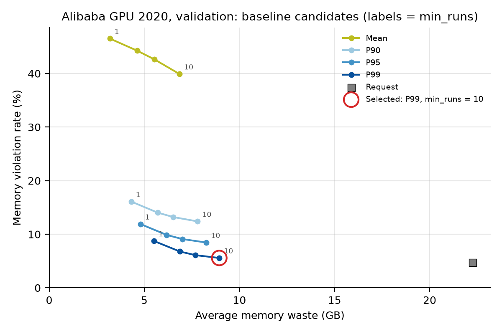
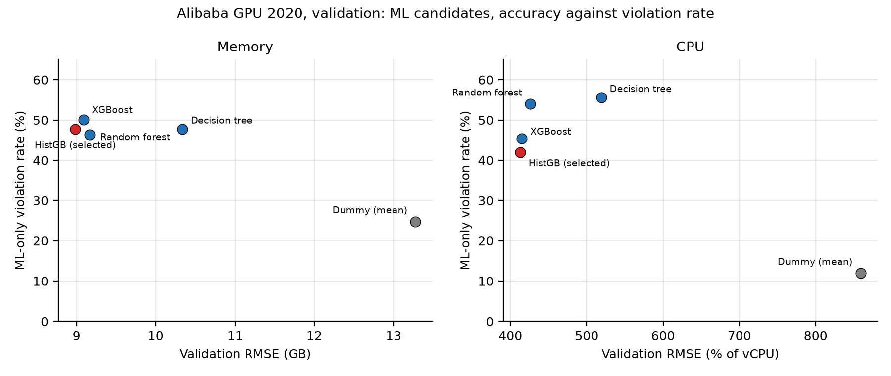
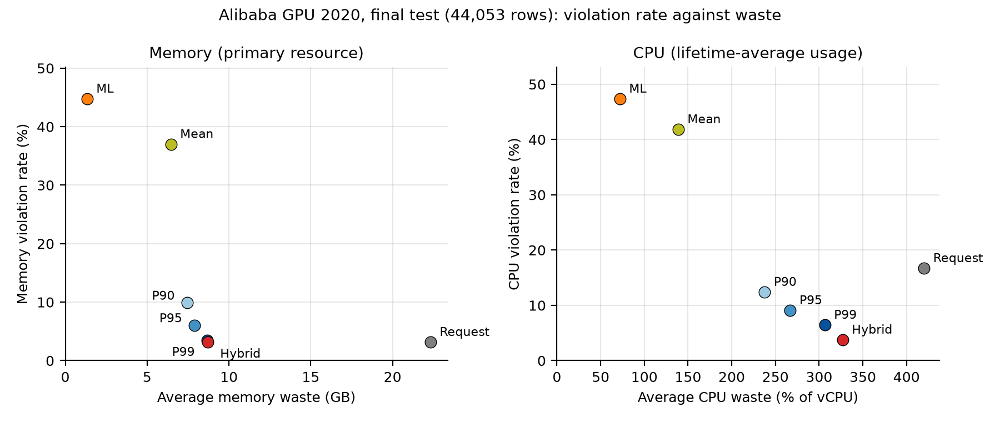
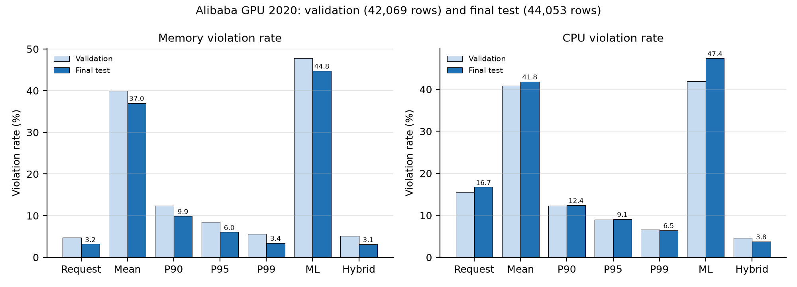

# Alibaba GPU 2020 — Results and Analysis

**Question:** What do the final Alibaba GPU 2020 results show about sizing memory and CPU from history, from an ML model, and from the Hybrid rule, and how do they compare with the Google subset?

**Short answer:** On the one-time final test (44,053 rows), **Hybrid = max(ML prediction, P99 at `min_runs = 10`)** has the lowest violation rate and the lowest shortfall on both resources: **3.15% memory** and **3.77% CPU**, against 3.44% and 6.45% for its P99 safeguard, at almost the same memory waste (8.71 GB against 8.67 GB). Requests are generous on this trace: Request ties Hybrid on memory violations (3.16%) but wastes 2.6 times as much memory (22.31 GB). ML alone is the most efficient policy (1.33 GB memory waste) but under-provisions 44.77% of memory targets. The pattern matches the Google subset: percentiles trade violations for waste, ML alone is efficient but unsafe, and Hybrid has fewer violations than its safeguard at almost the same waste.

**Status:** final. Tasks 3–7 were run from a clean checkout of `main` at `fe38ea0` on 30 Oct 2026, after PRs #98 and #102 were merged; the PR1 lock and the final test used the same commit, and the test set was read once (`ml/final_test_runs.jsonl` has one entry). Detailed data and baseline analysis is in `alibaba_gpu_2020_results_tasks1_6.md`; every number below is read from the files in this folder.

**Units:** memory in GB per instance of a task role (the real peak, `max_mem`); CPU in `percent_of_vcpu`, the **lifetime average** of each run, so CPU results describe average-usage sizing, not peak safety. Memory is the primary resource. No combined CPU-or-memory metric is reported. Waste, shortfall and utilization are averages per scored row.

---

## 0. Provenance

| Stage | Run | Output (copies in this folder) |
|---|---|---|
| Canonical (Task 3) | Shared build from `c2ae87f`; `--verify` passed: 1,254,108 roles, 7,410,783 instances, 121,824 rejected | `canonical/` |
| Targets (Task 4) | `build_alibaba_gpu_2020_targets.py`, 56 s | `targets/metadata.json`, `targets/SHA256SUMS` |
| Baselines (Task 6) | `run_alibaba_gpu_2020_baselines.py`, 110 s; identical to `alibaba_gpu_2020_results_tasks1_6.md` §5 | `baselines/` |
| ML lock (Task 7 PR1) | `run_alibaba_gpu_2020_ml.py`, 2 min 53 s; locked 17:33:08 UTC; decision manifest SHA-256 `dd6819bf…a34f925` | `ml/` |
| Final test (Task 7 PR2) | `run_alibaba_gpu_2020_final_test.py`, 7 s; 17:37:58 UTC; PR1 lock built at the same commit | `final_test/` |

Software: Python 3.12.9, numpy 2.5.4, pandas 2.3.3, pyarrow 23.0.1, scikit-learn 1.9.1, XGBoost 3.4.1, joblib 1.6.0 (`requirements-lock.txt`). Parquet tables and model files stay in `data/processed/` and are identified by the `SHA256SUMS` copies here.

## 1. Data that shapes the results

- **Selection:** 461,900 of 1,254,108 role occurrences (36.8%) are eligible; most exclusions are missing telemetry or unsuccessful jobs. Results describe completed, fully observed workloads.
- **Splits:** chronological 70/15/15 by submission time (323,329 / 69,286 / 69,285 rows). A row's target is the next eligible run of the same recurrence in the same split: 220,832 / 42,069 / 44,053 rows have one (CPU 220,299 / 41,913 / 44,045).
- **Requests are generous:** in train, the median memory request is about 7× the run's actual peak, and only 8% of runs exceed their memory request (`alibaba_gpu_2020_results_tasks1_6.md` §4).
- **History depth is skewed:** median 31 earlier runs per validation row; 25% have 9 or fewer.

## 2. Baseline candidates on validation

Twenty candidates on 42,069 validation rows, ranked memory first (memory violation, memory waste, CPU violation, CPU waste). Request is reported but not selectable. Source: `baselines/validation_comparison.csv`.

*Figure A1. Validation memory violation rate against memory waste for every baseline candidate. Labels give `min_runs` at the ends of each line; the circle marks the selected candidate.*

| Policy | `min_runs` = 1 | 3 | 5 | 10 |
|---|---|---|---|---|
| Mean | 46.52 | 44.26 | 42.65 | 39.90 |
| P90 | 16.10 | 14.05 | 13.21 | 12.40 |
| P95 | 11.90 | 9.88 | 9.11 | 8.46 |
| **P99** | 8.74 | 6.77 | 6.10 | **5.58** |
| Request | 4.74 | 4.74 | 4.74 | 4.74 |

*Memory violation rate (%), validation.*

- **Higher percentiles mean fewer violations and more waste**, as on Google.
- **Larger `min_runs` makes every history policy safer**, the opposite of Google. Rows with fewer than `min_runs` earlier runs fall back to the request (7.6% of rows at `min_runs = 1`, 25.7% at 10), and here requests are generous, so the fallback adds safety at the cost of waste. The selected baseline is therefore **P99 at `min_runs = 10`**: 5.58% memory violations at 8.94 GB waste, against Request's 4.74% at 22.26 GB.

## 3. ML model selection

Five candidates, each with one fixed setting, fitted on train (CPU 220,299 rows; memory 220,832) and scored on validation (41,913; 42,069). Selection order: RMSE, MAE, violation %, average shortfall, model name. The mean `DummyRegressor` is scored as a reference floor and never selected. 25 input features (43 columns after one-hot encoding). Source: `ml/candidate_models.csv`, `ml/model_selection.json`.

*Figure A2. Validation RMSE against ML-only violation rate for every candidate. Accuracy and violation rate pull in opposite directions; the constant predictor has the fewest violations and no skill.*

| Resource | Model | RMSE | MAE | R² | Violation % | Avg. shortfall | Clipped |
|---|---|---|---|---|---|---|---|
| CPU | Dummy (mean) | 858.95 | 566.23 | −0.049 | 11.97 | 190.73 | 0 |
| CPU | Decision tree | 519.17 | 167.49 | 0.617 | 55.59 | 79.09 | 0 |
| CPU | Random forest | 425.97 | 134.67 | 0.742 | 53.98 | 54.39 | 0 |
| CPU | **HistGradientBoosting** | **412.94** | 135.72 | 0.758 | 41.91 | 49.23 | 151 |
| CPU | XGBoost | 415.04 | 134.48 | 0.755 | 45.35 | 49.82 | 1 |
| Memory | Dummy (mean) | 13.28 | 9.23 | −0.030 | 24.79 | 3.49 | 0 |
| Memory | Decision tree | 10.34 | 3.62 | 0.376 | 47.75 | 1.42 | 0 |
| Memory | Random forest | 9.16 | 3.21 | 0.510 | 46.38 | 1.24 | 0 |
| Memory | **HistGradientBoosting** | **8.98** | 3.14 | 0.529 | 47.76 | 1.24 | 376 |
| Memory | XGBoost | 9.09 | 3.22 | 0.518 | 50.01 | 1.23 | 353 |

- **HistGradientBoosting is selected for both resources** (`max_iter = 100`, `learning_rate = 0.1`, `max_leaf_nodes = 31`, seed 42). XGBoost and the random forest are within 1–2% RMSE.
- **The models have real skill:** R² of 0.76 for CPU and 0.53 for memory, far above the Google models (raw R² about 0 for CPU and 0.11 for memory), although the targets and units differ.
- **Why accuracy first:** the dummy has the lowest violation rate of all candidates on both resources (11.97% CPU, 24.79% memory) because the mean of a heavy-tailed target sits above most values. A violation-first order would select a model with no skill; the Hybrid rule handles under-provisioning instead.
- **The unlimited-depth decision tree is the weakest learner**, as expected with one fixed setting and no depth limit.

## 4. Validation comparison (42,069 rows)

Models trained on train only; Hybrid's safeguard is the selected Task 6 baseline, which always has a value because it falls back to the request, so Hybrid fell back to ML on 0 rows. Source: `ml/validation_policy_comparison.csv`, `ml/metadata.json`.

| Policy | CPU viol. % | Memory viol. % | CPU waste | Memory waste (GB) | CPU util. | Memory util. |
|---|---|---|---|---|---|---|
| Request | 15.52 | 4.74 | 430.06 | 22.26 | 0.37 | 0.26 |
| Mean | 40.84 | 39.90 | 142.56 | 6.85 | 0.78 | 0.74 |
| P90 | 12.25 | 12.40 | 235.44 | 7.80 | 0.70 | 0.68 |
| P95 | 9.00 | 8.46 | 263.08 | 8.26 | 0.68 | 0.66 |
| P99 | 6.62 | 5.58 | 294.96 | 8.94 | 0.64 | 0.63 |
| ML | 41.91 | 47.76 | 86.50 | 1.90 | 0.82 | 0.85 |
| Hybrid | 4.60 | 5.15 | 305.62 | 9.14 | 0.63 | 0.62 |

The same split selected the ML models, so the ML and Hybrid rows are optimistic; the final test is the unbiased result.

## 5. Final test (44,053 rows, run once)

Locked models refitted on train + validation; no training, selection or manifest change. CPU valid rows 44,045; memory 44,053. Negative predictions clipped: CPU 44, memory 18. Hybrid fell back to ML on 0 rows. Source: `final_test/final_test_policy_comparison.csv`, `final_test/run_record.json`.

*Figure A3. Final-test violation rate against average waste, per policy. Memory (left) is the primary resource; CPU (right) is average-usage sizing.*

| Policy | CPU viol. % | Memory viol. % | CPU waste | Memory waste (GB) | CPU util. | Memory util. | CPU shortfall | Memory shortfall (GB) |
|---|---|---|---|---|---|---|---|---|
| Request | 16.71 | 3.16 | 419.97 | 22.31 | 0.38 | 0.25 | 191.46 | 0.66 |
| Mean | 41.83 | 37.02 | 138.75 | 6.45 | 0.79 | 0.75 | 81.05 | 0.61 |
| P90 | 12.41 | 9.89 | 237.57 | 7.44 | 0.70 | 0.68 | 48.06 | 0.30 |
| P95 | 9.10 | 6.04 | 266.95 | 7.89 | 0.68 | 0.66 | 45.27 | 0.26 |
| P99 | 6.45 | 3.44 | 306.44 | 8.67 | 0.65 | 0.62 | 43.53 | 0.23 |
| ML | 47.37 | 44.77 | **72.01** | **1.33** | 0.86 | 0.84 | 78.38 | 1.05 |
| **Hybrid** | **3.77** | **3.15** | 326.82 | 8.71 | 0.63 | 0.62 | **20.54** | **0.20** |

- **Hybrid is the safest policy on both resources**: the lowest violation rate and the lowest average shortfall. Against its P99 safeguard it removes 8% of memory violations (3.44% → 3.15%) and 42% of CPU violations (6.45% → 3.77%) for 0.04 GB more memory waste and 6.7% more CPU waste.
- **Hybrid against Request:** the same memory violation rate (3.15% against 3.16%) with 61% less memory waste (8.71 against 22.31 GB), and less than a quarter of Request's CPU violations.
- **ML alone** is the most efficient policy but under-provisions almost every second run (44.77% memory, 47.37% CPU).
- **Mean** is a poor sizing rule on heavy-tailed usage: about 40% violations on both resources.

## 6. Validation against test

*Figure A4. Memory and CPU violation rates on validation (42,069 rows) and final test (44,053 rows).*

Memory violation rates are lower on test than on validation for every policy (for example P99 5.58% → 3.44%, Hybrid 5.15% → 3.15%), so the test period is easier for memory. CPU rates change by about one point or less (Request +1.19, Hybrid −0.83), except for ML, whose CPU violation rate rises from 41.91% to 47.37%. Hybrid has the lowest CPU violation rate in both periods. On memory, Request is lowest on validation (4.74% against Hybrid's 5.15%) and the two tie on test (3.16% against 3.15%); Hybrid reaches this at about 40% of Request's memory waste in both periods. The ordering of the other policies is the same in both periods.

## 7. Final-test sensitivity

Source: `final_test/final_test_sensitivity.csv`.

| Cut | Rows | P99 CPU / memory viol. % | Hybrid CPU / memory viol. % | Request CPU / memory viol. % |
|---|---|---|---|---|
| All rows (occurrence-weighted) | 44,053 | 6.45 / 3.44 | 3.77 / 3.15 | 16.71 / 3.16 |
| Same-second successors excluded | 43,802 | 6.48 / 3.46 | 3.78 / 3.16 | 16.81 / 3.17 |
| Same-second successors only | 251 | 1.20 / 1.20 | 1.20 / 1.20 | 0.00 / 1.99 |
| Multi-instance roles (`inst_num > 1`) | 595 | 12.10 / 8.07 | 5.55 / 5.71 | 14.79 / 13.45 |
| Group-weighted (each recurrence equal) | 44,053 | 11.38 / 4.17 | 4.08 / 3.71 | 21.22 / 4.11 |

- Same-second successors (which could share a submission instant with their predecessor) change no conclusion.
- **Hybrid's gain over P99 is largest on multi-instance roles** (memory 8.07% → 5.71%; CPU 12.10% → 5.55%) **and when every recurrence counts equally** (CPU 11.38% → 4.08%; memory 4.17% → 3.71%), so it is not driven by a few very large recurrences.
- Hybrid has the lowest or equal-lowest violation rate in every cut except same-second CPU, where Request has none on 251 rows.

## 8. Interpretation and comparison with Google

| Finding | Alibaba GPU 2020 | Google subset |
|---|---|---|
| Requests | Generous: Request has few memory violations (3.16%) but 2.6× Hybrid's memory waste | Too low: Request violates 54.47% (any resource) |
| Effect of larger `min_runs` | Safer (fallback to a generous request); P99 at 10 selected | Less safe (fallback to a low request); P99 at 1 selected |
| ML alone | Most efficient; 44.77% memory violations | Most efficient; 32.82% any-resource violations |
| Hybrid against its safeguard | Fewer violations than P99 on both resources at almost the same memory waste | Fewer violations than P95 on every metric at almost the same waste |
| Best policy on violations | Hybrid (both resources) | Hybrid (any resource and memory); P99 for CPU |

The numbers are not compared across datasets (different units, CPU semantics and populations), but the qualitative result is the same on two structurally different traces: the max rule lets an efficient but unsafe model add capacity only where it expects a higher next run, which lowers violations below the safeguard's at close to the safeguard's waste. What changes between the traces is the role of the request, which decides whether the history fallback adds or removes safety, and therefore which `min_runs` is selected.

## 9. Limitations

- CPU is the lifetime average per run: CPU results describe average-usage sizing, not peak safety.
- One fixed setting per model and no hyperparameter search; ML and Hybrid validation results are optimistic because the same split selected the models.
- Only eligible roles are evaluated (36.8%), and most evaluated roles are single-instance (595 multi-instance rows on test).
- GPU fields are used as features only; GPU sizing is not evaluated.

## Files

| File | Content |
|---|---|
| `alibaba_gpu_2020_results_tasks1_6.md` | Detailed data, split, target and baseline analysis (Tasks 1–6) |
| `canonical/`, `targets/` | Canonical and target build records and checksums |
| `baselines/` | Baseline selection, 20-candidate validation comparison, sensitivity, checksums |
| `ml/` | Decision manifest, model selection, candidate table, validation comparison, feature order, metadata, run log, checksums |
| `final_test/` | Final-test comparison, sensitivity, run record, metadata, checksums |
| `figures/fig_alibaba_*.png` | Figures A1–A4, generated by `../make_results_figures.py` from the CSVs |
