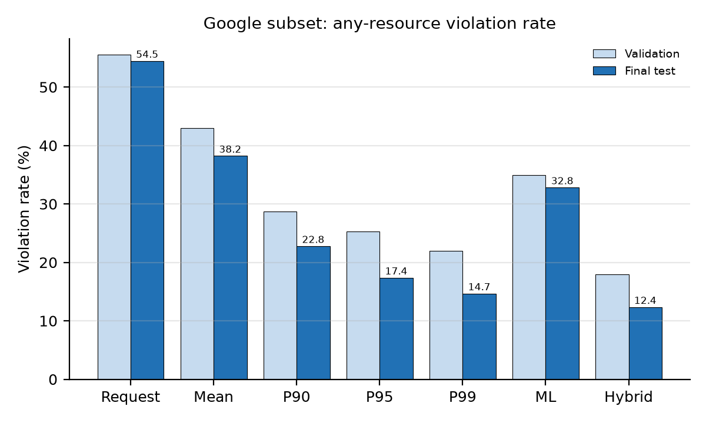

# Google ClusterData 2019 Subset — Results and Analysis

**Question:** What do the final Google subset results show about sizing CPU and memory from history, from an ML model, and from the Hybrid rule, and why?

**Short answer:** On the one-time final test (259 occurrences), **Hybrid = max(ML prediction, P95)** has the lowest any-resource violation rate, **12.36%**, against 14.67% for the validation-selected P99, 17.37% for P95 and 54.47% for Request, while keeping P95's waste (CPU 7.64 against 7.62; memory 1.55 against 1.54). Requests are too low on this trace: Request is exceeded on more than half of the occurrences. ML alone is the most efficient policy but is exceeded on 32.82% of occurrences. History percentiles trade violations for waste, and the Hybrid rule moves that trade-off: fewer violations than its safeguard at almost the same waste.

**Status:** final. Run details, frozen decisions and how to reproduce are in `googlepipeline_finalrun.md`; this report analyses the same committed tables and adds figures. Every number below is read from `tables/*.csv` or `n05_ml_metadata.json`.

**Units:** Google's normalized CPU and memory units (not cores or GB). A violation means the recommendation is below the next occurrence's peak usage. Waste, shortfall and utilization are averages per occurrence. The evaluation population is occurrences with both a CPU and a memory next-occurrence target.

---

## 1. Baseline candidates on validation

Twenty candidates (Request, Mean, P90, P95, P99 × `min_runs` ∈ {1, 3, 5, 10}) on 329 validation occurrences; selection by lowest any-resource violation rate. Source: `tables/baseline_validation_comparison.csv`.

*Figure G1. Validation any-resource violation rate against CPU waste for every baseline candidate. Labels give `min_runs` at the ends of each line; the circle marks the selected candidate.*

| Policy | `min_runs` = 1 | 3 | 5 | 10 |
|---|---|---|---|---|
| Mean | 42.99 | 42.94 | 41.72 | 45.09 |
| P90 | 28.66 | 28.83 | 28.83 | 35.28 |
| P95 | 25.30 | 25.46 | 26.07 | 33.44 |
| **P99** | **21.95** | 22.39 | 23.31 | 30.98 |
| Request | 55.52 | 55.52 | 55.52 | 55.52 |

*Any-resource violation rate (%), validation.*

- **Higher percentiles mean fewer violations and more waste.** From P90 to P99 at `min_runs = 1`, the any-resource violation rate falls from 28.66% to 21.95% while CPU waste rises almost fourfold (4.86 to 19.04).
- **Larger `min_runs` makes every history policy worse.** A row with fewer than `min_runs` earlier runs falls back to its request, and on this trace requests are too low (Request violates 55.52%). Raising `min_runs` from 1 to 10 sends more rows to the request and raises P99's violation rate from 21.95% to 30.98%. The selected baseline is therefore **P99 at `min_runs = 1`**: any history is better than the request.
- **Request is invariant to `min_runs`**, as expected; it is the status-quo reference.

## 2. ML model selection

Decision tree, random forest and XGBoost were tuned per resource with time-ordered, purged cross-validation on the training set (150 configurations in total; `tables/ml_tuning_results.csv`) and selected by lowest validation RMSE on the `log1p` scale. A median predictor is the reference. Source: `tables/ml_validation_model_comparison.csv`, `tables/ml_cv_summary.csv`.

| Resource | Model (tuned) | log1p RMSE | RMSE | MAE | R² |
|---|---|---|---|---|---|
| CPU | **Random forest** | **0.850** | 9.559 | 2.824 | −0.005 |
| CPU | XGBoost | 0.860 | 9.600 | 2.851 | −0.014 |
| CPU | Decision tree | 0.891 | 9.686 | 2.852 | −0.032 |
| CPU | Median reference | 1.048 | 9.914 | 2.756 | −0.081 |
| Memory | **Random forest** | **0.387** | 1.255 | 0.454 | 0.107 |
| Memory | XGBoost | 0.439 | 1.306 | 0.528 | 0.034 |
| Memory | Decision tree | 0.421 | 1.313 | 0.488 | 0.024 |
| Memory | Median reference | 0.472 | 1.393 | 0.425 | −0.099 |

- The selected random forests beat the median reference on log-scale RMSE and raw RMSE but not on MAE: they reduce large errors more than typical errors.
- Point accuracy is low (raw R² about 0 for CPU and 0.11 for memory). Next-occurrence peak usage on this trace is hard to predict from the available features, which is why a point prediction alone is not a safe recommendation (§3).
- Cross-validation grouped by workload gives similar or lower error than time-ordered folds (CPU random forest 0.781 against 0.839), with larger spread; it is reported as a check only.

## 3. Final test (259 occurrences, run once)

Source: `tables/final_test_policy_comparison.csv`.

*Figure G2. Final-test violation rate against average waste, per policy, for CPU and memory.*

| Policy | CPU viol. % | Memory viol. % | Any-resource viol. % | CPU waste | Memory waste | CPU util. | Memory util. |
|---|---|---|---|---|---|---|---|
| Request | 50.58 | 34.24 | 54.47 | 0.498 | 0.176 | 0.617 | 0.548 |
| Mean | 28.57 | 33.59 | 38.22 | 1.226 | 0.235 | 0.436 | 0.491 |
| P90 | 18.15 | 16.60 | 22.78 | 3.847 | 0.744 | 0.330 | 0.383 |
| P95 | 13.13 | 13.13 | 17.37 | 7.616 | 1.541 | 0.278 | 0.342 |
| P99 | **9.27** | 11.97 | 14.67 | 17.483 | 2.994 | 0.233 | 0.297 |
| ML | 30.12 | 18.92 | 32.82 | **0.424** | **0.130** | 0.431 | 0.312 |
| **Hybrid** | 10.81 | **7.72** | **12.36** | 7.637 | 1.546 | 0.242 | 0.190 |

- **Hybrid is the safest policy overall:** the lowest any-resource (12.36%) and memory (7.72%) violation rates. Against its own safeguard, P95, it has fewer violations on CPU (10.81% against 13.13%), memory (7.72% against 13.13%) and any resource (12.36% against 17.37%) at almost the same waste, because the ML prediction raises the P95 floor only where the model expects a higher next peak.
- **Hybrid against P99**, the validation-selected baseline: fewer memory and any-resource violations and less than half the waste (CPU 7.64 against 17.48; memory 1.55 against 2.99). P99 keeps the lowest CPU violation rate (9.27% against 10.81%).
- **ML alone** is the most efficient policy but is exceeded on about one occurrence in three (32.82%): a point estimate of the next peak is often below it.
- **Request** is exceeded on 54.47% of occurrences: Google requests are set below the peaks the workloads actually reach.
- **Utilization is low for the safe policies** (Hybrid 0.24 CPU, 0.19 memory): avoiding violations on a heavy-tailed peak requires recommendations well above the typical run.

## 4. Validation against test

*Figure G3. Any-resource violation rate on validation (329 occurrences) and final test (259 occurrences).*

The ordering of the policies by any-resource violation rate is the same on validation and test (Hybrid, P99, P95, P90, ML, Mean, Request), and every policy's rate is lower on test than on validation (for example P99 21.95% → 14.67%, Hybrid 17.93% → 12.36%). The selection made on validation therefore carries over to test, although the absolute level differs between the two periods.

## 5. Target-period sensitivity (validation)

Google targets are built before the split, so 104 of the 329 validation occurrences have their next occurrence in the test period. Rescoring the 225 occurrences whose targets stay in the validation period (`tables/validation_policy_comparison_target_period_sensitivity.csv`):

| Policy | Any-resource viol. %, all 329 | 225 in-period |
|---|---|---|
| P95 | 25.30 | 23.21 |
| P99 | 21.95 | 18.30 |
| ML | 34.95 | 36.89 |
| Hybrid | 17.93 | 17.78 |
| Hybrid_P99 (supplementary) | 15.50 | 14.22 |

The selected baseline and the ordering of the core policies do not change, so the cross-boundary targets do not alter any decision; validation rates are somewhat optimistic for the history policies.

## 6. Interpretation

1. **Requests are a poor sizing signal on this trace** because they are too low; any history, even a single earlier run, is better.
2. **Percentile level is the main control** of the violation–waste trade-off for history policies.
3. **An accurate model is not a safe recommendation**: ML has the lowest waste but a high violation rate.
4. **The Hybrid rule combines the two**: wherever P95 has a value, Hybrid recommends at least P95, so it cannot have more violations than P95 on those rows, and the ML prediction adds capacity only where the model expects a higher peak. On test this removed more than a quarter of P95's any-resource violations (17.37% → 12.36%) for a 0.3% increase in CPU waste.

## 7. Limitations

- Small populations: 329 validation and 259 test occurrences; one occurrence moves a rate by about 0.3–0.4 percentage points.
- Kaggle 31-day sample, not the full ClusterData 2019 trace.
- Normalized units: waste is not in cores or GB, and Google numbers are not compared numerically with Alibaba GPU 2020.
- Targets cross the validation/test boundary (§5).

## Files

| File | Content |
|---|---|
| `googlepipeline_finalrun.md` | Run details, frozen decisions, reproduction |
| `tables/*.csv` | All tables above |
| `decision_manifest.json`, `final_test_run_metadata.json`, `n04_metadata.json`, `n05_ml_metadata.json`, `ml_feature_manifest.json` | Decisions and provenance |
| `figures/fig_google_*.png` | Figures G1–G3, generated by `../make_results_figures.py` from the tables |
